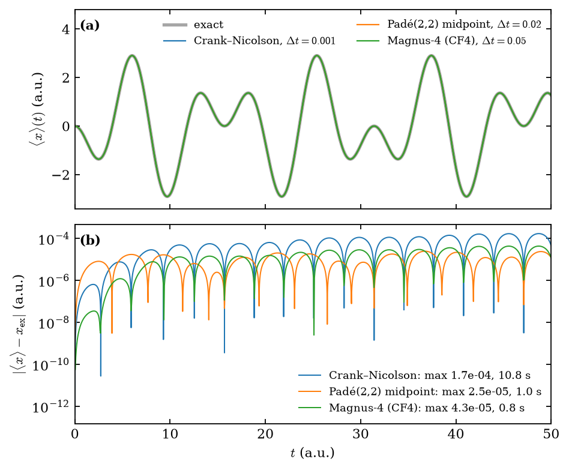

# Performance optimisations in TDSE-Z

This page documents the optimisations of the propagation and output path, the
speed-ups measured for each, and why none of them changes the computed results
beyond rounding or the linear-solver tolerance.

All timings were measured on a workstation with 2–4 MPI ranks, using the
end-of-run **TIMING SUMMARY** printed by `tdsez.x` (wall time, maximum over
ranks). Speed-ups on a cluster are expected to be similar but have not been
re-measured at scale.

## Notation

The semi-discrete Schrödinger equation is

```math
i\,\mathbf M\,\dot{\mathbf c}(t) = \mathbf H(t)\,\mathbf c(t),
\qquad
\mathbf H(t) = \mathbf H_0 + \mathbf E(t)\cdot\mathbf D ,
```

with overlap matrix $`\mathbf M`$, field-free Hamiltonian $`\mathbf H_0`$
(kinetic $`\mathbf K`$ plus potential $`\mathbf V`$, plus the CAP when enabled) and
dipole matrices $`\mathbf D = (\mathbf D_x,\mathbf D_y,\mathbf D_z)`$.

## Summary

| Optimisation | Test case | Before | After | Gain |
|---|---|---|---|---|
| Preconditioner reuse, right preconditioning, assembly savings | 3D propagation | — | — | propagation $`2.5\times`$, run $`1.7`$–$`2.3\times`$ |
| Magnus-4 instead of Crank–Nicolson (better accuracy) | 1D driven HO | 10.8 s | 0.83 s | $`13\times`$ ($`\approx 70\times`$ at error $`10^{-6}`$) |
| Padé/Magnus stage solver | 3D HO, 200 Magnus steps | 249 s | 219 s | $`-12\%`$ |
| Monitor products + batched HDF5 writes | 1D HO, $`5\times10^4`$ steps | 15.8 s | 12.3 s | $`-22\%`$ |
| | 1D with CAP, $`2.2\times10^4`$ steps | 5.6 s | 4.1 s | $`-27\%`$ |
| | 3D variable mass, 100 steps | 3.42 s | 3.24 s | $`-5\%`$ |
| Sum-factorised assembly (BLAS contractions) | 3D, $`p=7`$, $`10^3`$ elements: $`\mathbf H,\mathbf M`$ | 114 s | 8.0 s | $`14\times`$ |
| | same, time-dependent operators | 464 s | 32 s | $`14\times`$ |
| | 3D $`z`$-polarisation, $`p=5`$: whole run | 62.6 s | 7.1 s | $`8.9\times`$ |
| Banded insertion | 3D, $`p=7`$, $`10^3`$ elements, 4 ranks: $`\mathbf H,\mathbf M`$ | 12.1 s | 2.1 s | $`5.9\times`$ |
| | same, time-dependent operators | 54.2 s | 6.5 s | $`8.4\times`$ |
| | 3D, $`p=7`$, $`20^3`$ elements, 4 ranks: $`\mathbf H,\mathbf M`$ | 258 s | 11.5 s | $`22\times`$ |

## 1. Crank–Nicolson solver set-up

Crank–Nicolson solves at every step

```math
\Bigl(\mathbf M + \tfrac{i\Delta t}{2}\,\mathbf H^{n+1/2}\Bigr)\mathbf c^{n+1}
= \Bigl(\mathbf M - \tfrac{i\Delta t}{2}\,\mathbf H^{n+1/2}\Bigr)\mathbf c^{n},
\qquad
\mathbf H^{n+1/2} = \mathbf H\!\left(t_n + \tfrac{\Delta t}{2}\right),
```

with GMRES and a restricted additive-Schwarz preconditioner with ILU(0) subdomain
solves.

* **Preconditioner reuse.** The system matrix changes between steps only
  through the scalar field $`\mathbf E(t)`$, so the ILU factorisation of the first
  step remains an effective preconditioner. The SNES layer used to reset the
  KSP reuse flag at every step and refactor; it now builds the preconditioner
  once (`SNESSetLagPreconditioner(snes, -2)` with persistence).
* **Right preconditioning.** GMRES monitors the true residual, so the relative
  tolerance $`10^{-12}`$ bounds the actual Crank–Nicolson solve error,
  independently of the preconditioner quality.
* **Assembly.** Real-valued upper-triangle assembly of the symmetric operators,
  and no finite-difference mass derivatives when the discrete Ehrenfest
  acceleration is used.

Measured on 3D test problems: propagation $`2.5\times`$ faster, complete runs
$`1.7`$–$`2.3\times`$ faster.

* **ILU(0) subdomains.** Subdomains above 4000 rows used ILU(1). In 3D, degree
  4 ($`110\,592`$ DOFs, 8 ranks), ILU(0) needs the same 7 GMRES iterations, its
  set-up takes 4.6 s instead of 45.7 s, the step 4.5 s instead of 11.4 s, and the
  dipole time series agree to $`8\times10^{-15}`$. In 2D ILU(1) saved at most one
  iteration and was 10–20% slower per step. ILU(0) is the default;
  `-tdsez_ilu_levels n` restores another level.
* **Constant mass detected.** A `Mass` expression without `x`, `y`, `z` now sets
  `MassIsConstant` automatically. Without it, the multi-axis force kernels
  computed finite-difference derivatives of $`1/m`$ (about 260 expression
  evaluations per quadrature point and axis): the 3D degree-4 benchmark spent
  more than 10 minutes per rank in the time-dependent operator assembly, 19 s
  with the detection. The derivatives of a constant are exactly zero, so the
  operators are unchanged.

## 2. Fourth-order propagators (`Propagator = pade22 | magnus4`)

Both use the $`(2,2)`$ Padé approximant of the step exponential,

```math
R_{22}(z) = \frac{1 + z/2 + z^2/12}{1 - z/2 + z^2/12},
\qquad z = -i\,h\,\mathbf M^{-1}\mathbf H_{\mathrm E},
```

which is fourth order and unitary for Hermitian $`\mathbf H_{\mathrm E}`$. Its
numerator has the roots $`z_\pm = -3 \pm i\sqrt3`$, so $`R_{22}`$ factorises into
two Cayley-type stages

```math
\bigl(\mathbf M + g_k\,\mathbf H_{\mathrm E}\bigr)\,\mathbf y
= \bigl(\mathbf M + \overline{g_k}\,\mathbf H_{\mathrm E}\bigr)\,\mathbf x,
\qquad
g_{1,2} = \frac{h\,(\mp\sqrt3 + 3i)}{12}.
```

`magnus4` is the commutator-free fourth-order Magnus scheme (CF4, Blanes and
Moan 2006),

```math
U = \exp\!\bigl[h(a_1A_1 + a_2A_2)\bigr]\,\exp\!\bigl[h(a_2A_1 + a_1A_2)\bigr],
\qquad
A_j = -i\,\mathbf M^{-1}\mathbf H(t_n + c_j h),
```

with Gauss nodes $`c_{1,2} = \tfrac12 \mp \tfrac{\sqrt3}{6}`$ and
$`a_{1,2} = (3 \mp 2\sqrt3)/12`$. Because $`\mathbf H(t)`$ is linear in the field
and $`a_1 + a_2 = \tfrac12`$, each factor is an ordinary half step $`h/2`$ with the
effective field $`2(a_1\mathbf E_1 + a_2\mathbf E_2)`$ (respectively
$`2(a_2\mathbf E_1 + a_1\mathbf E_2)`$); no commutator is ever formed.

Accuracy versus cost for a strongly driven 1D harmonic oscillator,
$`E(t) = \cos(0.6\,t)`$, $`T = 50`$ ($`p = 7`$, 1200 elements on $`[-60, 60]`$, 2 ranks),
against the exact solution $`\langle x\rangle(t) = -\dfrac{E_0}{1-\omega^2}\bigl(\cos\omega t - \cos t\bigr)`$
with $`E_0 = 1`$, $`\omega = 0.6`$:

| Propagator | $`\Delta t`$ | Solves per step | $`\max_t \lvert\langle x\rangle - x_{\mathrm{ex}}\rvert`$ | Propagation |
|---|---|---|---|---|
| Crank–Nicolson | $`10^{-3}`$ | 1 | $`1.7\times10^{-4}`$ | 10.8 s |
| `pade22` | $`0.02`$ | 2 | $`2.5\times10^{-5}`$ | 1.0 s |
| `magnus4` | $`0.05`$ | 4 | $`4.3\times10^{-5}`$ | 0.83 s |



*(a) Dipole $`\langle x\rangle(t)`$ from the `dipoles` dataset of each run's HDF5 output, on top of the exact solution. (b) Absolute error; the legend gives the maximal error and the propagation wall time.*

Observed orders of accuracy: $`2.00`$ (Crank–Nicolson), $`3.97`$–$`4.00`$ (`magnus4`);
`pade22` is fourth order in the field-free phase but second order in the field
variation. For an error of $`10^{-6}`$, extrapolating the second-order behaviour
of Crank–Nicolson gives a cost ratio of about $`70`$ relative to `magnus4`.

The figure is reproduced by `docs/perf/run.sh` (inputs `docs/perf/ho1d_*.inp`,
plot script `docs/perf/plot_propagator_dipoles.py`).

## 3. Padé/Magnus stage solver

**Cached field-free parts.** The stage matrices are

```math
\mathbf A_k = \mathbf M + g_k\,\mathbf H_{\mathrm E}
= \underbrace{\mathbf M + g_k\,\mathbf H_0}_{\mathbf B_k}
+ g_k\,\mathbf E\cdot\mathbf D .
```

$`\mathbf B_k`$ depends only on the step length $`h`$ (and $`\mathbf H_0`$ is fixed
during propagation, including the CAP), so it is computed once per step length.
Each stage update is then one copy and one field term.

**Paired right-hand sides.** Since $`\overline{g_1} = -g_2`$,

```math
\bigl(\mathbf M + \overline{g_1}\,\mathbf H_{\mathrm E}\bigr)\mathbf x
= 2\,\mathbf M\mathbf x - \mathbf A_2\,\mathbf x,
\qquad
\bigl(\mathbf M + \overline{g_2}\,\mathbf H_{\mathrm E}\bigr)\mathbf x
= 2\,\mathbf M\mathbf x - \mathbf A_1\,\mathbf x ,
```

so both stage matrices are built once per $`R_{22}`$ application and each
right-hand side needs two sparse products ($`\mathbf M`$ and $`\mathbf A_{\text{other}}`$)
instead of three ($`\mathbf H_0`$, $`\mathbf D`$, $`\mathbf M`$).

**Extrapolated initial guess.** Each stage solve starts from the stage input
plus the increment the same stage produced on the previous step,

```math
\mathbf y_0^{(n)} = \mathbf x^{(n)} + \bigl(\mathbf y^{(n-1)} - \mathbf x^{(n-1)}\bigr),
```

which removes the leading part of the increment from the initial residual. It
can be disabled with `-pade_extrapolate_guess 0`.

3D harmonic oscillator, $`19\,683`$ DoFs, `magnus4`, $`\Delta t = 0.05`$, 200 steps,
4 ranks:

| | Before | Cached + paired | + extrapolated guess |
|---|---|---|---|
| Propagation | 249 s | 252 s | **219 s** |
| GMRES iterations per solve | 5.98 | 5.98 | **5.07** |
| PC applications per solve | 7.0 | 7.0 | **6.1** |
| Operator updates | 800 (10.2 s) | 400 (6.3 s) | 400 (5.4 s) |

## 4. Monitors and output

The observables ($`\langle H\rangle`$, energies, $`\langle x\rangle`$, acceleration,
populations, currents) are still computed and written at **every** step.

**Verified product identities.** Without a CAP, $`\mathbf H_0 = \mathbf K + \mathbf V`$,
and for a constant mass the inverse-mass matrix is
$`\mathbf M_{m^{-1}} = m^{-1}\mathbf M`$. On the first monitor call both
identities are checked on the current state,

```math
\frac{\lVert \mathbf H_0\boldsymbol\psi - \mathbf K\boldsymbol\psi - \mathbf V\boldsymbol\psi\rVert}
     {\lVert \mathbf H_0\boldsymbol\psi\rVert} \le 10^{-12},
\qquad
\frac{\lVert \mathbf M_{m^{-1}}\boldsymbol\psi - c\,\mathbf M\boldsymbol\psi\rVert}
     {\lVert \mathbf M_{m^{-1}}\boldsymbol\psi\rVert} \le 10^{-12},
\quad
c = \frac{\boldsymbol\psi^\dagger \mathbf M_{m^{-1}}\boldsymbol\psi}{\boldsymbol\psi^\dagger \mathbf M\boldsymbol\psi},
```

and only the identities that hold are used afterwards, replacing up to two
sparse products per step by vector operations. With a CAP or a variable mass
the full products are kept automatically.

**Batched HDF5 writes.** Every step is recorded in the ring buffer. The buffer
is written at multiples of `OutputStrideTS`, but at most once every 2 s of wall
time, and always every `FLUSH_INTERVAL` $`= 5000`$ steps and at the end of the
run. With `OutputStrideTS = 1` this replaces one HDF5 write per step by a few
per run; the file contents and dataset shapes are identical.

| Case | Monitor | HDF5 writes | Propagation |
|---|---|---|---|
| 1D HO, $`5\times10^4`$ steps | 6.04 → 2.31 s | 50 001 → 10 (3.28 → 0.01 s) | 15.8 → 12.3 s |
| 1D with CAP, $`2.2\times10^4`$ steps | 2.23 → 0.76 s | 22 051 → 4 (1.37 → 0.003 s) | 5.58 → 4.05 s |
| 3D variable mass, 100 steps | 1.00 → 0.86 s | 101 → 2 | 3.42 → 3.24 s |

## 5. Sum-factorised assembly

The element matrices are integrals of the form

```math
E_{ab} = \sum_{q} c(\mathbf r_q)\, D^{\alpha} N_a(\mathbf r_q)\, D^{\beta} N_b(\mathbf r_q),
```

where $`c`$ contains the quadrature weight and the coefficient
($`\tfrac{1}{2m}`$, $`V`$, $`m^{-1}`$, $`x_d`$, $`\partial_d V/m`$, ...) and
$`D^\alpha, D^\beta`$ are values or first derivatives. The B-spline basis and the
Gauss rule are tensor products,

```math
N_a(\mathbf r) = N_{a_1}(x)\,N_{a_2}(y)\,N_{a_3}(z),
\qquad
\mathbf r_q = (x_{q_1}, y_{q_2}, z_{q_3}),
```

so the sum over the $`Q^3`$ points can be contracted one axis at a time:

```math
\begin{aligned}
T_1[a_1 b_1](q_2,q_3) &= \sum_{q_1} N^{\alpha_1}_{a_1}(x_{q_1})\,N^{\beta_1}_{b_1}(x_{q_1})\;c(q_1,q_2,q_3),\\
T_2[a_1 b_1 a_2 b_2](q_3) &= \sum_{q_2} N^{\alpha_2}_{a_2}(y_{q_2})\,N^{\beta_2}_{b_2}(y_{q_2})\;T_1[a_1 b_1](q_2,q_3),\\
E_{ab} &= \sum_{q_3} N^{\alpha_3}_{a_3}(z_{q_3})\,N^{\beta_3}_{b_3}(z_{q_3})\;T_2[a_1 b_1 a_2 b_2](q_3).
\end{aligned}
```

With $`n = p+1`$ functions and $`Q`$ points per axis, the work per element and
term drops from $`Q^3 n^6`$ to $`n^6 Q + n^4 Q^2 + n^2 Q^3`$ in 3D (from
$`Q^2 n^4`$ to $`n^4 Q + n^2 Q^2`$ in 2D). The same quadrature points and the same
pointwise coefficients are used, so the element matrices are identical up to
rounding; symmetric matrices are symmetrised exactly and the velocity matrix is
built as $`i(\mathbf E - \mathbf E^{\mathsf T})`$, exactly antisymmetric.

Applies to $`\mathbf H, \mathbf M`$ and to the time-dependent operators
$`\mathbf K, \mathbf V, \mathbf M_{m^{-1}}, \mathbf D_d, \mathbf{Vel}_d, \partial_d V`$
for every polarisation, in 2D and 3D. The cases with mass-gradient corrections
in the force operator (variable mass with the operator-form acceleration, and
2D variable mass) keep the per-point kernels. The $`y`$/$`z`$/multi-axis
polarisations are now assembled in one batched pass instead of six separate
per-operator passes. Options: `-tdsez_sumfact 0` disables it;
`-tdsez_sumfact_check` computes every element both ways and prints the largest
relative difference ($`\le 5\times10^{-15}`$ in all tests).

**Matrix products (BLAS).** Each axis contraction is a dense matrix product
and is evaluated with the BLAS that PETSc was configured with (through PETSc's
`BLASREALgemm_` macro, so OpenBLAS, MKL, BLIS, ESSL, Cray LibSci, 32- or 64-bit
BLAS integers all work; CMake links PETSc's `BLASLAPACK_LIB`). In 3D, with
$`m = n^2`$ products per axis,

```math
\begin{aligned}
\mathbf T_1 &= \mathbf P_1\,\mathbf C^{\mathsf T} && (m \times Q^2,\ \text{inner } Q),\\
\mathbf T_2 &= \mathbf T_1\,\mathbf P_2^{\mathsf T} && (mQ \times m,\ \text{inner } Q),\\
\mathbf E &= \mathbf V\,\mathbf P_3^{\mathsf T} && (m^2 \times m,\ \text{inner } Q),
\end{aligned}
```

where $`\mathbf V`$ is $`\mathbf T_2`$ with the $`q_3`$ and $`a_2b_2`$ indices
swapped. All terms of one operator (the three kinetic terms and, for
$`\mathbf H`$, the potential) accumulate into the same real buffer in the last
product ($`\beta = 1`$), and the buffer is written into the complex element
matrix once per operator, symmetrised ($`\tfrac12(\mathbf E+\mathbf E^{\mathsf T})`$)
or, for the velocity, antisymmetrised ($`\mathbf E-\mathbf E^{\mathsf T}`$) in
the same pass. During the element loops BLAS is set to one thread
(`PetscBLASSetNumThreads`, PETSc $`\ge 3.21`$) and restored afterwards, so a
threaded BLAS does not start one thread per core in every MPI rank.

**Element work only** ($`\mathbf H, \mathbf M`$, one rank, time per element):

| $`p`$ | per-point kernels | sum factorised, loops | sum factorised, BLAS | total gain | flop ratio |
|---|---|---|---|---|---|
| 5 | 7.1 ms | 0.44 ms | 0.18 ms | 39× | 23× |
| 7 | 75.6 ms | 4.5 ms | 1.27 ms | 60× | 38× |

The per-point kernels scale as $`Q^3 n^6 \sim p^9`$ (measured growth $`10.7`$
from $`p=5`$ to $`7`$, predicted $`11.0`$). The gain exceeds the flop ratio
because the matrix products run near the floating-point peak while the
per-point kernels are limited by memory traffic; the remaining element time is
mostly the symmetrised write into the complex element matrix
($`2n^6`$ reads per operator).

**Whole assembly phases** (3D harmonic oscillator, $`10^3`$ elements, 4 ranks):

| Case | $`\mathbf H,\mathbf M`$ | Time-dependent operators | Whole run |
|---|---|---|---|
| $`x`$-pol., $`p=3`$ | 0.12 → 0.08 s | 0.52 → 0.32 s | 1.04 → 0.80 s |
| $`x`$-pol., $`p=5`$ | 2.89 → 1.00 s | 9.75 → 4.07 s | 14.6 → 7.0 s |
| $`x`$-pol., $`p=7`$ | 114 → 8.5 s | 464 → 36 s | |
| $`x`$-pol., $`p=7`$, BLAS contractions | 8.5 → 8.0 s | 36 → 32 s | 53 → 49 s |
| $`z`$-pol., $`p=3`$ | 0.12 → 0.08 s | 2.47 → 0.31 s | 3.00 → 0.78 s |
| $`z`$-pol., $`p=5`$ | 2.81 → 1.05 s | 57.9 → 4.0 s | 62.6 → 7.1 s |

With the BLAS contractions the element work is about 0.3 s of the 8 s for
$`\mathbf H,\mathbf M`$ in the $`p=7`$ case; the remaining assembly cost is the insertion of the element
matrices into PETSc ($`(p+1)^6`$ values per element and matrix, about 25 ns each)
and the communication of entries owned by other ranks; section 6 removes most of it.

**High-order eigensolves.** At $`p \ge 7`$ in 3D the B-spline overlap matrix is
very ill-conditioned and $`\boldsymbol x^\dagger\mathbf M\boldsymbol x`$ carries a
rounding-level imaginary part that exceeded SLEPc's default definiteness check
($`\sim 10\,\varepsilon`$), aborting the eigensolve. The check is now set to a
relative $`10^{-10}`$ (overridable with `-bv_definite_tol`); the eigenpairs have
residuals of $`10^{-11}`$–$`10^{-13}`$ and agree between the two assembly paths.

## 6. Banded insertion of element matrices

After sum factorisation the assembly time is the insertion of the element
matrices into PETSc. Element-by-element insertion (`MatSetValuesLocal` per
element) adds every stored entry once for each element that shares it, up to

```math
\frac{(p+1)^{2d}}{(2p+1)^{d}}
```

times ($`78`$ at $`p=7`$ in 3D). Each addition is a search in a row of
$`(2p+1)^d`$ columns, plus a copy into the communication stash when the row
belongs to another rank. With $`p=7`$ nearly every element touches rows of a
neighbouring rank, so more ranks made the assembly slower.

On a tensor-product B-spline space, function $`i = (i_1,i_2,i_3)`$ couples only
to $`j`$ with $`|j_d - i_d| \le p_d`$. Each rank therefore sums its element
matrices into a dense band over its ghosted node box,

```math
B\bigl[r(i)\bigr]\bigl[(j_1-i_1+p_1) + w_1\,\bigl((j_2-i_2+p_2) + w_2\,(j_3-i_3+p_3)\bigr)\bigr],
\qquad w_d = 2p_d+1,
```

with $`r(i)`$ PetIGA's ghosted local index (checked against PetIGA's element
mapping on the first element; on a mismatch the code falls back to element
insertion). Each row is then inserted once. Rows of other ranks are still
communicated by PETSc, once per entry. The matrices are the same sums of the
same element matrices in a different order.

The buffer holds (ghosted nodes) $`\times\ \prod_d (2p_d+1)`$ scalars per matrix,
about the size of the assembled matrix. Matrices are accumulated in groups that
fit in `-tdsez_assembly_buffer_mb` (default 1024 MB per rank, at least one matrix
per group); each group is one element pass, and the sum-factorised element work
computes only the matrices of the current group. `-tdsez_band 0` restores
element-by-element insertion.

| Case (4 ranks unless stated) | element insertion | banded | gain |
|---|---|---|---|
| 3D, $`p=7`$, $`10^3`$ elements, $`\mathbf H,\mathbf M`$ | 12.1 s | 2.1 s | $`5.9\times`$ |
| same, time-dependent operators ($`x`$-pol.) | 54.2 s | 6.5 s | $`8.4\times`$ |
| same, whole run | 81.4 s | 22.7 s | $`3.6\times`$ |
| 3D, $`p=7`$, $`20^3`$ elements (19 683 DoFs), $`\mathbf H,\mathbf M`$ | 258 s | 11.5 s | $`22\times`$ |
| same, 1 rank | 129 s | 16.8 s | $`7.7\times`$ |

The first three rows were measured back to back on a partly loaded machine.
On the $`20^3`$-element case the eigensolve (shift-invert with the iterative
inner solver) now dominates the run.

## Effect on accuracy

* **Cached and paired stages** are exact algebraic rewritings; results differ
  only by floating-point rounding.
* **Extrapolated initial guess** changes only the GMRES starting point. The
  stopping test (true residual below $`10^{-12}`$ relative, right preconditioning)
  is unchanged. On the 3D Magnus test the new and old results differ by at most
  $`1\times10^{-10}`$ in $`\langle x\rangle`$ and $`2\times10^{-10}`$ in
  $`\langle H\rangle`$, the accumulated solver tolerance over 800 solves, five
  orders of magnitude below the time-step error of the method at the same
  $`\Delta t`$.
* **Monitor shortcuts** only read $`\boldsymbol\psi`$ and do not affect the
  propagation; they are used only when verified to $`10^{-12}`$. Across the
  regression set the written energies, dipoles and accelerations agree with the
  previous code to $`\le 3\times10^{-14}`$.
* **Batched writes** do not change any written value.
* **Sum-factorised assembly** uses the same quadrature points and coefficients;
  element matrices agree with the per-point kernels to $`\le 5\times10^{-15}`$
  relative. On the 28 repository test inputs, energies, dipoles and spectra
  agree to $`\le 5\times10^{-14}`$.
* **Banded insertion** sums the same element matrices in a different order.
  Across the test inputs, outputs agree with element insertion to rounding
  ($`\le 10^{-13}`$ in spectra and dipoles).
* **Eigenpairs** are made reproducible independently of these changes (see the
  eigensolver documentation): whole degenerate shells, a canonical basis inside
  each shell and a fixed phase. Per-state populations, currents and saved
  wavefunctions agree across assembly paths and MPI rank counts to
  $`\le 5\times10^{-12}`$; before, any rounding change could rotate the states of a
  degenerate shell.

## Reproducing the measurements

Each run prints a TIMING SUMMARY (phase wall times, KSP/PC statistics, operator
updates, HDF5 writes) and a PERFORMANCE block (DoFs, ranks, time per step). To
compare propagators on the same problem, run with the same number of ranks and
change only

```text
Propagator = cn        # or pade22, magnus4
TimeStep   = 0.001     # e.g. 0.05 for magnus4 at comparable accuracy
```
