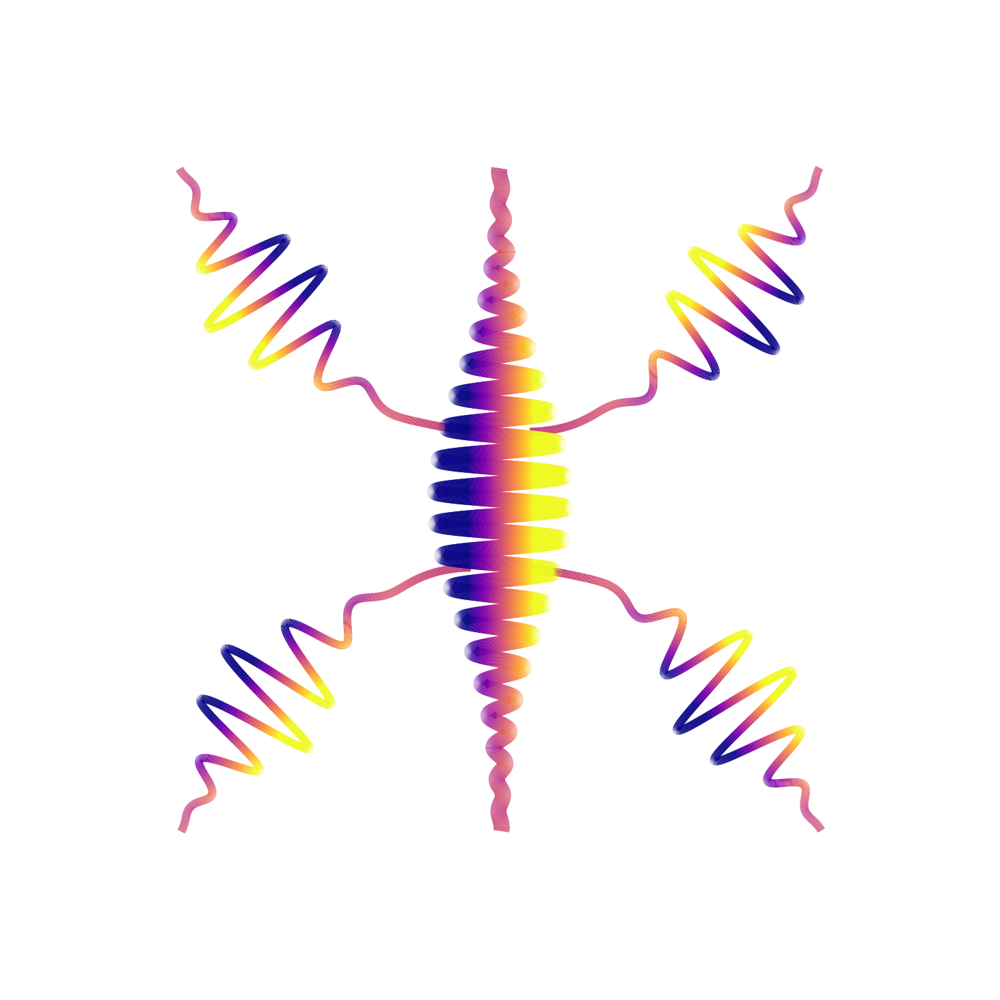

<p align="center">
  
</p>

<h1 align="center">TDSE-Z</h1>

<p align="center">
  <strong>Strong-field quantum dynamics, from atoms to heterostructures</strong><br>
  A parallel B-spline solver for the time-dependent Schrödinger equation in 1D, 2D and 3D
</p>

<p align="center">
  <a href="https://github.com/dahbiz/tdsez/actions/workflows/docs.yml"></a>
  <a href="https://dahbiz.github.io/tdsez/docs/index.html"></a>
  <a href="https://arxiv.org/abs/2608.18472"></a>
  
  
  <a href="LICENSE"></a>
</p>

<p align="center">
  <a href="https://dahbiz.github.io/tdsez/docs/index.html">Documentation</a> &middot;
  <a href="https://arxiv.org/abs/2608.18472">Paper</a> &middot;
  <a href="PERFORMANCE.md">Performance notes</a> &middot;
  <a href="https://github.com/dahbiz/zkit">zkit (analysis)</a> &middot;
  <a href="#citation">Citation</a>
</p>

---

TDSE-Z solves the single-particle time-dependent Schrödinger equation in one, two
and three dimensions. It computes bound states and propagates them in arbitrary
laser fields, with user-defined potentials and position-dependent effective masses.
The same code and input format cover atoms, molecular ions and layered
semiconductor structures. Space is discretised with B-splines (isogeometric
analysis, [PetIGA](https://github.com/dalcinl/PetIGA)). Linear algebra, eigenproblems
and MPI parallelism are built on [PETSc](https://petsc.org) and
[SLEPc](https://slepc.upv.es).

## Capabilities

**Physics**
- Arbitrary potentials $`V(\mathbf r)`$ and effective masses $`m(\mathbf r)`$ given as
  expressions in the input file (muParser), including piecewise profiles of
  heterostructures.
- Hermitian BenDaniel–Duke kinetic operator $`-\tfrac12\nabla\cdot m^{-1}(\mathbf r)\nabla`$
  for position-dependent masses.
- Length-gauge coupling to user-defined laser fields along $`x`$, $`y`$ and $`z`$; the
  response is recorded on every axis, so cross-polarized emission is captured.
- Electrons or holes: `Charge` sets the carrier, $`H = K - q\,(V + \mathbf r\cdot\mathbf E)`$.
- Reflecting (Neumann) or hard-wall (Dirichlet) boundaries; complex absorbing
  potential.

**Discretisation and solvers**
- B-splines of any degree; uniform, graded, hydrogenic and interface-aligned knot
  sequences ($`C^0`$ knots at material interfaces).
- Bound states by shift-invert Krylov–Schur (SLEPc), with a direct (MUMPS) or
  iterative inner solver. Degenerate levels are kept whole and returned in a
  reproducible basis.
- Time propagation by Crank–Nicolson, a unitary Padé(2,2) exponential midpoint
  rule, or a fourth-order commutator-free Magnus integrator.
- Propagator solves preconditioned by additive Schwarz (default) or geometric
  B-spline multigrid (exact knot-insertion prolongation, Galerkin coarse levels);
  the preconditioner is rebuilt automatically when a strong field changes the
  operator.

**Observables**
- Dipole, velocity and acceleration (operator or equation-of-motion form, exact at
  sharp interfaces), energy decomposition, currents, bound-state populations,
  autocorrelation, Berry phase, transition-dipole matrices and wavefunction
  snapshots.
- Photoelectron momentum spectra by t-SURFF (`TSurff = 1`, separate
  `td/surff_<input>.h5`), validated against the analytic free wave packet in
  1D, 2D and 3D.
- HDF5 output; the bound-state file records the input file, code version, units
  and eigenpair residuals.

**Performance**
- Sum-factorised element assembly with BLAS contractions, banded insertion of the
  element matrices, and MPI parallelism throughout.
- Measured speed-ups and the methods behind them are documented in
  [PERFORMANCE.md](PERFORMANCE.md).

## Requirements

| Dependency | Notes |
|---|---|
| C++17 compiler, CMake ≥ 3.15, MPI | |
| [PETSc](https://petsc.org) | Complex scalars (`--with-scalar-type=complex`), HDF5; MUMPS for direct solves |
| [SLEPc](https://slepc.upv.es) | Installed in the PETSc prefix |
| [PetIGA](https://github.com/dalcinl/PetIGA) | Installed in the PETSc prefix |
| [muParser](https://github.com/beltoforion/muparser) | Expression parsing |
| Python 3 with pytest, numpy, scipy, h5py and [zkit](https://github.com/dahbiz/zkit) | Tests and post-processing (optional) |

A PETSc configuration known to work:

```bash
./configure --prefix=$HOME/petsc --with-scalar-type=complex --with-64-bit-indices \
            --with-cxx-dialect=c++17 --with-debugging=0 \
            --download-slepc --download-hdf5 --download-mumps --download-scalapack \
            --download-metis --download-parmetis --download-muparser --download-openblas
```

PetIGA is then built against this PETSc and installed into the same prefix.
CMake reads the compiler flags, BLAS/LAPACK libraries and optional CUDA and OpenMP
settings from the PETSc installation; no further configuration is needed.

## Building

```bash
export PETSC_DIR=/path/to/petsc        # the PETSc install prefix
cmake -S . -B build
cmake --build build -j
```

This produces `build/tdsez.x` and the post-processing tools `tdmprocessor`,
`tdmselect` and `drecprocessor`.

## Running

```bash
mpirun -np 4 build/tdsez.x -inp tests/inputs/ho1d.inp
```

The input file sets the dimension, domain, B-spline space, potential, mass,
laser field, propagator and outputs. Bound states are written to
`static/EigenData_<input>.h5`. With `EnablePropagation = 1`, time-dependent
observables go to `td/TimeEvolutionData_<input>.h5`, alongside wavefunction
snapshots and the autocorrelation. PETSc and SLEPc options (`-eps_*`, `-ksp_*`,
`-log_view`, ...) can be added on the command line. See the
[input reference](https://dahbiz.github.io/tdsez/docs/Input-File.html) and the
[examples](https://dahbiz.github.io/tdsez/docs/Examples.html).

## Tests

```bash
cmake --build build --target test      # or: pytest tests/ -v
```

The suite runs `tdsez.x` on small inputs with 1–5 MPI ranks and finishes in under a
minute. It checks:
- spectra and degeneracies against analytic or independent references (harmonic
  oscillators in 1D/2D/3D, box and infinite well, double quantum well,
  position-dependent and step masses);
- driven dynamics against the exact solution, including the convergence order of
  each propagator, and Ehrenfest and gauge consistency at a mass step;
- sum-factorised against per-point assembly, MPI-layout independence, absorbing
  boundaries, initial states, output metadata and input validation.

See [tests/README.md](tests/README.md).

## Documentation

The [user guide](https://dahbiz.github.io/tdsez/docs/index.html) covers the
physical model, input format, solvers, observables, output schema and examples.
The C++ API reference is generated with Doxygen. Both can be built locally:

```bash
cmake --build build --target docs-sphinx   # user guide -> docs/docs_sphinx/_build/html
cmake --build build --target docs          # API reference -> docs/doxygen/html
```

## Repository layout

| Path | Contents |
|---|---|
| `src/parser.cpp`, `src/parser_validation.cpp` | Input parsing, expressions, validation |
| `src/core.cpp`, `src/core_knots.cpp` | B-spline space, knot sequences, bound-state solve |
| `src/assembly/` | Operator assembly (sum factorisation, banded insertion) |
| `src/manager.cpp`, `src/propagator.cpp`, `src/monitor.cpp` | Time propagation, observables, HDF5 output |
| `src/diagnostics.cpp` | Transition matrices and consistency checks |
| `include/` | Public headers; `tdsez_internal.hpp` collects shared declarations |
| `src/tsurff.cpp` | t-SURFF photoelectron spectra |
| `src/multigrid.cpp` | Geometric B-spline multigrid preconditioner |
| `tests/` | Regression and analytic test suite |
| `examples/` | Validated decks and scripts: HHG (`hhg/`), t-SURFF (`tsurff/`) |
| `docs/` | User guide sources and website |

## Citation

If you use TDSE-Z in your work, please cite:

> Z. Dahbi and A. Zaïr, *Unified Strong-Field Dynamics Simulations from Atoms to
> Heterostructures*, arXiv:2608.18472 (2026).

```bibtex
@article{dahbi2026unified,
  title   = {Unified Strong-Field Dynamics Simulations from Atoms to Heterostructures},
  author  = {Dahbi, Zakaria and Za{\"\i}r, Amelle},
  journal = {arXiv preprint arXiv:2608.18472},
  year    = {2026}
}
```

Citation metadata is also provided in [`CITATION.cff`](CITATION.cff).

## License

TDSE-Z is released under the [PolyForm Noncommercial License 1.0.0](LICENSE).
Use, modification and redistribution for non-commercial research and teaching are
permitted. Commercial use requires a separate license; please contact
[zdahbi@outlook.es](mailto:zdahbi@outlook.es).

## Contact

Dr Zakaria Dahbi, King's College London —
[zakaria.dahbi@kcl.ac.uk](mailto:zakaria.dahbi@kcl.ac.uk)

## Acknowledgements

Z.D. acknowledges funding from UK Research and Innovation (UKRI) under the UK
government's Horizon Europe funding guarantee (Grant No. EP/Z000807/1).

<p align="center">
  
</p>
