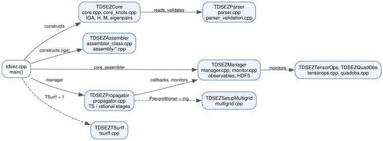

Architecture
============

TDSE-Z is organised as a pipeline of C++ classes. Each class owns one stage of
the computation and hands PETSc objects to the next. ``main()`` in
``src/tdsez.cpp`` constructs the objects in order
(:numref:`fig-architecture-classes`); the solver stages are described in
:doc:`Overview`.

   Classes of the ``tdsez.x`` executable and the source files that implement
   them. Dashed arrows are used only for the indicated input settings.

Modules
-------

.. list-table::
   :header-rows: 1
   :widths: 22 30 48

   * - Type
     - Sources
     - Responsibility
   * - ``TDSEZParser``
     - ``src/parser.cpp``, ``src/parser_validation.cpp``
     - Reads ``key = value`` files, resolves key aliases, compiles the
       muParser expressions and validates the parameter set
       (``ValidateOrThrow``). Parameters are static members.
   * - ``TDSEZCore``
     - ``src/core.cpp``, ``src/core_knots.cpp``
     - Creates the PetIGA context and knot vectors, assembles
       :math:`\mathbf H` and :math:`\mathbf M`, solves the eigenproblem with
       SLEPc, builds the initial state and writes
       ``static/<name>_eigen.h5``.
   * - ``TDSEZAssembler``
     - ``src/assembler_class.cpp``, ``src/assembly/*.cpp``
     - Assembles the kinetic, potential, dipole, velocity, force, CAP and
       :math:`L_z` matrices. ``assembly.cpp`` holds the point kernels,
       ``sumfact.cpp`` the sum-factorised element integrals, ``band.cpp`` the
       banded insertion and ``cap.cpp`` the absorbing potential.
   * - ``TDSEZManager``
     - ``src/manager.cpp``, ``src/monitor.cpp``
     - Holds the operators used during propagation, the residual and
       Jacobian callbacks, the per-step monitors, the HDF5 ring buffers and
       viewers.
   * - ``TDSEZPropagator``
     - ``src/propagator.cpp``
     - Runs PETSc TS (``cn``) or the rational stage solves (``pade22``,
       ``magnus4``) and configures the Krylov solver and preconditioner.
   * - ``TDSEZTSurff``
     - ``src/tsurff.cpp``
     - Accumulates the t-SURFF surface flux during propagation and writes
       ``td/<name>_surff.h5`` (``TSurff = 1``).
   * - ``TDSEZTensorOps``
     - ``src/tensorops.cpp``
     - Applies the separable operators in factorised (Kronecker) form in 2D
       and 3D.
   * - ``TDSEZQuadObs``
     - ``src/quadobs.cpp``
     - Evaluates the monitor expectation values from :math:`\psi` at the
       quadrature points.
   * - ``TDSEZProfile``
     - ``src/timing.cpp``
     - Phase wall times, PETSc log stages and the final timing summary.
   * - ``TDSEZInfo``
     - ``include/tdsez_info.hpp``
     - Terminal log: centred stage titles and sections, key-value rows,
       wrapped notes and warnings, tables.

Free functions complete the pipeline: ``TDSEZSetupMultigrid``
(``src/multigrid.cpp``, ``Preconditioner = mg``) and the diagnostics in
``src/diagnostics.cpp`` (transition dipole matrix, length/velocity check,
operator export). The post-processors ``src/tdmprocessor.cpp``,
``src/tdmselect.cpp`` and ``src/drecprocessor.cpp`` are separate executables.

Ownership rules
---------------

* PETSc and PetIGA objects are created collectively on ``PETSC_COMM_WORLD``.
* Each class destroys only the objects it creates; matrices exposed through
  getters remain owned by the creating class.
* The HDF5 viewers are opened when ``TDSEZManager`` is constructed;
  ``CloseHDF5`` writes the remaining buffered rows and closes them.
* MPI rank 0 prints the terminal summaries and writes the text logs; all
  ranks take part in collective PETSc and HDF5 operations.

Generated API reference
-----------------------

The Doxygen reference of all classes and functions (``Doxyfile``, inputs
``include/`` and ``src/``) is built with::

    cmake --build build --target docs

and written to ``docs/doxygen/html/index.html``. See :doc:`API-Reference`.
