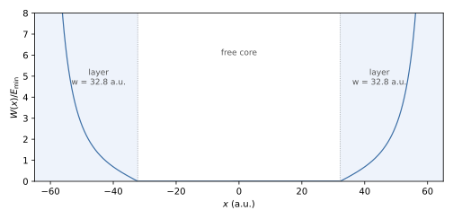

Boundary Conditions
===================

The computational box has a wall condition, Neumann (default) or Dirichlet,
which applies to all walls of all axes. Independently of it, a complex
absorbing potential (CAP) can be added near the walls to remove outgoing
electrons. All keys are also listed in :doc:`Input-File`.

Wall conditions
---------------

.. list-table::
   :widths: 30 10 14 46
   :header-rows: 1

   * - Key (aliases)
     - Type
     - Default
     - Description
   * - ``BoundaryType`` (``Boundary``)
     - string
     - ``Neumann``
     - ``Neumann`` or ``natural``: reflecting wall without constraint.
       ``Dirichlet`` or ``wall``: :math:`\psi = 0` at the walls.
       Case-insensitive; any other value stops the run.

**Neumann.** The Galerkin equations are assembled over the full basis without
constraints. The boundary term of the weak form is dropped, which imposes the
natural condition :math:`m^{-1}\,\partial_n\psi = 0` only weakly; the wall
reflects. The wave function at the wall is not forced to zero, so a box that
truncates a bound state lowers its energy below the converged value
(:doc:`Knot-Sequences` gives a measured example).

**Dirichlet.** On a clamped knot vector the first and the last B-spline of an
axis are the only functions that do not vanish at the walls. With
``BoundaryType = Dirichlet`` their coefficients are fixed to zero: their rows
and columns are removed from :math:`H` and :math:`M`, and a decoupled
diagonal entry is kept for each, which gives one spurious eigenvalue per wall
coefficient near the top of the discrete spectrum. The same rows and columns
are removed from the time-dependent and diagnostic operators (dipole,
velocity, force, CAP, :math:`L_z`), so the wall coefficients stay zero during
propagation. With Dirichlet walls the monitors use the assembled sparse
matrices; the factorised (``-tdsez_tensor_ops``) and quadrature-point
(``-tdsez_quad_obs``) evaluations are disabled (:doc:`CLI-Flags`).

Both conditions reflect outgoing waves. Dirichlet walls suit potentials that
confine the state (quantum wells, hard-wall boxes, singular potentials at the
wall), and benchmarks whose reference solution vanishes at the box edge.

Complex absorbing potential
---------------------------

.. list-table::
   :widths: 30 10 14 46
   :header-rows: 1

   * - Key (aliases)
     - Type
     - Default
     - Description
   * - ``EnableCAP`` (``AbsorbingBoundary``)
     - bool
     - 0
     - Add the CAP to the propagation Hamiltonian.
   * - ``CAPKmin``
     - real
     - 0.1
     - Lowest momentum :math:`k_{\min}` (a.u.) absorbed with small
       reflection; sets the layer width :eq:`eq-boundary-conditions-width`.
       Must be > 0.
   * - ``CAPWidth`` (``CAPLayerWidth``)
     - real
     - 0
     - Layer width :math:`w` per wall (a.u.). A positive value overrides
       ``CAPKmin`` through :eq:`eq-boundary-conditions-width`; 0 uses
       ``CAPKmin``; a negative value is rejected.

The CAP adds :math:`-\mathrm{i}\,W(\mathbf r)` to the Hamiltonian of the time
propagation, with the transmission-free profile of Manolopoulos
[Manolopoulos2002]_. Every axis :math:`a` of the problem receives an
absorbing layer of width

.. math::
   :label: eq-boundary-conditions-width

   w = \frac{c}{2\,\delta\,k_{\min}} \approx \frac{6.555}{k_{\min}},
   \qquad c = 2.62206,\quad \delta = 0.2,

at both of its walls. Within a layer, with :math:`u \in [0, w)` the depth
measured from the inner edge of the layer and :math:`r = c\,u/w`,

.. math::
   :label: eq-boundary-conditions-profile

   W_a = E_{\min}\left(a\,r - b\,r^3 + \frac{4}{(c-r)^2} - \frac{4}{(c+r)^2}\right),
   \qquad E_{\min} = \tfrac12 k_{\min}^2,
   \quad a = 1 - \frac{16}{c^3},\quad b = \frac{1 - 17/c^3}{c^2},

and :math:`W_a = 0` outside the layers. The profile starts at zero at the inner
edge (no step that would reflect slow electrons) and diverges at the wall; at
the wall itself the argument is held just below the pole :math:`r = c`. The
contributions of the axes add, :math:`W = \sum_a W_a`, so boxes of any aspect
ratio are absorbed on every face. Electrons with momentum above
:math:`k_{\min}` (energy above :math:`E_{\min}`) are absorbed with a reflection
probability below about 1 % [Manolopoulos2002]_; slower electrons are partly
reflected.

   CAP profile :math:`W(x)/E_{\min}` of :eq:`eq-boundary-conditions-profile`
   on the axis :math:`[-65, 65]` a.u. with ``CAPKmin = 0.2``
   (:math:`w = 32.8` a.u.); shaded: absorbing layers. Script
   ``figures/make_Boundary-Conditions-cap.py``.

:numref:`fig-boundary-conditions-cap` shows the profile. The layers are placed
at the walls of each axis (including ``OffsetX/Y/Z``). Input validation
requires :math:`w \le 0.45\,(L_{\max} - L_{\min})` on every axis, so that a
free core remains, and stops the run otherwise.

Choosing the layer
~~~~~~~~~~~~~~~~~~

- The layer width and the lowest absorbed momentum are one parameter,
  :math:`w\,k_{\min} \approx 6.555`. Set either ``CAPWidth`` (the part of the
  box spent on absorption) or ``CAPKmin`` (the slowest electron to absorb). A
  wider layer absorbs slower electrons but requires a larger box.
- The physically relevant region must lie in the free core. For HHG this is
  the quiver motion of amplitude :math:`\alpha = E_0/\omega^2` and the
  returning trajectories.
- With ``EnableCAP = 1`` the start-up output reports the layer width, the
  absorbed momentum range and, for each axis, the absorbing intervals and the
  free-core width. When the field scales are known
  (:doc:`Knot-Sequences`, field-resolution check), it compares the free-core
  half width of each polarised axis with :math:`2\alpha + 10` a.u. and prints
  a warning when it is smaller.
- A t-SURFF surface must lie in front of the layers (:doc:`TSurff`).
- To check that reflections are negligible, compare the observables (for
  example the HHG spectrum or the bound-state population) with a run in a
  larger box or with a smaller ``CAPKmin``.

``-tdsez_cap_check`` additionally assembles the CAP with the element kernel
and prints the largest difference to the separable assembly
(:doc:`CLI-Flags`).

Reflecting and absorbing boundaries compared
--------------------------------------------

.. list-table::
   :widths: 20 40 40
   :header-rows: 1
   :stub-columns: 1

   * -
     - Neumann or Dirichlet walls only
     - With CAP
   * - Outgoing flux
     - Reflected into the box
     - Absorbed in the layers
   * - Norm
     - Conserved
     - Decreases as flux is absorbed
   * - Typical use
     - Bound-state dynamics, confined systems
     - Ionisation, HHG, photoelectron spectra
   * - Parameters
     - None
     - ``CAPKmin`` or ``CAPWidth``; the box must contain the layers
