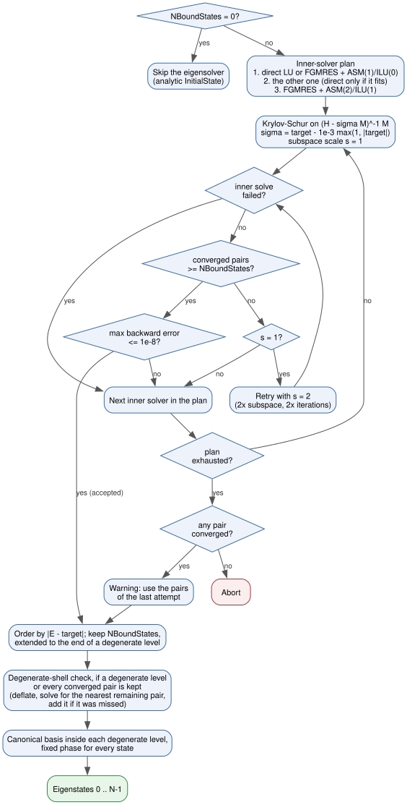

Eigensolver
===========

Before the propagation TDSE-Z computes bound states of the field-free
Hamiltonian :math:`H_0` (:eq:`eq-potential-mass-hamiltonian`). In the spline
basis this is the generalised Hermitian eigenproblem

.. math::
   :label: eq-eigensolver-ghep

   H_0\,\mathbf c = E\,M\,\mathbf c ,

with :math:`M` the overlap matrix (:eq:`eq-potential-mass-matrices`). The
absorbing potential is not part of :math:`H_0`; it is added only for the
propagation (:doc:`Physics-Conventions`). The eigenpairs are used as initial
states (:doc:`Initial-State`), for populations and current decomposition
(:doc:`Observables`) and are written to ``static/EigenData_<input>.h5``
(:doc:`HDF5-Output`).

Keys
----

.. list-table::
   :widths: 35 15 10 40
   :header-rows: 1

   * - Key
     - Type
     - Default
     - Description
   * - NBoundStates / NumberOfBoundStates
     - int
     - ``1``
     - Number of eigenpairs to compute, stored as states :math:`0 \ldots N-1`.
       If the last requested state belongs to a degenerate level, the whole
       level is kept (with a printed note). ``0`` skips the eigensolver and is
       accepted only with an analytic ``InitialState`` (:doc:`Initial-State`).
   * - TargetEigenvalue / TargetEnergy
     - real
     - ``0.0``
     - Target energy :math:`\tau` in Hartree. The eigenvalues nearest to
       :math:`\tau` are computed.
   * - UseDirectSolve / DirectSolve
     - bool
     - ``0``
     - Start with the direct inner solver (when a direct solver package is
       available), as ``-tdsez_eps_inner direct``.
   * - NBoundStatesSave / SaveBoundStates
     - bool
     - ``0``
     - Also write the eigenvectors to ``EigenData_<input>.h5``.
   * - BoundStateFormat / StateFormat / SaveStateFormat
     - string
     - ``complex``
     - Format of the saved eigenvectors: ``complex`` or ``real`` (see
       `Saved eigenstates`_).

The states returned are the :math:`N` eigenvalues closest to the target, not
necessarily the lowest ones. To obtain the ground state and the lowest
excited states, set ``TargetEigenvalue`` at or slightly below the expected
ground-state energy (for example ``-0.8`` for a soft-core atom with
:math:`E_0 = -0.67`). The command-line options that control the eigensolver
are listed in :doc:`CLI-Flags`.

Shift-Invert Krylov-Schur
-------------------------

The eigenproblem :eq:`eq-eigensolver-ghep` is solved with the Krylov-Schur
method [Stewart2002]_ of SLEPc [Hernandez2005]_ (``EPSKRYLOVSCHUR``, problem
type ``EPS_GHEP``) applied to the shift-and-invert operator

.. math::
   :label: eq-eigensolver-sinvert

   (H_0 - \sigma M)^{-1} M\,\mathbf c = \theta\,\mathbf c, \qquad
   \theta = \frac{1}{E - \sigma}, \qquad
   \sigma = \tau - 10^{-3}\max(1, |\tau|) ,

whose largest :math:`|\theta|` belong to the eigenvalues :math:`E` nearest the
shift. The shift lies slightly below the target so that a target placed
exactly on an eigenvalue does not make :math:`H_0 - \sigma M` singular; the
selection of the eigenvalues nearest to :math:`\tau` is unaffected. The outer
tolerance is :math:`10^{-12}` with at most 2000 restarts; the subspace
dimensions are chosen from :math:`N` and the problem size.

Inner solvers
~~~~~~~~~~~~~

Each application of :eq:`eq-eigensolver-sinvert` solves a linear system with
the indefinite matrix :math:`H_0 - \sigma M`. Three inner solvers are
available:

* **Direct**: LU factorisation, computed once. MUMPS when PETSc provides it
  (with 50 % extra workspace unless ``-st_mat_mumps_icntl_14`` is set),
  otherwise SuperLU_DIST, otherwise PETSc's own LU on a single rank; for GPU
  matrices cuSPARSE on a single rank.
* **Iterative**: FGMRES [Saad1986]_ (restart 100, or 50 above
  :math:`10^6` DOFs; relative tolerance :math:`10^{-10}`; at most 500
  iterations) preconditioned by restricted additive Schwarz [CaiSarkis1999]_
  with overlap 1 and ILU(0) on each block. The block factorisations use
  in-block shifts against the zero pivots of the indefinite matrix.
* **Iterative, strong**: as above with overlap 2, ILU(1) and at most 3000
  iterations.

The first inner solver is chosen as follows:

* ``-tdsez_eps_inner direct`` or ``UseDirectSolve = 1``: direct (iterative if
  no direct package is available).
* ``-tdsez_eps_inner iterative``: iterative.
* Otherwise direct when the factorisation fits, that is in 1D and 2D up to
  :math:`2\times 10^6` DOFs, and in 3D for spline degree :math:`\ge 6` up to
  30 000 DOFs, where the overlapping Schwarz blocks would cover most of the
  domain. All other cases start with the iterative solver.

The remaining entries of the plan follow: after a direct start the iterative
and then the strong iterative solver; after an iterative start the direct
solver (if it fits: 1D and 2D up to :math:`2\times 10^6` DOFs, 3D up to
:math:`3\times 10^5` DOFs) and then the strong iterative solver. The options
``-st_ksp_*``, ``-st_pc_*`` and ``-st_sub_pc_*`` are applied on top of these
defaults, and ``-eps_*`` options on top of the eigensolver settings.

Acceptance of an attempt
~~~~~~~~~~~~~~~~~~~~~~~~

Each attempt is accepted only if the inner solves succeed, at least
``NBoundStates`` pairs converge, and the backward error of every requested
pair,

.. math::
   :label: eq-eigensolver-backward-error

   \eta(E, \mathbf c) =
   \frac{\|H_0\mathbf c - E M\mathbf c\|_2}
        {\left(\|H_0\|_\infty + |E|\,\|M\|_\infty\right)\|\mathbf c\|_2} ,

satisfies :math:`\eta \le 10^{-8}`. Unlike the relative residual
:math:`\|r\|/(|E|\,\|\mathbf c\|)`, :math:`\eta` stays meaningful for
:math:`E \to 0`, for example for the constant ground state of a free
particle with Neumann walls. :numref:`fig-eigensolver-flow` shows the
complete sequence:

* An inner-solve failure or a backward error above :math:`10^{-8}` moves to
  the next inner solver.
* Too few converged pairs repeat the attempt once with twice the subspace
  dimensions and iteration limit, then move to the next inner solver.
* When no inner solver meets every check, the converged pairs of the last
  attempt are used with a warning; the run stops only when no pair has
  converged.

   Control flow of the eigensolver: inner-solver plan, per-attempt checks
   with the subspace retry, and the construction of the canonical
   eigenstates.

The backward error printed for each state in the EIGENVALUES table (next to
the energy in a.u. and in eV) and the dataset
``run_metadata/eig_residual`` in ``EigenData_<input>.h5`` contain
:math:`\eta` of :eq:`eq-eigensolver-backward-error` for the final states.

Degenerate Levels and Reproducible States
-----------------------------------------

Inside a degenerate level any orthonormal basis is an eigenbasis, and the one
SLEPc returns depends on rounding (assembly order, MPI layout, BLAS); the
global phase of each eigenvector is arbitrary as well. Per-state populations,
currents, saved wavefunctions and superposition initial states would then
change from run to run. TDSE-Z therefore post-processes the converged pairs.
Two eigenvalues belong to the same level when

.. math::
   :label: eq-eigensolver-degeneracy

   |E_i - E_j| \le \varepsilon_{\mathrm{deg}}\,\max(1, |E_i|) ,

with :math:`\varepsilon_{\mathrm{deg}}` set by ``-tdsez_degeneracy_tol``
(default :math:`10^{-9}`).

1. **Selection.** The pairs are ordered by their distance to the target
   (ties by energy). The first ``NBoundStates`` are kept, extended to the end
   of a degenerate level.
2. **Degenerate-shell check.** Krylov solvers can miss copies of a repeated
   eigenvalue. Whenever the kept set contains a degenerate level, or ends at
   the last converged pair, the kept states are deflated and SLEPc is asked
   for the nearest remaining pair (at a loose tolerance). If that pair is not
   farther from the target than the last kept state, or has the energy of a
   kept level, it was missed: it is recomputed at the full tolerance, added,
   and the check repeats (``Degenerate-shell check: added ...``). Each check
   costs about one extra eigensolve.
3. **Canonical basis.** Inside each degenerate level the states are
   :math:`M`-orthonormalised and rotated to diagonalise a fixed position
   weight (a generic quadratic polynomial of the coordinates at the Greville
   points), sorted by that weight. The spanned subspace is unchanged; all
   states of the level are assigned the mean energy of the level. A warning
   is printed if the weight does not separate the states of a level.
4. **Phase.** The global phase of each state is chosen so that
   :math:`\mathbf c^{T} M\,\mathbf c` is real and positive (which makes the
   coefficient vector of a nondegenerate state real), and the sign so that
   the overlap :math:`\int w\,\psi\,d\mathbf r` with
   :math:`w = \prod_d (1 + 0.3\,\hat x_d)` is positive, where :math:`\hat x_d`
   is the coordinate scaled to :math:`[-1, 1]`. When that overlap vanishes,
   :math:`w = \prod_d e^{a_d \hat x_d}` with :math:`a = (0.37, 0.53, 0.71)`
   is used instead.

The resulting states, and everything computed from them, agree across
assembly paths and MPI rank counts to rounding.

Saved eigenstates
-----------------

When ``NBoundStates > 0``, ``static/EigenData_<input>.h5`` is always written
with the spectrum and the run metadata, including :math:`\eta` of each state.
``NBoundStatesSave = 1`` adds, for each kept state :math:`i`, the vector
``psi_<i>`` in the PetIGA layout and ``coeff_<i>`` in natural ordering
(:doc:`HDF5-Output`). ``BoundStateFormat`` selects their form:

* ``complex``: the canonical eigenvectors described above.
* ``real``: each state is rotated by the phase of one of its nonzero
  coefficients, its real part is kept and renormalised to
  :math:`\|\psi\|_M = 1`. For a nondegenerate state this coincides with the
  canonical eigenvector up to sign.
