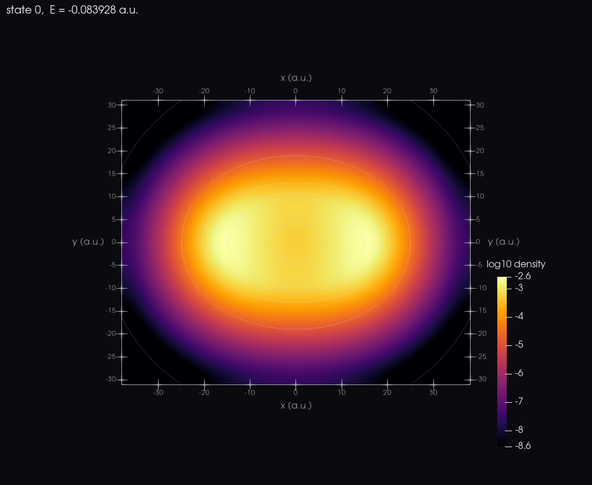
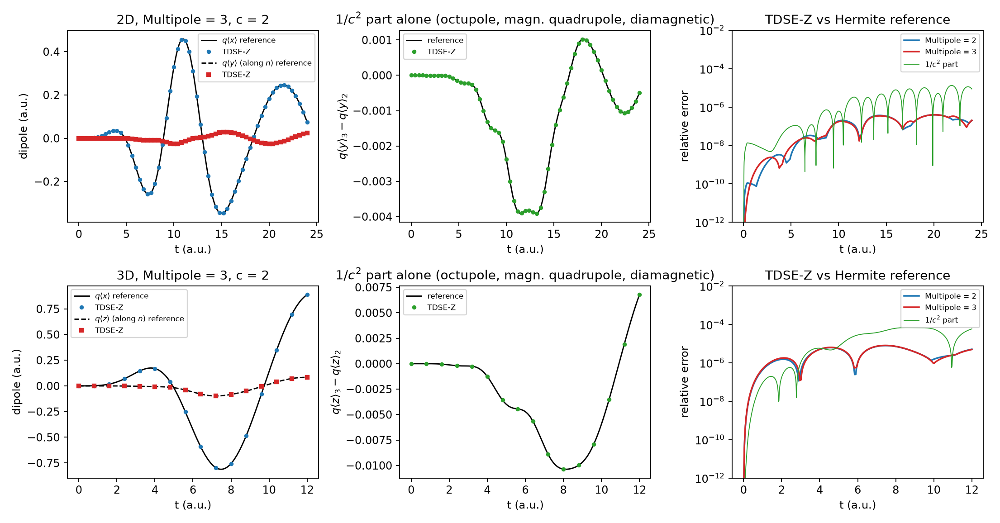

Gallery
=======

Each entry gives the picture or movie, the input deck that produced it
(in ``examples/gallery/``) and the commands. The images and movies are made
with zkit: ``zkit vtk`` exports the run to VTK (ParaView and VisIt) and
``zkit render`` drives ParaView (:doc:`Post-Processing`, *Visualisation with
ParaView and VisIt*).

.. raw:: html

   

Electron spiral in a circularly polarised pulse (2D)
----------------------------------------------------

A 2D soft-core atom (:math:`I_p = 0.5`) in a 4-cycle circularly polarised
pulse, :math:`\omega = 0.3`, :math:`E_0 = 0.12` a.u. The ionised wavepacket
leaves the atom along a spiral that follows the rotating field; log10 of the
density over six decades, the potential as contour lines. About 4·10\ :sup:`4`
DOFs, 2 minutes on 4 cores.

.. raw:: html

   <video class="tdsez-movie" controls loop muted playsinline poster="_static/gallery/circ2d.png">
     <source src="_static/gallery/circ2d.mp4" type="video/mp4">
   </video>

.. code-block:: bash

   mpiexec -n 4 tdsez.x -inp circ2d.inp
   zkit --run-dir . vtk circ2d.inp --render          # vtk/circ2d.mp4, vtk/images/

.. literalinclude:: ../../examples/gallery/circ2d.inp
   :language: text
   :caption: examples/gallery/circ2d.inp

Volume rendering of a 3D atom in a linear pulse
-----------------------------------------------

3D soft-core atom, linear field along :math:`z`. Volume rendering of log10
density with isosurfaces 1, 2.5 and 4 decades below the maximum; the camera
orbits once over the movie. 2.7·10\ :sup:`4` DOFs.

.. raw:: html

   <video class="tdsez-movie" controls loop muted playsinline poster="_static/gallery/lin3d.png">
     <source src="_static/gallery/lin3d.mp4" type="video/mp4">
   </video>

.. code-block:: bash

   mpiexec -n 4 tdsez.x -inp lin3d.inp
   zkit --run-dir . vtk lin3d.inp --npoints 100 --render --orbit

.. literalinclude:: ../../examples/gallery/lin3d.inp
   :language: text
   :caption: examples/gallery/lin3d.inp

Kramers-Henneberger atom in elliptical light
--------------------------------------------

``Mode = kh``: the ground state of the cycle-averaged potential
:math:`V_{\rm KH}` for 800 nm elliptical light, :math:`\alpha_0 = 20`,
:math:`\varepsilon = 0.6` (:doc:`KH-Frame`). The density sits on the
elliptical quiver path; the contour lines are :math:`V_{\rm KH}` itself,
which the exporter averages over the quiver stored in the run.

.. code-block:: bash

   mpiexec -n 4 tdsez.x -inp kh_elliptical_2d.inp
   zkit --run-dir . vtk kh_elliptical_2d.inp --states 0,1,2 --npoints 240 --render

.. literalinclude:: ../../examples/gallery/kh_elliptical_2d.inp
   :language: text
   :caption: examples/gallery/kh_elliptical_2d.inp

Nondipole coupling against an exact reference (Available very soon)
-------------------------------------------------------------------

``Multipole = 3`` (electric quadrupole and octupole, magnetic dipole and
quadrupole, diamagnetic; :ref:`multipole-coupling`) on an anisotropic
oscillator with :math:`c = 2`, against the same problem solved in its
Hermite basis, where every term is an exact ladder-operator matrix. Top 2D,
bottom 3D: :math:`\langle\mathbf r\rangle(t)` along the field and along the
propagation direction, the :math:`1/c^2` part alone, and the relative error.
The figure is made from the runs of ``tests/test_multipole.py``.

.. code-block:: bash

   mpiexec -n 2 tdsez.x -inp multipole3_oscillator_2d.inp
   pytest tests/test_multipole.py -k hermite        # the 2D and 3D comparisons

.. literalinclude:: ../../examples/gallery/multipole3_oscillator_2d.inp
   :language: text
   :caption: examples/gallery/multipole3_oscillator_2d.inp

More
----

* :doc:`KH-Frame`: KH states and energies of a 1D soft-core atom versus the
  quiver amplitude (``examples/kh/kh_soft_core_1d.py``).
* :doc:`HHG`: harmonic spectra (``examples/hhg``).
* :doc:`TSurff`: photoelectron spectra (``examples/tsurff``).
