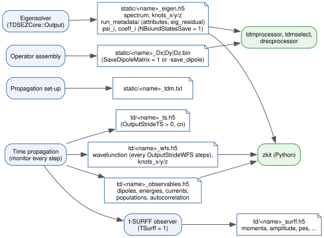

HDF5 Output Schema
==================

A run with input file ``h2p.inp`` writes the files below, relative to the
run directory. Every file starts with the run name ``<name>``, the input file
name without its extension (``h2p``): ``static/`` holds the stationary
results, ``td/`` the time-dependent ones. Files of earlier versions
(``static/EigenData_h2p.inp.h5``, ``td/TimeEvolutionData_h2p.inp.h5``, ...)
are still read by zkit and the post-processing tools. At start-up TDSE-Z removes ``td/<name>_observables.h5``,
``td/<name>_wfs.h5``, ``td/<name>_ts.h5`` and
``static/<name>_eigen.h5`` left by a previous run with the same input
file. :numref:`fig-hdf5-output-dataflow` shows which phase writes each file
and which tools read it.

   Output files of a run and the phase that writes them. The static files
   feed the post-processing tools (:doc:`Post-Processing`); all HDF5 files
   can be read with the Python package ``zkit``.

.. list-table:: Output files
   :name: table-hdf5-output-files
   :widths: 38 62
   :header-rows: 1

   * - File
     - Written
   * - ``static/<name>_eigen.h5``
     - by the eigensolver, always
   * - ``static/<name>_Dx.bin`` (``_Dy``, ``_Dz``)
     - with ``SaveDipoleMatrix = 1``, ``SaveDipoleAxes`` or ``-save_dipole``
   * - ``static/<name>_tdm.txt``
     - at the start of the propagation
   * - ``td/<name>_observables.h5``
     - during the propagation
   * - ``td/<name>_wfs.h5``
     - during the propagation (snapshots with ``OutputStrideWFS > 0``)
   * - ``td/<name>_ts.h5``
     - with ``OutputStrideTS > 0``
   * - ``td/<name>_surff.h5``
     - at the end of the propagation, with ``TSurff = 1``

Time Evolution Data
-------------------

File ``td/<name>_observables.h5``. Five two-dimensional ``float64``
datasets with one row per recorded step (:math:`t = 0` and every step after
it), written by rank 0 as extendable datasets in chunks of 256 rows. Every
dataset is present in every file; quantities disabled with ``PhysicsOutput``
keep the time column and are zero elsewhere (:doc:`Output-Control`). Definitions are in
:doc:`Observables`; :math:`q` = ``Charge``, :math:`s = -q`.

Rows are buffered in memory and appended when the buffer is full, every 5000
recorded steps, at multiples of ``OutputStrideTS`` if at least 2 s of wall
time have passed since the last write, and at the end of the run. Every step
is recorded; the buffering only affects when rows reach the file.

``dipoles``
~~~~~~~~~~~

.. list-table::
   :widths: 12 30 58
   :header-rows: 1

   * - Dimension
     - Columns
     - Layout
   * - 1D
     - 4
     - ``t, Ex, Dx, Ax``
   * - 2D
     - 7
     - ``t, Ex, Ey, Dx, Dy, Ax, Ay``
   * - 3D
     - 10
     - ``t, Ex, Ey, Ez, Dx, Dy, Dz, Ax, Ay, Az``

``E*`` is the physical field :math:`E_a(t)` (zero on axes not in
``Polarization``), :math:`D_a = q\langle x_a\rangle` the dipole
(:eq:`eq-observables-dipole`) and :math:`A_a = q\,\mathrm d\langle
v_a\rangle/\mathrm dt = \ddot D_a` the acceleration
(:eq:`eq-observables-acc-operator`, :eq:`eq-observables-acc-discrete`). All
axes are observed by default, so the response along axes without a field is
recorded too; with ``ObserveAllAxes = 0`` the ``D`` and ``A`` columns of the
axes not in ``Polarization`` are zero.

``energies``
~~~~~~~~~~~~

.. list-table::
   :widths: 10 18 72
   :header-rows: 1

   * - Col
     - Name
     - Content
   * - 0
     - ``t``
     - time
   * - 1
     - ``Kin``
     - :math:`\langle K\rangle`
   * - 2
     - ``Pot``
     - :math:`\langle sV\rangle`, the potential term of the Hamiltonian
   * - 3
     - ``Int``
     - :math:`s\,\mathbf E(t)\cdot\langle\mathbf r\rangle`, the field coupling
   * - 4
     - ``Tot``
     - :math:`\mathrm{Re}\langle H\rangle + \text{Int} = \text{Kin} + \text{Pot} + \text{Int}`
   * - 5
     - ``InvMass``
     - :math:`\langle m(\mathbf r)^{-1}\rangle`
   * - 6
     - ``Norm``
     - :math:`\langle\psi|\psi\rangle_M`

The energies are the real parts of unnormalised expectation values
(:eq:`eq-observables-energies`).

``currents``
~~~~~~~~~~~~

Columns 0-2 are ``t``, :math:`\langle L_z\rangle` and the phase increment
:math:`\Delta\Gamma` (:eq:`eq-observables-dgamma`). The remaining columns are
the current :math:`J_a = q\langle v_a\rangle = \dot D_a` and its intra-band,
inter-band and bound-continuum parts (:eq:`eq-observables-current-split`):

.. list-table::
   :widths: 14 12 74
   :header-rows: 1

   * - Dimension
     - Columns
     - Layout
   * - 1D, 2D
     - 11
     - ``t, Lz, dGamma, Jx, Jy, Jx_intra, Jy_intra, Jx_inter, Jy_inter,
       Jx_bc, Jy_bc`` (the ``Jy*`` columns are zero in 1D)
   * - 3D
     - 15
     - ``t, Lz, dGamma, Jx, Jy, Jz, Jx_intra, Jy_intra, Jz_intra, Jx_inter,
       Jy_inter, Jz_inter, Jx_bc, Jy_bc, Jz_bc``

``Lz`` is non-zero only in 2D with ``EnableLzDiag = 1``.

``populations``
~~~~~~~~~~~~~~~

:math:`N + 1` columns: ``t`` followed by :math:`P_0, \dots, P_{N-1}`
(:eq:`eq-observables-population`), where :math:`N` is the number of bound
states kept by the eigensolver (``NBoundStates``, extended to the end of a
degenerate level).

``autocorrelation``
~~~~~~~~~~~~~~~~~~~

Three columns: ``t``, :math:`\mathrm{Re}\,C(t)` and :math:`\mathrm{Im}\,C(t)`
with :math:`C(t) = \langle\psi(0)|\psi(t)\rangle_M`
(:eq:`eq-observables-autocorrelation`), recorded every step like the other
datasets.

Wavefunction Snapshots
----------------------

File ``td/<name>_wfs.h5``. The state is written every ``OutputStrideWFS``
steps (with ``wfs`` in ``PhysicsOutput``) to the dataset ``wavefunction``
through PETSc's HDF5 viewer with time stepping; the time-step index is
:math:`\text{step}/\texttt{OutputStrideWFS}`. At the end of the run the knot
vectors ``knots_x``/``knots_y``/``knots_z`` are added with the same
attributes as in ``<name>_eigen.h5`` (below), so that the file alone suffices to
evaluate the wavefunction on any grid.

PETSc Time-Stepper Snapshots
----------------------------

File ``td/<name>_ts.h5`` in the run directory, written only with
``OutputStrideTS > 0`` and ``Propagator = cn`` (1D and 3D runs): the PETSc
``TS`` object as written by ``TSView`` every ``OutputStrideTS`` steps,
dataset ``timestepper``.

t-SURFF Spectra
---------------

File ``td/<name>_surff.h5``, written at the end of the propagation with
``TSurff = 1``. Datasets ``momenta`` (:math:`n_k \times d`), ``amplitude``
(:math:`n_k \times 2`, real and imaginary part of :math:`b(\mathbf k)`) and
``pes`` :math:`=|b(\mathbf k)|^2`; for a momentum grid also ``k_x``/``k_y``/
``k_z`` and ``pes_grid`` (the spectrum reshaped to the grid); with
``SurffInterior = 1`` also ``amplitude_flux`` (the surface-flux part alone).
File attributes: ``final_time``, ``radius``, ``exterior_mass``,
``exterior_potential``, ``charge``, ``A_final``, ``stride``,
``n_surface_points``, ``n_samples`` and ``interior``. See :doc:`TSurff`.

Eigenstate Data
---------------

File ``static/<name>_eigen.h5``.

.. list-table::
   :widths: 30 70
   :header-rows: 1

   * - Object
     - Content
   * - ``spectrum``
     - Eigenvalues of the kept states (``float64``).
   * - ``psi_0``, ``psi_1``, ...
     - Eigenstates as PetIGA vectors (structured layout), with
       ``NBoundStatesSave = 1``; the solver eigenvectors, or with
       ``BoundStateFormat = real`` rotated to a real canonical phase.
   * - ``coeff_0``, ``coeff_1``, ...
     - The same coefficients as plain vectors in PetIGA's natural ordering
       (the ordering of the saved dipole matrices), with
       ``NBoundStatesSave = 1``.
   * - ``run_metadata`` (group)
     - Attributes ``code_version``, ``input_file``, ``units``,
       ``Dimension``, ``SplineDegree``, ``Nelements``, ``LMinX`` ...
       ``LMaxZ``, ``Charge``, ``TargetEigenvalue``, ``NBoundStatesSave``,
       ``NBoundStates``, ``state_format``, ``Mode`` (``td`` or ``kh``) and
       ``Multipole``; with ``Multipole >= 2`` also ``PropagationDirection_x/y/z``
       (normalised), ``SpeedOfLight`` and ``MultipoleMagnetic``; with
       ``Mode = kh`` ``KH_window_start``, ``KH_window_end``, ``KH_omega``,
       ``KH_alpha_x/y/z`` (largest :math:`|\alpha|`) and ``KH_samples``.
       Datasets ``eig_residual`` and, with ``Mode = kh``, the quiver at the
       averaging nodes: ``kh_times`` (N), ``kh_weights`` (N, sum 1) and
       ``kh_alpha`` (N, 3), read by ``zkit.Run(...).kh``.
   * - ``knots_x``, ``knots_y``, ``knots_z``
     - Knot vector of each axis; attributes ``mult_start_end`` (multiplicity
       of the first and last knot), ``SplineDegree`` and ``nfuncs`` (number
       of basis functions).

``eig_residual`` is the backward error of each kept eigenpair
:math:`(E, \mathbf v)`,

.. math::
   :label: eq-hdf5-output-backward-error

   \eta = \frac{\|\mathbf H\mathbf v - E\,\mathbf M\mathbf v\|_2}
               {\big(\|\mathbf H\|_\infty + |E|\,\|\mathbf M\|_\infty\big)\,\|\mathbf v\|_2} ,

with the 2-norm for vectors and the infinity norm for matrices.

The knot vectors are stored in PetIGA's compact form, of length
``nfuncs`` :math:`+\,p`; appending one more copy of the last knot gives the
standard open knot vector of length ``nfuncs`` :math:`+\,p + 1`
[deBoor2001]_.

Other Static Files
------------------

``static/<name>_Dx.bin`` (``Dy``, ``Dz``)
   Assembled position matrices :math:`(\mathbf D_a)_{ij} = \int B_i\,x_a\,B_j`
   in PETSc binary format (``MatLoad``), in PetIGA's natural ordering. Input
   of the post-processing tools.

``static/<name>_tdm.txt``
   Text summary of the bound-state transition dipoles written at the start of
   the propagation: for each state the dipole moments to the other states,
   transition energies, oscillator strengths
   :math:`f_{ij} = (2/d)\,(E_j - E_i)\,|\boldsymbol\mu_{ij}|^2` and branching
   ratios.

Reading the Files
-----------------

The Python package ``zkit`` reads all of these files::

    import zkit

    run = zkit.load(".", "h2p.inp")          # run directory, input file
    E   = run.spectrum.values                # static/h2p_eigen.h5
    ev  = run.evolution                      # td/h2p_observables.h5
    t, dip = ev.time, ev.dipoles

    eig = zkit.open_eig("static/h2p_eigen.h5")
    eig["spectrum"], eig["meta"], eig["eig_residual"], eig["knots_x"]

Any HDF5 reader works as well, for example ``h5py``:
``h5py.File("td/h2p_observables.h5")["dipoles"][:]``.
