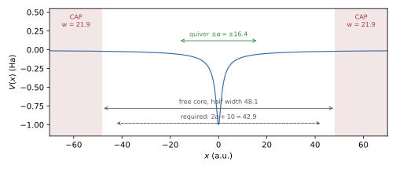

Simulating HHG Correctly
========================

High-harmonic spectra are the Fourier transform of a time signal that spans
many orders of magnitude, so small numerical defects (reflections, a field with
a DC component, an unresolved cutoff, drifting free electrons) appear as
spurious structure long before they affect norms or energies. This page lists
what to set and what to check, with a validated 1D example. The physical
picture is the three-step model [Corkum1993]_ [Lewenstein1994]_: ionisation,
acceleration in the field and recombination with the parent ion, with the
plateau cutoff [Krause1992]_

.. math::
   :label: eq-hhg-cutoff

   \hbar\omega_c \approx I_p + 3.17\,U_p ,\qquad
   U_p = \frac{E_0^2}{4\omega^2} ,\qquad
   \alpha = \frac{E_0}{\omega^2},

where :math:`U_p` is the ponderomotive energy and :math:`\alpha` the quiver
amplitude of a free electron. The quantum-mechanical treatment
[Lewenstein1994]_ refines the cutoff to :math:`1.32\,I_p + 3.17\,U_p`, which
the example below reproduces.

Worked Example
--------------

Files: ``examples/hhg/hhg_1d.inp`` and ``examples/hhg/hhg_spectrum.py``.

1D soft-core atom :math:`V=-1/\sqrt{x^2+1}` (:math:`I_p = 0.670` Ha), 800 nm
(:math:`\omega = 0.057`), :math:`10^{14}` W/cm² (:math:`E_0 = 0.0534`),
16-cycle flat-top pulse with 2-cycle sin² ramps. The field is
:math:`E = -dA/dt` of :math:`A(t) = (E_0/\omega) f(t)\sin\omega t`, with the
envelope :math:`f` and its derivative written out explicitly in ``LaserX``.
The deck (comments removed):

::

    Dimension            = 1
    Domain               = -70.0, 70.0
    SplineDegree         = 7
    NQuadratures         = 10
    KnotSequence         = uniform
    NSplines             = 560
    Charge               = -1.0
    Mass                 = 1.0
    Potential            = -1.0 / sqrt(x*x + 1.0)
    PotentialDerivativeX = x / (x*x + 1.0)^1.5
    TargetEigenvalue     = -0.8
    NBoundStates         = 4
    InitialState         = ground
    Variables            = E0=0.0534, w=0.057
    Variables            = Tr=220.4625, Tf=1543.2375, Tp=1763.7
    Polarization         = x
    LaserX               = -(E0/w)*( (t<Tr ? (pi/(2*Tr))*sin(pi*t/Tr) : t<Tf ? 0 : t<Tp ? -(pi/(2*Tr))*sin(pi*(t-Tf)/Tr) : 0)*sin(w*t) + w*(t<Tr ? sin(pi*t/(2*Tr))^2 : t<Tf ? 1 : t<Tp ? cos(pi*(t-Tf)/(2*Tr))^2 : 0)*cos(w*t) )
    EnablePropagation    = 1
    Propagator           = pade22
    TimeStep             = 0.05
    FinalTime            = 1763.7
    EnableCAP            = 1
    CAPKmin              = 0.3
    OutputStrideWFS      = 100000

Run from ``examples/hhg`` (``tdsez.x`` is built in ``build/``; see
:doc:`MPI-Notes` for ``--bind-to none``):

::

    mpiexec -n 1 --bind-to none ../../build/tdsez.x -inp hhg_1d.inp
    python hhg_spectrum.py td/TimeEvolutionData_hhg_1d.inp.h5 --omega 0.057 --plot hhg.png

:numref:`fig-hhg-box` shows the layout of the box: the CAP layers of width
:math:`6.555/0.3 = 21.9` a.u. leave a free core of half width 48.1 a.u., more
than the :math:`2\alpha + 10 = 42.9` a.u. checked at start-up.

   Box of ``examples/hhg/hhg_1d.inp``: soft-core potential, CAP layers at both
   walls, free core and the quiver amplitude :math:`\alpha = E_0/\omega^2` of
   :eq:`eq-hhg-cutoff`.

Measured result (15 s on one core): clean odd harmonics (even/odd peak ratio
:math:`10^{-4}`–:math:`10^{-3}`), plateau up to H27–H29 and a sharp cutoff at
:math:`1.32\,I_p + 3.17\,U_p = 1.58` Ha (H27.7); the three equivalent spectra
of :eq:`eq-hhg-spectrum` agree to a few per cent up to H39; final norm 0.992
(0.8 % ionised, no depletion).

The Spectrum
------------

The dipole table (``td/TimeEvolutionData_<input>.h5``, dataset ``dipoles``)
holds, per axis, the dipole :math:`D = q\langle x\rangle` and the dipole
acceleration :math:`A = q\,d\langle v\rangle/dt` (:doc:`Observables`); the
``currents`` table holds :math:`J = q\langle v\rangle`. The emitted spectrum is

.. math::
   :label: eq-hhg-spectrum

   S(\omega) = |\tilde A(\omega)|^2 = \omega^2|\tilde J(\omega)|^2
             = \omega^4|\tilde D(\omega)|^2 ,

and the three forms are identical for exact dynamics [Burnett1992]_.
``hhg_spectrum.py`` computes all three with a window over the whole record and
writes ``<stem>_hhg.dat`` with the columns harmonic order, :math:`S_A`,
:math:`S_J`, :math:`S_D`, where ``<stem>`` is the HDF5 file name without
``.h5``. Options:

.. list-table::
   :widths: 25 75
   :header-rows: 1

   * - Option
     - Effect
   * - ``--omega W``
     - Laser angular frequency in a.u. (required); sets the harmonic order
       :math:`\omega/W`.
   * - ``--axis x|y|z``
     - Emission axis (default ``x``); must exist in the run.
   * - ``--window hann|blackman|none``
     - Window applied before the transform (default ``hann``).
   * - ``--max-order N``
     - Highest harmonic order written (default 60).
   * - ``--plot FILE``
     - Write a log-scale plot of the three spectra (requires matplotlib).

The script stops if the time samples are not uniform. How to read the three
spectra:

- Use :math:`|\tilde A|^2` as the result. The acceleration is dominated by the
  recolliding electron near the core and is insensitive to the slowly drifting
  free part.
- :math:`\omega^2|\tilde J|^2` should agree with it across the plateau; a
  disagreement indicates an unconverged run.
- :math:`\omega^4|\tilde D|^2` amplifies any low-frequency error by
  :math:`\omega^4`. It agrees in a clean run (example above) but is the first to
  show reflections or free-electron drift; a dipole spectrum far above the
  acceleration spectrum is a diagnostic, not a result.

Checklist
---------

**Field**

- Give the field as :math:`E = -dA/dt` of a vector potential that vanishes at
  both ends (``LaserX`` is the electric field). Then
  :math:`\int E\,dt = 0`: no DC kick, no drift of the ionised electrons, no
  spurious low-order signal. A sin² envelope written directly on :math:`E` has
  a non-zero area for most phases.
- Short sin² pulses chirp the harmonics (the intensity changes every cycle), and
  the single-atom spectrum then shows broad, shifted and even-order-looking
  structure. This is physical, not numerical noise; use a flat-top pulse, as in
  the example, when clean harmonic lines are needed, for example for
  convergence tests.
- Set ``Polarization`` to the driven axes; the response on the other axes is
  recorded as well (``ObserveAllAxes = 1``, default), which gives the
  cross-polarised emission in 2D/3D.

**Box and absorber**

- The free core must hold the electron excursion: half width at least about
  :math:`2\alpha + 10` a.u. (:math:`\alpha` = 16.4 a.u. at 800 nm,
  :math:`10^{14}` W/cm²). The CAP report printed at start-up lists the free
  core of every axis and, on the driven axes, compares its half width with
  :math:`2\alpha + 10`; a shortfall is reported as
  ``WARNING: x free core half width ... < 2 alpha + 10``. :math:`E_0` and
  :math:`\omega` are estimated from the field expression for this check.
- ``EnableCAP = 1``. The CAP [Manolopoulos2002]_ removes the electrons that do
  not return; without it they reflect from the wall and recollide at wrong
  times. ``CAPKmin`` (default 0.1) is the slowest momentum absorbed with little
  reflection and sets the layer width per wall, :math:`w = 6.555/k_{\min}`;
  ``CAPWidth > 0`` sets :math:`w` directly instead. ``CAPKmin`` 0.2–0.3 a.u.
  (``CAPWidth`` 22–33 a.u.) is a good start; check that a wider layer (larger
  domain) does not change the spectrum.

**Resolution**

- Space: the fastest returning electron has
  :math:`k_{\max} = \sqrt{2(3.17U_p+I_p)}` (1.65 a.u. here, wavelength
  3.8 a.u.); use at least 8–10 basis functions per wavelength (element width
  0.25 a.u. with degree 7 in the example). At start-up the code compares the
  widest element of every axis with :math:`\pi/(2k_{\max})` and prints
  ``TDSEZ WARNING: x axis: widest element ... the returning electron and the
  harmonic cutoff are under-resolved there`` when it is wider; this check uses
  :math:`I_p = -E_{\rm target}`, with :math:`E_{\rm target}` =
  ``TargetEigenvalue`` (:math:`I_p = 0.5` if the target is not negative).
  Near a Coulomb-like core refine the knots (:doc:`Knot-Sequences`). With
  ``KnotSequence = hydrogenic`` the measured requirement is an outer width
  :math:`\le \pi/(2k_{\max})` along the field and twice that across it
  (``TransverseElementFactor``), applied automatically per axis when
  ``HydrogenicHMax = 0``, the default, and a field is present, and an innermost
  spacing ``HydrogenicR1`` :math:`\le` 0.05 a.u. on every axis. A smaller
  transverse box is possible as long as a free core of about :math:`\pm`
  15–20 a.u. remains inside the CAP layers.
- Time: resolve the cutoff, :math:`\omega_c\Delta t \ll 1`. Crank-Nicolson
  (``cn``) has a relative phase error :math:`(\omega\Delta t)^2/12` per step;
  the fourth-order propagators (``pade22``, ``magnus4``) allow
  :math:`\Delta t` = 0.05 at 800 nm (:doc:`Time-Propagation`).
- The time series are recorded at every step, so the Nyquist frequency is
  :math:`\pi/\Delta t`, far above any cutoff.

**Atom**

- Ground state from the eigensolver (``InitialState = ground``) with a
  ``TargetEigenvalue`` just below it.
- ``PotentialDerivativeX/Y/Z`` must be the exact gradient of ``Potential``:
  the operator form of the acceleration uses it (``AccelerationMethod = auto``,
  the default, selects the operator form for a constant mass). A wrong
  derivative gives a wrong :math:`\tilde A` while :math:`\tilde J` and
  :math:`\tilde D` remain correct; the three-way comparison of
  :eq:`eq-hhg-spectrum` detects it.
- ``Charge = -1`` for electrons. The dipole and acceleration columns carry the
  charge (:math:`D = q\langle x\rangle`); the spectra do not depend on its sign.
- Watch depletion: the final norm (``energies`` column 6) and the ground-state
  population. Above about 50 % ionisation the plateau is saturated and the
  spectrum depends strongly on the pulse shape. The softer potential
  :math:`-1/\sqrt{x^2+2}` (:math:`I_p = 0.5`) is ionised by 94 % under the same
  pulse (measured).

**Convergence**

Repeat with :math:`\Delta t/2`, a finer grid, a larger box and a smaller
``CAPKmin``; the harmonic peaks of :math:`|\tilde A|^2` should move by much
less than the feature being interpreted.

**Higher dimensions**

The same rules apply in 2D/3D. The cost is dominated by the number of
non-zeros per row, :math:`(2p+1)^d`: prefer degree 3–4 in 3D, use
``ObserveAllAxes = 0`` when only the driven axis is needed, and keep the box
just large enough for the free core; the CAP absorbs the rest.
