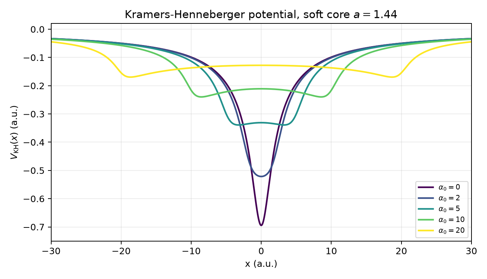
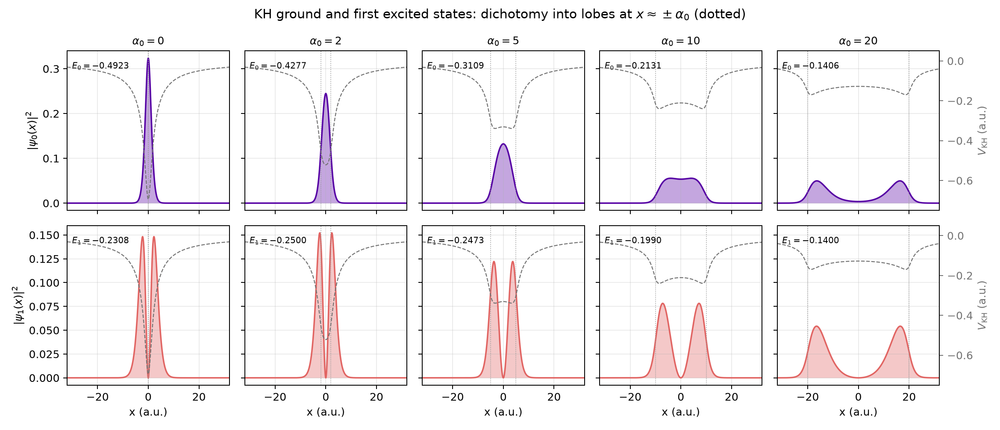
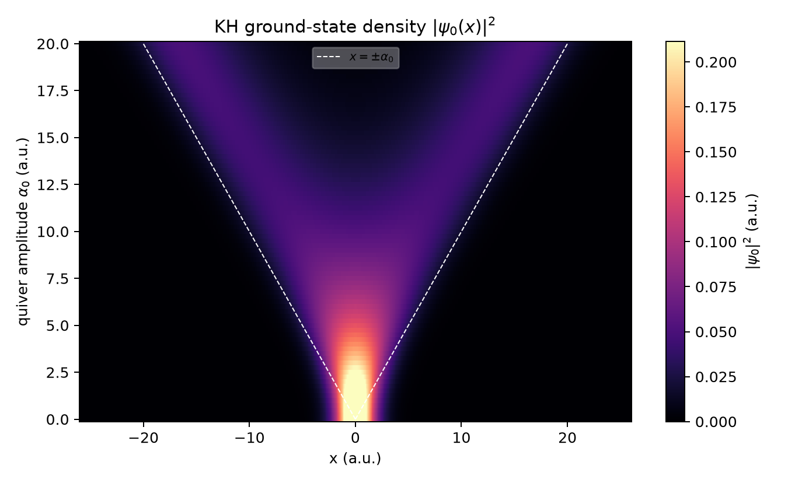
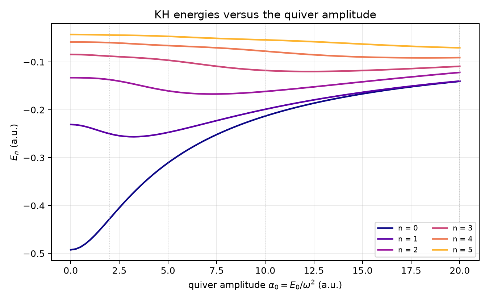

Kramers-Henneberger Frame
=========================

``Mode = kh`` solves the static Kramers-Henneberger (KH) problem: the
eigenstates of the potential averaged over the quiver motion of the carrier in
the laser field [Henneberger1968]_ [Gavrila2002]_. No time propagation is
run. ``Mode = td`` (default) is the usual laboratory-frame calculation.

Theory
------

A free carrier of charge :math:`q` and mass :math:`m` in the uniform field
:math:`\mathbf E(t)` oscillates along the quiver path

.. math::
   :label: eq-kh-quiver

   m\,\ddot{\boldsymbol\alpha}(t) = q\,\mathbf E(t) .

In the frame that follows this motion, :math:`\mathbf r \to \mathbf r +
\boldsymbol\alpha(t)`, the length-gauge Hamiltonian of
:eq:`eq-laser-field-coupling` becomes
:math:`p^2/2m + s\,V(\mathbf r + \boldsymbol\alpha(t))`: the field acts only
through the displaced potential. For high frequencies its cycle average,

.. math::
   :label: eq-kh-potential

   V_{\text{KH}}(\mathbf r) = \frac{1}{P}\int_{t_0}^{t_0 + P}
   V\big(\mathbf r + \boldsymbol\alpha(t)\big)\,dt ,
   \qquad P = 2\pi/\omega ,

is the leading term of the high-frequency Floquet theory; its eigenstates are
the dressed states of atomic stabilisation, with the characteristic
dichotomy of the dressed density for large quiver amplitudes
:math:`\alpha_0 = |q|E_0/m\omega^2`.

What TDSE-Z does
----------------

With ``Mode = kh`` the potential in every operator is replaced by
:math:`V_{\text{KH}}`; everything else is a normal stationary run
(``static/<name>_eigen.h5``, ``SaveDipoleAxes``, the post-processing tools of
:doc:`Post-Processing`, zkit). The quiver is computed from the laser
expressions ``LaserX/Y/Z`` (or ``Laser``) of the polarised axes:

1. **Window.** One optical cycle centred at the peak of
   :math:`|\mathbf E(t)|` in :math:`[0, \texttt{FinalTime}]`. The period is
   :math:`2\pi/\omega` with :math:`\omega` the largest ``Omegax/y/z`` of the
   polarised axes, otherwise it is measured from the first and the last zero
   crossing of the field (located to rounding by bisection).
   ``KHWindow = t0, t1`` sets the window directly.
2. **Quiver.** Integrating :eq:`eq-kh-quiver` twice over the window and
   removing the mean velocity (the drift) and the mean position leaves the
   pure quiver; for a monochromatic field
   :math:`\boldsymbol\alpha(t) = -(q\mathbf E_0/m\omega^2)\sin(\omega t +
   \varphi)`. With Cauchy's formula for the repeated integral,
   :math:`\boldsymbol\alpha` at every node needs only single integrals of
   :math:`\mathbf E`, evaluated by composite 8-point Gauss-Legendre
   quadrature (accurate to rounding).
3. **Average.** :eq:`eq-kh-potential` is evaluated at every quadrature point
   of the assembly by composite Gauss-Legendre quadrature over the window,
   which converges exponentially for a smooth quiver, periodic (CW) or not (a
   pulse envelope across the cycle). The number of nodes doubles from 16
   until :math:`V_{\text{KH}}` changes by less than :math:`10^{-12}` on a
   test lattice; ``KHSamples`` fixes it.

The log reports the window, the period, the quiver amplitude and rms per axis
and the number of nodes. ``run_metadata`` in ``static/<name>_eigen.h5``
records them (attributes ``Mode``, ``KH_window_start``, ``KH_window_end``,
``KH_omega``, ``KH_alpha_x/y/z``, ``KH_samples``) together with the quiver
itself: the datasets ``kh_times`` (:math:`t_k`), ``kh_weights``
(:math:`w_k`, summing to 1) and ``kh_alpha`` (:math:`N\times 3`,
:math:`\boldsymbol\alpha(t_k)`), so that
:math:`V_{\text{KH}}(\mathbf r) = \sum_k w_k V(\mathbf r + \boldsymbol\alpha(t_k))`
can be evaluated outside TDSE-Z:

.. code-block:: python

   import h5py, numpy as np
   with h5py.File("static/run_eigen.h5") as f:
       g = f["run_metadata"]
       t, w, alpha = g["kh_times"][:], g["kh_weights"][:], g["kh_alpha"][:]
   V = lambda x: -1 / np.sqrt(x * x + 1)                 # the Potential of the input
   V_kh = lambda x: sum(wk * V(x + ak[0]) for wk, ak in zip(w, alpha))

The period search samples :math:`[0, \texttt{FinalTime}]` with steps of at
most 0.005 a.u. (at least 40 000 points), so frequencies up to about
600 a.u. are resolved; a field that oscillates faster stops the run with a
request for ``Omegax/y/z`` or ``KHWindow``.

Input
-----

.. list-table::
   :widths: 20 12 12 56
   :header-rows: 1

   * - Key
     - Type
     - Default
     - Description
   * - ``Mode``
     - ``td`` | ``kh``
     - ``td``
     - ``kh``: static KH problem (no propagation, ``EnablePropagation`` is
       ignored).
   * - ``KHWindow``
     - ``t0, t1``
     - --
     - Averaging window (a.u.); default one cycle at the field peak.
   * - ``KHSamples``
     - int
     - 0
     - Gauss nodes per window (rounded up to a multiple of 8); 0 chooses
       them automatically.

The laser (``Polarization``, ``LaserX/Y/Z``, ``FinalTime`` covering the
pulse) is required; the mass must be constant (the quiver of a free carrier);
``FieldTerm`` is not supported. Linear, elliptical and circular polarisation in
1D, 2D and 3D are handled alike.

Example: a soft-core atom dressed by a strong high-frequency field, linear
along :math:`z`:

.. code-block:: text

   Mode         = kh
   Dimension    = 3
   Potential    = -1/sqrt(x*x + y*y + z*z + 1)
   Polarization = z
   Variables    = E0=5.0, w=1.0, T=62.83
   LaserZ       = E0*sin(pi*t/T)^2*sin(w*t)
   FinalTime    = 62.83
   NBoundStates = 6
   NBoundStatesSave = 1

Example: dichotomy of a 1D soft-core atom
-----------------------------------------

``examples/kh/kh_soft_core_1d.py`` scans the quiver amplitude of a CW field
:math:`E_0\sin t` (:math:`\omega = 1`, :math:`\alpha_0 = E_0`) from 0 to 20 in
steps of 0.25 for :math:`V(x) = -1/\sqrt{x^2 + a^2}`, :math:`a = 1.44`
(81 runs of ``Mode = kh``, 14 s on four cores):

.. code-block:: bash

   python examples/kh/kh_soft_core_1d.py --binary build/tdsez.x --out kh_out

As :math:`\alpha_0` grows, the averaged potential develops two minima near
:math:`x = \pm\alpha_0` (where the carrier spends most of each cycle) and
becomes shallower; the bound states follow it and split into two lobes
(dichotomy), and the ground and first excited states become a near-degenerate
pair (:math:`E_0 = -0.14058`, :math:`E_1 = -0.13998` at :math:`\alpha_0 = 20`).

   :math:`V_{\text{KH}}(x)` for :math:`\alpha_0 = 0, 2, 5, 10, 20`, evaluated
   from the quiver written by TDSE-Z (``kh_alpha``, ``kh_weights``).

   Ground and first excited KH states (shaded) with :math:`V_{\text{KH}}`
   (dashed, right axis); dotted lines mark :math:`x = \pm\alpha_0`.

   Ground-state density versus :math:`x` and :math:`\alpha_0`: one peak below
   :math:`\alpha_0 \approx 7`, two lobes that follow :math:`x \approx
   \pm\alpha_0` beyond.

   The six lowest KH energies versus :math:`\alpha_0`; the ground state rises
   from :math:`-0.492` (bare atom) and merges with the first excited state.

Validation
----------

``tests/test_kh.py`` compares ``Mode = kh`` with exact results.

**The quiver.** For a field that is a sum of sines,
:math:`E_a = \sum_j c_j \sin(k_j t + \varphi_j)` (a :math:`\sin^2` pulse is
:math:`\tfrac{E_0}{2}\sin\omega t - \tfrac{E_0}{4}[\sin(\omega+\Omega)t +
\sin(\omega-\Omega)t]`, :math:`\Omega = 2\pi/T`), the double integral is
:math:`-\sum_j c_j\sin(k_j t + \varphi_j)/k_j^2` plus a line fixed by the
removal of the mean velocity and position; ``kh_alpha`` is compared with it at
every node:

.. list-table:: Quiver against the closed form (largest relative error)
   :widths: 60 40
   :header-rows: 1

   * - Field
     - :math:`\boldsymbol\alpha(t_k)`
   * - CW, phase 0.4, :math:`m = 2` (1D)
     - :math:`4\times10^{-15}`
   * - circular (2D)
     - :math:`4\times10^{-15}`
   * - elliptical in :math:`xy` + second harmonic on :math:`z`, hole (3D)
     - :math:`1.4\times10^{-14}`
   * - :math:`\sin^2` pulse, automatic window
     - :math:`4\times10^{-15}`
   * - :math:`\sin^2` pulse, ``KHWindow`` not a whole cycle
     - :math:`4\times10^{-15}`
   * - CW :math:`\omega = 20`, ``FinalTime = 2000``
     - :math:`1.4\times10^{-12}` (rounding of :math:`\sin(\omega t)` at
       :math:`\omega t \approx 2\times10^4`)

The weights sum to 1, :math:`\langle\boldsymbol\alpha\rangle = 0`, axes
outside ``Polarization`` have :math:`\alpha = 0`, and the automatic window is
one period to :math:`10^{-12}`.

**The dressed levels.** For an
oscillator :math:`V = \tfrac12 m\omega_0^2 r^2`,
:math:`V_{\text{KH}} = V + \tfrac12 m\omega_0^2\langle|\boldsymbol\alpha|^2\rangle`,
so every level shifts by :math:`\tfrac14 m\omega_0^2\alpha_0^2` for a linear
field and :math:`\tfrac12 m\omega_0^2\alpha_0^2` for a circular one (constant
:math:`|\boldsymbol\alpha|`). The shift is checked against a ``Mode = td``
run on the same grid (the discretisation cancels, so this tests the quiver),
and the levels against :math:`\sum_a \omega_a(n_a + \tfrac12)` + shift. A
Gaussian well in a :math:`\sin^2` pulse (window, period and quiver found
automatically) is compared with an independent reference: the quiver
integrated with SciPy and :math:`V_{\text{KH}}` diagonalised by fourth-order
finite differences.

.. list-table:: Relative errors
   :widths: 40 30 30
   :header-rows: 1

   * - Case
     - Shift vs ``Mode = td``
     - Levels vs exact / reference
   * - 1D oscillator, :math:`m = 2`, linear
     - :math:`7\times10^{-12}`
     - :math:`3\times10^{-11}`
   * - 2D oscillator, circular
     - :math:`1\times10^{-13}`
     - :math:`2\times10^{-8}`
   * - 3D anisotropic oscillator, linear along :math:`z`
     - :math:`6\times10^{-12}`
     - :math:`2\times10^{-3}` (coarse test grid)
   * - 1D Gaussian well, :math:`\sin^2` pulse
     - --
     - :math:`1.5\times10^{-7}` (finite-difference reference)
