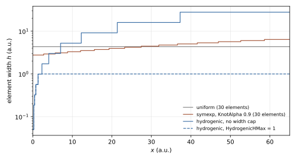
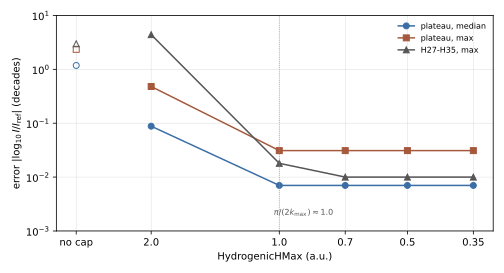

Knot Sequences
==============

The knot sequence of an axis fixes the element boundaries of the B-spline
basis (:doc:`Grid-Domain`) and therefore where the grid is fine and where it is
coarse. TDSE-Z provides uniform, graded, interface-aligned and hydrogenic
sequences. This page defines them, describes the field-resolution check that
applies to every sequence, and reports convergence studies for Coulomb
potentials and high-harmonic generation (HHG).

Selection
---------

``KnotSequence`` takes one name for all axes or a comma-separated list, one
name per axis (case-insensitive)::

    KnotSequence = symexp                 # every axis
    KnotSequence = hydrogenic, uniform    # x hydrogenic, y uniform, z uniform (default)
    KnotSequence = symexp, uniform, symtanu

A single name applies to every axis; with two names the z axis keeps the
default ``uniform``. Valid names are ``uniform``, ``symexp``, ``symtanu``,
``symtann``, ``symlogtan``, ``hydrogenic`` and ``interface`` (alias
``interfaces``); any other name stops the run during input validation. The
knot vectors are generated on rank 0 and broadcast; the environment variable
``TDSEZ_DUMP_KNOTS`` prints the interior knots of a non-uniform x axis.

.. list-table::
   :widths: 18 52 30
   :header-rows: 1

   * - Sequence
     - Knot placement
     - Tuning keys
   * - ``uniform``
     - Equal elements on :math:`[L_{\min}, L_{\max}]`.
     - --
   * - ``symexp``
     - Exponential map :eq:`eq-knot-sequences-symexp`: dense at the origin,
       coarse at the walls.
     - ``KnotAlpha`` (default 0.9)
   * - ``symtanu``
     - Inverse-tanh map :eq:`eq-knot-sequences-symtanu`: dense at the centre
       of the box, coarse at the walls.
     - ``KnotAlpha`` (default 0.9)
   * - ``symtann``
     - tanh map :eq:`eq-knot-sequences-symtann`: dense at the walls, coarse at
       the centre of the box.
     - ``KnotAlpha`` (default 0.9)
   * - ``symlogtan``
     - Tangent map :eq:`eq-knot-sequences-symlogtan`: mildly dense at the
       origin.
     - ``KnotAlpha`` (default 0.5)
   * - ``hydrogenic``
     - Linear near the origin, exponential outside, optionally capped
       (:eq:`eq-knot-sequences-hyd-lin` to :eq:`eq-knot-sequences-hyd-cap`).
     - ``HydrogenicNLin``, ``HydrogenicR1``, ``HydrogenicNExp``,
       ``HydrogenicHMax``
   * - ``interface``
     - Uniform within each material layer, :math:`C^0` knots at the layer
       boundaries.
     - Breakpoints of ``Potential`` and ``Mass``

``KnotAlpha`` (aliases ``KnotGrading``, ``GradingStrength``) applies to all
graded axes; a value :math:`\le 0` selects the defaults listed above. The
hydrogenic keys are per-axis lists (:doc:`Input-File`).

Graded sequences
----------------

``symexp``, ``symtanu``, ``symtann`` and ``symlogtan`` place
:math:`n = N_{\mathrm{el}} - 1` interior knots (``Nelements - 1``) at the
images of the uniform parameters

.. math::
   :label: eq-knot-sequences-t

   t_i = \frac{2i}{n+1} - 1, \qquad i = 1, \dots, n,

under a map of :math:`(-1, 1)` onto the axis, with :math:`\alpha` =
``KnotAlpha``:

.. math::
   :label: eq-knot-sequences-symexp

   x_i = L_\pm\,\frac{e^{\alpha |t_i|} - 1}{e^{\alpha} - 1},
   \qquad L_+ = L_{\max}\ (t_i \ge 0),\quad L_- = L_{\min}\ (t_i < 0),

.. math::
   :label: eq-knot-sequences-symtanu

   x_i = L_{\min} + (L_{\max} - L_{\min})\,
   \tfrac12\left[1 + \frac{\operatorname{artanh}(t_i \tanh\alpha)}{\alpha}\right],

.. math::
   :label: eq-knot-sequences-symtann

   x_i = L_{\min} + (L_{\max} - L_{\min})\,
   \tfrac12\left[1 + \frac{\tanh(\alpha t_i)}{\tanh\alpha}\right],

.. math::
   :label: eq-knot-sequences-symlogtan

   x_i = L_{\max}\,\frac{\tan(\alpha' t_i)}{\tan\alpha'},
   \qquad \alpha' = 1.57\,\frac{\alpha}{\alpha + 1}.

``symexp`` grades towards :math:`x = 0` and scales each side to its own wall,
so it also serves boxes that are asymmetric about the origin. ``symtanu`` and
``symtann`` are symmetric about the box centre. ``symlogtan`` uses
:math:`L_{\max}` for both sides and assumes :math:`L_{\min} = -L_{\max}`.

A knot lies at :math:`t = 0` (the origin, or the box centre) only when
:math:`n` is odd, i.e. when ``Nelements`` is even; otherwise a warning is
printed. A Coulomb centre should sit on a knot (see the quadrature study under `Coulomb potential: 3D hydrogen`_).

Hydrogenic sequence
-------------------

The ``hydrogenic`` sequence is built on the half axis :math:`[0, L]` with
:math:`L = L_{\max}` and mirrored about the origin; the axis is
:math:`[-L_{\max}, L_{\max}]` and ``LMin`` is not used. With
:math:`N_{\mathrm{lin}}` = ``HydrogenicNLin`` (0 selects ``Nelements - 1``),
:math:`R_1` = ``HydrogenicR1`` (0 selects 0.1 a.u.) and
:math:`N_{\exp}` = ``HydrogenicNExp`` (0 selects 10), the half-axis knots are

.. math::
   :label: eq-knot-sequences-hyd-lin

   r_i = i R_1, \qquad i = 0, \dots, N_{\mathrm{lin}},

followed by the exponentially graded knots

.. math::
   :label: eq-knot-sequences-hyd-exp

   r_{\mathrm{c}}\left(\frac{L}{r_{\mathrm{c}}}\right)^{k/N_{\exp}},
   \qquad k = 1, \dots, N_{\exp} - 1, \qquad r_{\mathrm{c}} = N_{\mathrm{lin}} R_1 ,

so that each half axis carries :math:`N_{\mathrm{lin}}` linear and
:math:`N_{\exp}` exponential elements and the axis has
:math:`2(N_{\mathrm{lin}} + N_{\exp})` elements; ``Nelements`` only enters
through the default of ``HydrogenicNLin``. :math:`r_{\mathrm{c}} < L` is
required; otherwise the run stops with a message. The outermost element has
the width :math:`L\,[1 - (r_{\mathrm{c}}/L)^{1/N_{\exp}}]`.

``HydrogenicHMax`` (alias ``HydrogenicMaxSpacing``) caps the element width at
:math:`h_{\max}`: from the first element :math:`[r_j, r_{j+1}]` wider than
:math:`h_{\max}`, the rest of the half axis is replaced by

.. math::
   :label: eq-knot-sequences-hyd-cap

   \nu = \left\lceil \frac{L - r_j}{h_{\max}} \right\rceil

uniform elements. A positive value sets :math:`h_{\max}`; a negative value
disables the cap; 0 (default) derives :math:`h_{\max} = \pi/(2k_{\max})` from
the field (:eq:`eq-knot-sequences-hmax`) when ``EnablePropagation = 1`` and the
field is non-zero, and applies no cap otherwise. The start-up line
``TDSEZHydrogenicKnots`` reports the element count, :math:`R_1`, the largest
width (marked "capped" when the cap is active) and :math:`r_{\mathrm{c}}`.

:numref:`fig-knot-sequences-elements` compares the element widths of the
sequences on the x axis of the HHG study below.

   Element width against position on the half axis :math:`[0, 65]` a.u.:
   ``uniform`` and ``symexp`` (``KnotAlpha`` 0.9) with 30 elements, and
   ``hydrogenic`` (:math:`R_1 = 0.05`, :math:`N_{\mathrm{lin}} = 5`,
   :math:`N_{\exp} = 10`) without width cap and with
   ``HydrogenicHMax = 1``. Computed with the generator formulas of
   ``src/core_knots.cpp`` (script ``figures/make_Knot-Sequences-elements.py``).

Interface-aligned sequence
--------------------------

``interface`` places knots at the material interfaces of heterostructures
described by piecewise expressions. The breakpoints are read from comparisons
of the form ``x < c``, ``x <= c``, ``x > c``, ``x >= c`` (breakpoint
:math:`c`) and ``abs(x) < c`` or ``fabs(x) < c`` (breakpoints :math:`\pm c`)
in ``Potential`` and ``Mass``, with :math:`c` a numeric literal; comparisons on
other operands are ignored. Breakpoints are taken from comparisons on ``x``
only, and the same positions are used on every axis that selects
``interface``.

The ``Nelements`` elements are distributed over the layers between the
breakpoints in proportion to the layer width (at least one per layer) and are
uniform within each layer. Every interior breakpoint is a knot of multiplicity
:math:`p`, so the basis is :math:`C^0` there and can represent the kink of the
BenDaniel-Duke wave function at an abrupt interface [BenDanielDuke1966]_
(continuous :math:`\psi` and :math:`m^{-1}\psi'`, discontinuous
:math:`\psi'`). Each interface adds :math:`p - 1` basis functions. Without
breakpoints the sequence is uniform and a message is printed.

Field-resolution check
----------------------

When ``EnablePropagation = 1`` and the field is non-zero, TDSE-Z estimates
the field scales once from the input and compares them with the mesh of every
axis, for every knot sequence:

- :math:`E_0`: the largest :math:`|E_a(t)|` over the polarised axes, sampled
  at 20 001 points on :math:`[0, T]`, :math:`T` = ``FinalTime``;
- :math:`\omega`: the largest ``Omegax/y/z`` of the polarised axes; if all are
  zero, it is estimated from the zero crossings of the dominant field
  component (at least three crossings required);
- :math:`I_p`: :math:`-` ``TargetEigenvalue`` if negative, otherwise 0.5.

The highest return momentum follows from the classical cutoff law
[Krause1992]_ [Corkum1993]_,

.. math::
   :label: eq-knot-sequences-kmax

   U_p = \frac{E_0^2}{4\omega^2}, \qquad
   k_{\max} = \sqrt{2\,(3.17\,U_p + I_p)},

and the required element width is about four elements per de Broglie
wavelength of the fastest returning electron,

.. math::
   :label: eq-knot-sequences-hmax

   h \le \frac{\pi}{2k_{\max}} .

The start-up output prints :math:`E_0`, :math:`\omega`, :math:`U_p`,
:math:`I_p`, :math:`k_{\max}` and this width, and for each axis either the
widest element ("resolved") or a warning with the axis, the widest element and
its position. The grid is not modified; only ``hydrogenic`` with
``HydrogenicHMax = 0`` uses the width as its cap. :math:`E_0` and the
zero-crossing estimate of :math:`\omega` are taken from
:math:`[0, \mathrm{FinalTime}]`: a test run with a shortened ``FinalTime``
sees only the beginning of the pulse and may obtain a different width. The
zero-crossing estimate is accurate to a few per cent for short ramped pulses;
the criterion :eq:`eq-knot-sequences-hmax` has a margin of about a factor of
two (see `High-harmonic generation`_).

Convergence studies
-------------------

The following results were measured with TDSE-Z and serve as guidance for
choosing grids.

Coulomb potential: 3D hydrogen
~~~~~~~~~~~~~~~~~~~~~~~~~~~~~~

Setup: :math:`V = -1/r`, degree 3, 8 Gauss points, ``hydrogenic`` with
:math:`R_1 = 0.05`, :math:`N_{\mathrm{lin}} = 5`, :math:`N_{\exp} = 10`
(35 937 DOFs on :math:`\pm 10`); exact ground-state energy :math:`-0.5`.

**Box size and boundary condition.** The box size dominates the error. With
Neumann boundaries (:doc:`Boundary-Conditions`) the wave function is not
forced to zero at the wall, and the ground-state energy falls *below* the exact
value when the box truncates the tail of the state, because the truncated tail
carries positive local energy. Beyond 5 a.u. the 1s state holds 0.3 % of the
probability.

.. list-table:: Ground-state energy of 3D hydrogen against box size
   :widths: 20 40 40
   :header-rows: 1

   * - Box (a.u.)
     - Neumann (default)
     - Dirichlet
   * - :math:`\pm 5`
     - -0.501454
     - -0.498718
   * - :math:`\pm 10`
     - -0.4999968
     - -0.4999966
   * - :math:`\pm 15`
     - -0.4999935
     - -0.4999935

Recommended box half widths are 10 a.u. for the ground state, 20 a.u. for
:math:`n = 2` (on :math:`\pm 10` the :math:`n = 2` energies are
3–6·10\ :sup:`-3` too low) and about 35 a.u. for :math:`n = 3`. On
:math:`\pm 20` with :math:`N_{\exp} = 15` (79 507 DOFs) the 1s level and the
four :math:`n = 2` states agree with the exact energies to 2·10\ :sup:`-6`.

**Grading.** Refining the inner region (5 elements of 0.05 a.u.) changes the
ground-state energy by less than 10\ :sup:`-6`; the accuracy is limited by the
outer, exponentially graded elements (13 instead of 10 exponential elements:
error 3.2·10\ :sup:`-6` → 7.8·10\ :sup:`-7`). Smaller inner elements at a fixed
element count increase the error (:math:`R_1` = 0.01–0.02:
8–18·10\ :sup:`-6`) because the outer elements become coarser. The outermost
exponential element is 3.1 a.u. wide on :math:`\pm 10` and 5 a.u. on
:math:`\pm 20`, which is too coarse for ionised or excited electrons during
propagation. ``HydrogenicHMax`` limits this width without changing the bound
states noticeably (:math:`\pm 10`, ``HydrogenicHMax = 1``: 68 921 DOFs,
:math:`E_0 = -0.49999866`).

**Quadrature.** The nucleus lies on a knot, where no Gauss-Legendre point
falls. On the 8 elements that touch it, the 8-point rule integrates the
:math:`1/r` singularity with a relative error of 1.6·10\ :sup:`-4`; the
ground-state energy changes by 7·10\ :sup:`-7` from 8 to 10 points. Fewer
points under-integrate the singularity and overestimate the attraction, which
can cancel the discretisation error by accident (4 points: -0.500009, below the
exact value; 6 points: -0.4999990). Convergence must therefore be judged in the
number of points, not by the distance to -0.5. ``QuadratureRule = reduced``
behaves like a Gauss rule with fewer points (-0.4999976 with 8 points);
``lobatto`` places points on the knots, where :math:`1/r` is infinite, and the
run stops after assembly with a message. The assembly takes 0.24–0.39 s for 4
to 10 points; the eigensolve time does not depend on the rule.

**Basis.** At equal size (50 653 DOFs) the smooth B-splines are about 100 times
more accurate than the :math:`C^0` element bases, which span the same space as
each other and differ only in conditioning (:doc:`Grid-Domain`):

.. list-table:: Ground-state error of 3D hydrogen for the four bases
   :widths: 30 25 25
   :header-rows: 1

   * - ``Basis``
     - Error of :math:`E_0`
     - Eigensolve time
   * - ``bspline``
     - 1.1·10\ :sup:`-6`
     - 13.3 s
   * - ``bernstein``
     - 1.3·10\ :sup:`-4`
     - 6.9 s
   * - ``lagrange``
     - 1.3·10\ :sup:`-4`
     - 14.3 s
   * - ``spectral``
     - 1.3·10\ :sup:`-4`
     - 16.8 s

High-harmonic generation
~~~~~~~~~~~~~~~~~~~~~~~~

HHG requires resolution at both ends of the grid: far out, where the returning
electron travels, and at the nucleus, where it recombines
[Corkum1993]_ [Lewenstein1994]_.

Setup: 2D hydrogen-like atom (:math:`V = -0.5/r`, :math:`I_p = 0.5`), 800 nm,
:math:`10^{14}` W/cm², flat-top pulse, box :math:`[-65,65]\times[-40,40]` with
CAP, degree 3, ``Propagator = pade22``. The error measure is the deviation of
the integrated odd-harmonic yields of :math:`|\tilde A|^2` from a reference
grid (:math:`R_1 = 0.02`, ``HydrogenicHMax = 0.25``, 179k DOFs), in decades,
:math:`|\log_{10} I/I_{\mathrm{ref}}|`. The harmonic cutoff lies at H24.

.. list-table:: Harmonic-yield error against the hydrogenic grid
   :widths: 34 12 14 14 14
   :header-rows: 1

   * - Grid (:math:`R_1 = 0.05`, :math:`N_{\mathrm{lin}} = 5`,
       :math:`N_{\exp} = 10` unless stated)
     - DOFs
     - Plateau median
     - Plateau max
     - H27–H35 max
   * - no cap (elements up to 28 a.u.)
     - 1 089
     - 1.18
     - 2.35
     - 2.98
   * - ``HydrogenicHMax = 2.0``
     - 5 185
     - 0.088
     - 0.48
     - 4.4
   * - ``HydrogenicHMax = 1.0``
     - 14 553
     - 0.007
     - 0.031
     - 0.018
   * - ``HydrogenicHMax`` = 0.7, 0.5, 0.35
     - 26k–94k
     - 0.007
     - 0.031
     - 0.010
   * - ``HydrogenicHMax = 0.5``, :math:`R_1 = 0.1`, :math:`N_{\mathrm{lin}} = 3`
     - 46 341
     - 0.023
     - 0.097
     - 0.030
   * - ``HydrogenicHMax = 0.5``, :math:`R_1 = 0.2`, :math:`N_{\mathrm{lin}} = 2`
     - 44 589
     - 0.066
     - 0.27
     - 0.082

The last two rows keep the linear region :math:`N_{\mathrm{lin}} R_1`
(0.3 and 0.4 a.u.) comparable to the other rows while coarsening the
innermost elements.

   Harmonic-yield error against ``HydrogenicHMax`` for :math:`R_1 = 0.05`
   (values of the table above; open symbols: no cap). The dotted line marks
   the width :math:`\pi/(2k_{\max}) \approx 1.0` a.u. of
   :eq:`eq-knot-sequences-hmax`.

:numref:`fig-knot-sequences-hhg` shows that the outer element width converges
at about four elements per wavelength of the fastest returning electron,
:eq:`eq-knot-sequences-hmax` with :math:`k_{\max}` from
:eq:`eq-knot-sequences-kmax` (:math:`\pi/(2k_{\max}) \approx 1.0` a.u. here);
twice this width (2.0 a.u., about :math:`\pi/k_{\max}`) fails. The remaining
error of 1.6 % (0.007 decades) is set by the element size at the nucleus,
whose contribution grows approximately as :math:`R_1^{1.5}`; keep
:math:`R_1 \le 0.05` a.u. The acceleration and current spectra agree with each
other to 0.001–0.005 decades in every run, so their agreement does not reveal
an under-resolved grid; only refinement does.

With ``HydrogenicHMax = 0`` the automatic width
(`Field-resolution check`_) is 0.976 a.u. for this run and yields the
converged spectrum (plateau median 0.007, maximum 0.031 decades). For runs
with a shortened ``FinalTime`` set ``HydrogenicHMax`` explicitly, since the
automatic value is derived from the part of the pulse inside
:math:`[0, \mathrm{FinalTime}]`.
