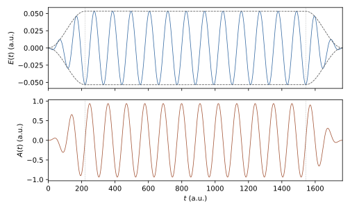

Laser Field
===========

The driving field is a classical, spatially uniform electric field
:math:`\mathbf E(t)` given as one muParser expression of the time ``t`` per
axis. It couples to the carrier in the length gauge, the only gauge
implemented:

.. math::
   :label: eq-laser-field-coupling

   H(t) = H_0 + s\,\mathbf E(t)\cdot\mathbf r
        = H_0 + s \sum_{a\in P} E_a(t)\,x_a ,
   \qquad s = -q ,

where :math:`H_0` is the field-free Hamiltonian
(:eq:`eq-potential-mass-hamiltonian`), :math:`q` the ``Charge`` and
:math:`P` the set of polarised axes. In the discrete equations
:math:`x_a` is the dipole matrix :math:`(D_a)_{ij} = \int B_i\,x_a\,B_j\,d\mathbf r`
(:doc:`Physics-Conventions`). For an electron (:math:`q = -1`,
:math:`s = 1`) the expression enters as written and the force on the carrier
is :math:`-\mathbf E(t)`.

``Multipole = 2, 3`` adds the nondipole terms of a plane wave, up to the
electric octupole (:ref:`multipole-coupling`).
``Gauge = velocity`` uses :math:`(\mathbf p - q\mathbf A)^2/2m` instead
(:ref:`velocity-gauge`).

Polarization
------------

.. list-table::
   :widths: 40 15 10 35
   :header-rows: 1

   * - Key
     - Type
     - Default
     - Description
   * - Polarization / LaserPolarization / DriverPolarization
     - string
     - empty
     - Axes coupled to the field: ``x``, ``y``, ``z``, ``xy``, ``xz``,
       ``yz``, ``xyz`` (``all`` is a synonym of ``xyz``), or ``none``.
       Case-insensitive.

Each listed axis must exist in the problem (``Polarization = xy`` needs
``Dimension >= 2``). Propagation (``EnablePropagation = 1``) needs at least one
polarised axis or a ``FieldTerm`` (:ref:`structured-fields`); a field-free
propagation is written as, for example, ``Polarization = x`` with
``LaserX = 0``.

Only the polarised axes are coupled to the field. The response (dipole,
current, acceleration) is recorded on every spatial axis by default;
``ObserveAllAxes = 0`` restricts it to the polarised axes (:doc:`Observables`).

Field Expressions
-----------------

.. list-table::
   :widths: 30 15 10 45
   :header-rows: 1

   * - Key
     - Type
     - Default
     - Description
   * - LaserX / LaserY / LaserZ (aliases DriverX / DriverY / DriverZ)
     - muParser in ``t``
     - empty
     - Field component :math:`E_a(t)` in atomic units on a polarised axis.
   * - Laser (alias Driver)
     - muParser in ``t``
     - empty
     - Field used for every polarised axis that has no ``LaserX/Y/Z`` of its
       own; with ``Polarization = xy`` it drives x and y with the same field.

The field is the expression exactly as given; no envelope, amplitude or phase
is applied on top of it, so the pulse shape is written inside the expression.
With ``EnablePropagation = 1`` every polarised axis must have a field (its own
or ``Laser``); the input is rejected otherwise. On axes that are not
polarised the field is zero, whatever expression is set. The constants
``pi``, the ``Variables`` and the input parameters listed in
:doc:`Potential-Mass` are available in the expressions.

Simple :math:`\sin^2` pulse of four cycles at 800 nm::

    Polarization = x
    Ampx   = 0.0534
    Omegax = 0.057
    LaserX = Ampx*sin(Omegax*t/8)^2*cos(Omegax*t + CEPx)

Field from a vector potential
-----------------------------

A field defined directly by an envelope times a carrier has in general a
nonzero time integral, so the carrier keeps a drift momentum after the pulse.
Writing the field as the derivative of a vector potential that vanishes at
both ends of the pulse avoids this:

.. math::
   :label: eq-laser-field-vector-potential

   A(t) = \frac{E_0}{\omega}\,f(t)\,\sin(\omega t), \qquad
   E(t) = -\frac{dA}{dt}
        = -\frac{E_0}{\omega}\left[f'(t)\,\sin(\omega t)
          + \omega\,f(t)\,\cos(\omega t)\right],

so that :math:`\int E\,dt = A(0) - A(T_p) = 0`. The example
``examples/hhg/hhg_1d.inp`` uses a flat-top envelope with :math:`\sin^2` ramps
of duration :math:`T_r`,

.. math::
   :label: eq-laser-field-envelope

   f(t) = \begin{cases}
     \sin^2\!\left(\dfrac{\pi t}{2T_r}\right), & 0 \le t < T_r,\\[4pt]
     1, & T_r \le t < T_f,\\[4pt]
     \cos^2\!\left(\dfrac{\pi (t-T_f)}{2T_r}\right), & T_f \le t < T_p,\\[4pt]
     0, & t \ge T_p ,
   \end{cases}

with :math:`f'(t)` written out explicitly in the field expression:

::

    Variables    = E0=0.0534, w=0.057
    Variables    = Tr=220.4625, Tf=1543.2375, Tp=1763.7
    Polarization = x
    LaserX = -(E0/w)*( (t<Tr ? (pi/(2*Tr))*sin(pi*t/Tr) : t<Tf ? 0 : t<Tp ? -(pi/(2*Tr))*sin(pi*(t-Tf)/Tr) : 0)*sin(w*t) + w*(t<Tr ? sin(pi*t/(2*Tr))^2 : t<Tf ? 1 : t<Tp ? cos(pi*(t-Tf)/(2*Tr))^2 : 0)*cos(w*t) )

:numref:`fig-laser-field-pulse` shows the resulting :math:`E(t)` and
:math:`A(t)`.

   Field :math:`E(t)` (top, dashed: :math:`\pm E_0 f(t)`) and vector potential
   :math:`A(t)` (bottom) of :eq:`eq-laser-field-vector-potential` and
   :eq:`eq-laser-field-envelope` for the parameters of
   ``examples/hhg/hhg_1d.inp`` (800 nm, :math:`E_0 = 0.0534` a.u., 2-cycle
   ramps, 12 flat cycles). Dotted lines mark :math:`T_r` and :math:`T_f`.

Named Field Parameters
----------------------

The keys below define named constants for the field expressions. Apart from
the use of ``Omegax/y/z`` described in the next section, they have no effect
unless an expression refers to them.

.. list-table::
   :widths: 35 15 15 35
   :header-rows: 1

   * - Key
     - Type
     - Default
     - Meaning (by convention)
   * - Ampx/y/z, Omegax/y/z, CEPx/y/z
     - real
     - ``0.0``
     - Per-axis amplitude, angular frequency and carrier-envelope phase.
   * - LaserAmplitude / DriverAmplitude
     - list
     - --
     - Comma-separated values for ``Ampx, Ampy, Ampz``.
   * - LaserFrequency / DriverFrequency
     - list
     - --
     - Comma-separated values for ``Omegax, Omegay, Omegaz``.
   * - CarrierEnvelopePhase / DriverCEP
     - list
     - --
     - Comma-separated values for ``CEPx, CEPy, CEPz``.

In the list forms a single value is used for all three axes, and missing
entries take the first value. Further constants (pulse duration, centre,
ramp times) are defined with ``Variables``, as in the example above.

.. _structured-fields:

Structured Fields
-----------------

A field that varies in space as well as in time is given as a sum of
separable terms, one ``FieldTerm`` line each (the lines accumulate):

.. code-block:: text

   FieldTerm = w(x, y, z) ; f(t)

Each term adds :math:`s\,f_k(t)\,w_k(\mathbf r)` to the Hamiltonian,

.. math::
   :label: eq-structured-field

   H(t) = H_0 + s\,\mathbf E(t)\cdot\mathbf r
        + s \sum_k f_k(t)\,w_k(\mathbf r),
   \qquad
   \mathbf E_{\text{local}}(\mathbf r, t) = \mathbf E(t)
        + \sum_k f_k(t)\,\nabla w_k(\mathbf r),

the length-gauge coupling to a quasi-static (curl-free) field with scalar
potential :math:`-\sum_k f_k w_k`. ``FieldTerm = z ; Ez(t)`` is exactly the
uniform field ``Polarization = z``, ``LaserZ = Ez(t)``. Plasmonic and
nanotip near fields, field gradients (``FieldTerm = x^2 ; f(t)``) and
localised gate pulses in heterostructures are written this way. The profile
may use ``x``, ``y`` and ``z`` (only the axes of the problem), the time
factor only ``t``; both may use every input constant and ``Variables``.
Structured terms combine with ``LaserX/Y/Z``, and ``Polarization`` may then
be ``none``.

.. code-block:: text

   # dipole pulse plus a Gaussian near field of the same carrier, decaying radially
   Variables    = E0=0.05, w=0.057, T=331, s0=8
   Polarization = z
   LaserZ       = E0*sin(pi*t/T)^2*sin(w*t)
   FieldTerm    = 2*z*exp(-(x*x+y*y+z*z)/(s0*s0)) ; E0*sin(pi*t/T)^2*sin(w*t)

**Cost.** Each term is one matrix :math:`(G_k)_{ij} = \int B_i\,w_k\,B_j\,d\mathbf r`
with the sparsity of :math:`H`, assembled once with the dipoles (sum
factorised in 2D and 3D, up to 12 terms per element pass). In every step it
enters the stage matrices in the same single pass over the stored values as
the dipoles: one multiply-add per stored entry and term, small next to the
linear solve. The monitors use one product :math:`G_k\psi` per term, shared
by the interaction energy and the acceleration. On a 2D atom (27 225 DOFs,
``pade22``) one extra term costs 11 % per step.

**Observables.** The interaction energy includes
:math:`s\sum_k f_k(t)\langle w_k\rangle`. The dipole acceleration is taken
from the discrete equation of motion (``AccelerationMethod = auto`` selects it;
``operator`` is rejected, since it would need :math:`\nabla w_k`), which
includes the terms exactly (:doc:`Observables`). The field columns of the
time series hold :math:`\mathbf E(t)` (``LaserX/Y/Z``) only.

**Photoelectron spectra.** The Volkov states of t-SURFF assume that outside
the surface only the uniform field acts. With ``TSurff = 1`` every
:math:`\nabla w_k` is therefore sampled outside the surface at start-up and
must be below :math:`10^{-6}` of its maximum, and with ``SurffEndTerm = 1``
every :math:`f_k` must vanish after ``FinalTime``.

.. _multipole-coupling:

Nondipole Coupling (Multipole)
------------------------------

``Multipole = 2`` or ``3`` replaces the uniform field by a plane wave
travelling along the unit vector :math:`\mathbf n` (``PropagationDirection``),

.. math::

   \mathbf E(\mathbf r, t) = \mathbf E(t - \mathbf n\cdot\mathbf r/c), \qquad
   \mathbf B = \mathbf n\times\mathbf E / c ,

and expands it about the origin in powers of :math:`1/c`, in the multipolar
(Power-Zienau-Woolley) gauge. With the charge :math:`q`, the mass :math:`m`,
:math:`\mathbf C(t) = \mathbf n\times\mathbf E(t)` and
:math:`\mathbf L = -i\,\mathbf r\times\nabla`, the terms added to
:eq:`eq-laser-field-coupling` are

.. list-table::
   :header-rows: 1
   :widths: 14 30 56

   * - order
     - term
     - operator
   * - :math:`1/c`
     - electric quadrupole
     - :math:`+\frac{q}{2c}\,(\mathbf n\cdot\mathbf r)\,(\mathbf r\cdot\dot{\mathbf E})`
   * -
     - magnetic dipole
     - :math:`-\frac{q}{2mc}\,\mathbf L\cdot\mathbf C`
   * - :math:`1/c^2`
     - electric octupole
     - :math:`-\frac{q}{6c^2}\,(\mathbf n\cdot\mathbf r)^2\,(\mathbf r\cdot\ddot{\mathbf E})`
   * -
     - magnetic quadrupole
     - :math:`+\frac{q}{3mc^2}\,\tfrac12\{\mathbf n\cdot\mathbf r,\ \mathbf L\}\cdot\dot{\mathbf C}`
   * -
     - diamagnetic
     - :math:`+\frac{q^2}{8mc^2}\,|\mathbf C\times\mathbf r|^2`

``Multipole = 2`` keeps the :math:`1/c` terms (the leading nondipole
correction, which drives the motion along :math:`\mathbf n`), ``Multipole = 3``
all of them; ``Multipole = 1`` (default) is the dipole coupling alone.
``MultipoleMagnetic = 0`` keeps only the electric terms. The laser expressions
are the field at the origin, :math:`\mathbf E(t)`; :math:`\dot{\mathbf E}` and
:math:`\ddot{\mathbf E}` are taken from them by 5-point central differences
(step :math:`2\cdot10^{-3}/\omega`, relative error about :math:`10^{-11}`).
At a point where a pulse switches off with a kink, the difference averages
across it.

.. code-block:: text

   # 800 nm along x, travelling along z, through the octupole order
   Dimension            = 3
   Polarization         = x
   Omegax               = 0.057
   LaserX               = 0.12*sin(pi*t/662)^2*sin(0.057*t)
   Multipole            = 3
   PropagationDirection = 0, 0, 1

**Rules.** ``Dimension`` must be 2 or 3, and :math:`\mathbf n` (normalised by
TDSE-Z) must lie in the plane of the problem and be transverse to the
polarised axes. The magnetic terms need a constant ``Mass``.
``SpeedOfLight`` (default 137.035999084) can be lowered to enlarge the
nondipole effects in tests. ``TSurff = 1`` and
``AccelerationMethod = operator`` are rejected. In ``Mode = kh``,
``Multipole = 2`` adds the figure-eight to the quiver instead
(:ref:`kh-nondipole`).

**Cost.** Each term is one matrix of the sparsity of :math:`H`, assembled once
(sum factorised, the :math:`\mathbf L` terms as antisymmetric first-order
forms) and handled like a ``FieldTerm`` (:ref:`structured-fields`). For
:math:`\mathbf n = \hat z` and :math:`\mathbf E \parallel \hat x`,
``Multipole = 2`` adds two matrices and ``Multipole = 3`` five.

**Observables.** The interaction energy includes every term. The acceleration
is the discrete one (``AccelerationMethod = auto``); with the magnetic terms
it is the time derivative of the canonical :math:`\langle\mathbf p\rangle/m`,
not of the kinetic velocity. The field columns hold :math:`\mathbf E(t)`.

**Validation** (``tests/test_multipole.py``). On a 2D oscillator,
``Multipole = 2`` keeps the Hamiltonian quadratic, and :math:`\langle\mathbf r\rangle(t)`
follows the classical Hamilton equations to :math:`5\cdot10^{-7}`, including
the drift along :math:`\mathbf n`, which only the nondipole terms drive. The
electric terms equal hand-written ``FieldTerm`` lines with analytic
:math:`\dot E`, :math:`\ddot E` to :math:`10^{-9}`. In 3D, the full
``Multipole = 3`` coupling is covariant under the rotation
:math:`(\mathbf n, \mathbf E) = (\hat z, \hat x) \to (\hat x, \hat y)` to
:math:`10^{-10}`, and the norm stays 1 without the CAP (Hermitian terms).
The full ``Multipole = 3`` coupling, all five terms, is compared with an
independent reference: an anisotropic oscillator solved in its own Hermite
basis, where every term is a polynomial in :math:`\mathbf r` and
:math:`\mathbf p` whose matrix follows exactly from the ladder operators.
:math:`\langle\mathbf r\rangle(t)` agrees to :math:`4\cdot10^{-7}` (2D) and
:math:`10^{-5}` (3D, the grid error of the dipole dynamics alone), and the
:math:`1/c^2` part alone (``Multipole = 3`` minus ``2``) to the same level.

.. _velocity-gauge:

Velocity Gauge
--------------

``Gauge = velocity`` propagates

.. math::

   H(t) = \frac{\big(\mathbf p - q\,\mathbf A(t - \mathbf n\cdot\mathbf r/c)\big)^2}{2m} + V(\mathbf r),
   \qquad \dot{\mathbf A} = -\mathbf E ,\quad \mathbf A(0) = 0 ,

with the same laser expressions (:math:`\mathbf E(t)`); TDSE-Z integrates
:math:`\mathbf A(t) = -\int_0^t \mathbf E` once at start-up (Gauss-Legendre on
a table of step :math:`\le 0.01` a.u., cubic Hermite interpolation with the
exact slope, error about :math:`10^{-10}`). The length-gauge term
:math:`s\,\mathbf E\cdot\mathbf r` is switched off. With ``Multipole``
(and ``PropagationDirection``, ``SpeedOfLight``) the vector potential is
expanded in :math:`s = \mathbf n\cdot\mathbf r/c`, and, dropping the constant
:math:`A^2`,

.. list-table::
   :header-rows: 1
   :widths: 18 82

   * - order
     - terms
   * - dipole
     - :math:`-\frac{q}{m}\,\mathbf A\cdot\mathbf p`
   * - :math:`1/c` (``Multipole = 2``)
     - :math:`-\frac{q}{m}\,s\,\mathbf E\cdot\mathbf p + \frac{q^2}{m}\,s\,\mathbf A\cdot\mathbf E`
   * - :math:`1/c^2` (``Multipole = 3``)
     - :math:`+\frac{q}{2m}\,s^2\,\dot{\mathbf E}\cdot\mathbf p + \frac{q^2}{2m}\,s^2\,(E^2 - \mathbf A\cdot\dot{\mathbf E})`

The fields are the same as those of the multipolar terms of
:ref:`multipole-coupling` at each order, so both gauges describe the same
physics to the truncation order; they differ by :math:`O(1/c^3)` at
``Multipole = 3``. ``MultipoleMagnetic`` has no effect (the magnetic field is
contained in :math:`\mathbf A(t - \mathbf n\cdot\mathbf r/c)`).

**When to use it.** In strong, high-frequency fields the length-gauge
wavefunction carries the phase :math:`e^{iq\mathbf A\cdot\mathbf r}`, with
wavenumbers up to :math:`|q|A_0 = |q|E_0/\omega`; in the velocity gauge the
canonical momentum of a dressed (stabilised) electron stays small, so far
coarser grids and longer time steps suffice. The velocity-gauge :math:`1/c`
terms need :math:`\mathbf E` only, so a pulse whose field has corners (a
trapezoidal :math:`\mathbf A`) is treated exactly, while the length-gauge
quadrupole needs :math:`\dot{\mathbf E}`.

**Derivative impulses.** Terms that use :math:`\dot{\mathbf E}` (length
:math:`1/c`, velocity :math:`1/c^2`) or :math:`\ddot{\mathbf E}` (length
:math:`1/c^2`) contain a delta impulse where the field or its derivative
jumps, which a time grid does not sample correctly. TDSE-Z checks the laser
expressions at start-up and warns with the time of the jump. A pulse defined
by :math:`A = A_0\sin^2(\pi t/T)\sin\omega t` has a jump in :math:`\dot E` at
:math:`T`; :math:`\sin^4` envelopes are smooth enough for every term.

**Observables.** :math:`q\langle\mathbf r\rangle`, the norm and, when
:math:`\mathbf A = 0`, the populations are gauge invariant. The acceleration
(discrete, ``AccelerationMethod = auto``) is that of the kinetic velocity
:math:`(\mathbf p - q\mathbf A)/m` in the dipole terms; with ``Multipole >= 2``
its :math:`O(1/c)` convective corrections are not included. During a pulse the
populations are projections of the velocity-gauge state; they equal the
length-gauge ones when :math:`\mathbf A(t) = 0`, e.g. after a pulse whose
:math:`\int\mathbf E\,dt` vanishes. Not supported yet: ``TSurff``,
``Mode = kh``, ``AccelerationMethod = operator``, a position-dependent mass.

**Validation** (``tests/test_velocity_gauge.py``): dipole velocity = length
gauge for :math:`q\langle\mathbf r\rangle`, the acceleration and the final
populations (1D: :math:`5\cdot10^{-11}`; 2D circular: :math:`10^{-8}`; the 2D
acceleration :math:`2\cdot10^{-5}` in a :math:`\pm 25` box and
:math:`4\cdot10^{-8}` in :math:`\pm 40`, the truncation error of the
length-gauge field term :math:`\mathbf E\cdot\langle[D, V]\rangle` near the
walls);
``Multipole = 2`` on an oscillator follows the classical Hamilton equations
(:math:`3\cdot10^{-7}`); ``Multipole = 2, 3`` against the Hermite-basis
reference (:math:`7\cdot10^{-7}`, the :math:`1/c^2` part alone
:math:`1.5\cdot10^{-5}`); the velocity and multipolar results differ by
:math:`O(1/c^3)` (ratio 8.0 when :math:`c` doubles), and both converge as
:math:`1/c^3` to the untruncated :math:`\mathbf A(t - \mathbf n\cdot\mathbf r/c)`.

Field Scales
------------

At start-up the field is sampled on the polarised axes over
:math:`[0, \texttt{FinalTime}]` to obtain its peak value :math:`E_0`. The
angular frequency :math:`\omega` is the largest ``Omegax/y/z`` of the
polarised axes; when these are zero it is estimated from the zero crossings
of the dominant component. From these, with
:math:`I_p = -\texttt{TargetEigenvalue}` (or 0.5 when the target is not
negative), TDSE-Z derives the three-step-model scales [Corkum1993]_

.. math::
   :label: eq-laser-field-scales

   U_p = \frac{E_0^2}{4\omega^2}, \qquad
   k_{\max} = \sqrt{2\,(3.17\,U_p + I_p)}, \qquad
   h = \frac{\pi}{2k_{\max}}, \qquad
   \alpha = \frac{E_0}{\omega^2} .

They are used only for diagnostics and defaults: elements wider than
:math:`h` produce a resolution warning, ``KnotSequence = hydrogenic`` with
the default ``HydrogenicHMax = 0`` caps the element width at :math:`h`
(:doc:`Knot-Sequences`), and with ``EnableCAP = 1`` the absorber-free core
is compared with the quiver radius :math:`\alpha` (:doc:`Boundary-Conditions`).
Without propagation, without a field, or when :math:`\omega` cannot be
determined, these scales are not computed and the checks are skipped.

Unsupported Keys
----------------

The keys ``Envelope``, ``EnvelopeType``, ``Amplitude``, ``Omega``, ``Phase``,
``PulseDuration`` and ``PulseCenter`` are not accepted: the envelope belongs in
the field expression, and named values are set with the per-axis constants or
``Variables``. With ``StrictInput = 1`` (default) such a key stops the run
with a message naming the replacement; ``EnvelopeType = custom`` (or an empty
value) only prints a warning, since it describes the expression form. With
``StrictInput = 0`` every unsupported key prints a warning.
