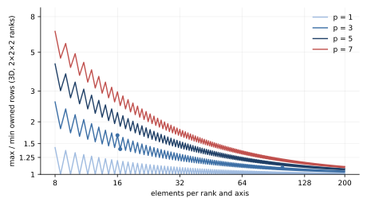

MPI Notes
=========

Process binding, load balance and rank counts for parallel runs. All PETSc,
SLEPc and PetIGA objects are distributed over ``PETSC_COMM_WORLD``.

Process binding with OpenMPI 5.x
--------------------------------

OpenMPI 5.x binds processes to cores by default (``--bind-to core``). A single
rank is then pinned to one core, and any OpenMP or threaded-BLAS work of that
process competes for it, which slows the run down severely. Disable binding:

.. code-block:: bash

   mpirun --bind-to none -np 1 ./build/tdsez.x -inp model.inp
   mpirun --bind-to none -np 4 ./build/tdsez.x -inp model.inp

The test suite launches ``tdsez.x`` in the same way (``_run`` in
``tests/test_tdsez.py``).

Load balance
------------

PetIGA splits the elements of each axis evenly over the ranks of that axis,
with leftover elements going to the first ranks. A rank owns one basis
function per element, and the last rank of each axis also owns the p trailing
ones (an open knot vector with :math:`n` elements carries :math:`n + p` basis
functions per axis). With :math:`P` ranks per axis, :math:`n_r` elements on
rank :math:`r` and :math:`\delta_{r,P-1}` marking the last rank, the owned
rows per axis are

.. math::
   :label: eq-mpi-owned

   N_r = n_r + p\,\delta_{r,P-1},
   \qquad
   \rho_{3\mathrm D} = \left(\frac{\max_r N_r}{\min_r N_r}\right)^3 .

The sparse products, ILU triangular solves and global reductions of every
GMRES iteration [Saad1986]_ wait for the rank with the most rows, so
:math:`\rho_{3\mathrm D}` sets the slowdown of the solves relative to a
perfectly balanced partition. For
degree p = 3 on 2×2×2 ranks, :eq:`eq-mpi-owned` gives:

.. list-table::
   :widths: 30 20 20 15 15
   :header-rows: 1

   * - Elements per axis
     - First rank owns
     - Last rank owns
     - Ratio per axis
     - Ratio in 3D
   * - 32
     - 16
     - 16 + 3 = 19
     - 1.19
     - 1.67
   * - 33
     - 17
     - 16 + 3 = 19
     - 1.12
     - 1.40
   * - 200 (100 per rank)
     - 100
     - 100 + 3 = 103
     - 1.03
     - 1.09

   Ratio :math:`\rho_{3\mathrm D}` of :eq:`eq-mpi-owned` on 2×2×2 ranks
   against the number of elements per rank and axis, for degrees p = 1, 3, 5
   and 7. Markers: the p = 3 rows of the table above.

The element count can shift the cut by one element per axis, not by p
(:numref:`fig-mpi-load-balance`); the imbalance decays as
:math:`p/n_r` and matters only for small subdomains. Use enough elements per
rank, or fewer ranks for small problems. In a measured 3D case with 32 cubic
elements per axis on 8 ranks, the restricted additive Schwarz subdomains
[CaiSarkis1999]_ ranged from 19\ :sup:`3` to 22\ :sup:`3` rows (with overlap)
and the ILU solve times differed by a factor 1.6 between ranks.

TDSE-Z keeps PetIGA's partition. Moving the element cuts so that every rank
owns the same number of basis functions shifts the imbalance to the
element-based work (assembly, quadrature monitors): in the measured 3D case
time stepping became 7–12 % faster, assembly and monitoring slower, and the
total run time changed by 0–5 %, within the timing noise.

Communication
-------------

The waiting time is a consequence of the imbalance, not of the communication:
a rank with more rows does more arithmetic, and the other ranks idle at the
next collective operation whether it is blocking or not. PETSc overlaps the
ghost exchange of each sparse product with the local part. Pipelined GMRES
overlaps the reductions as well (see :doc:`Time-Propagation`).

Heterogeneous cores
-------------------

Processors that combine performance and efficiency cores (for example Apple
M-series) run some ranks on the slower cores when, with ``--bind-to none``,
there are more ranks than performance cores; the other ranks then wait for
them. Use at most as many ranks as performance cores.
