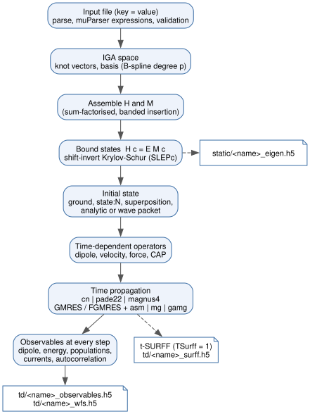

Overview
========

Governing equations, discretisation and the solver workflow of TDSE-Z. The
class structure is described in :doc:`Architecture`; sign conventions in
:doc:`Physics-Conventions`.

Model
-----

TDSE-Z treats one particle of charge :math:`q` (``Charge``, default
:math:`-1`) with a position-dependent mass :math:`m(\mathbf r)` (``Mass``) in
a potential :math:`V(\mathbf r)` (``Potential``). The field-free Hamiltonian
uses the Hermitian BenDaniel–Duke ordering of the kinetic energy
[BenDanielDuke1966]_,

.. math::
   :label: eq-overview-hamiltonian

   H_0 = -\frac{1}{2}\,\nabla\cdot\frac{1}{m(\mathbf r)}\,\nabla
         + s\,V(\mathbf r),
   \qquad s = -q,

which reduces to :math:`-\nabla^2/(2m_0)` for a constant mass. With
``EnableCAP = 1`` a complex absorbing potential [Manolopoulos2002]_ is added
near the domain boundaries (:doc:`Boundary-Conditions`). The laser field
:math:`\mathbf E(t)` couples in the length gauge,

.. math::
   :label: eq-overview-tdse

   i\,\partial_t\psi(\mathbf r,t)
     = \bigl[H_0 + s\,\mathbf r\cdot\mathbf E(t)\bigr]\,\psi(\mathbf r,t).

Discretisation
--------------

The wavefunction is expanded in tensor-product B-splines of degree p
[deBoor2001]_ [Bachau2001]_, :math:`\psi(\mathbf r,t) = \sum_j c_j(t)
B_j(\mathbf r)`, built and integrated by PetIGA [Dalcin2016]_. The Galerkin
projection of :eq:`eq-overview-tdse` gives the semi-discrete system

.. math::
   :label: eq-overview-semidiscrete

   i\,\mathbf M\,\dot{\mathbf c}
     = \Bigl[\mathbf H + s\sum_{a} E_a(t)\,\mathbf D_a\Bigr]\mathbf c,

with the overlap (mass) matrix :math:`M_{ij} = \langle B_i|B_j\rangle`, the
Hamiltonian matrix :math:`\mathbf H` of :eq:`eq-overview-hamiltonian` and the
position matrices :math:`(\mathbf D_a)_{ij} = \langle B_i|x_a|B_j\rangle`.
The sum runs over the axes in ``Polarization``. For ``Propagator = cn``
PETSc TS integrates the residual form

.. math::
   :label: eq-overview-residual

   \mathbf F = i\,\mathbf M\,\dot{\mathbf c} - \mathbf H\mathbf c
               - s\sum_a E_a(t)\,\mathbf D_a\,\mathbf c = 0

with the theta method at :math:`\theta = 1/2` (Crank–Nicolson
[Crank1947]_). The ``pade22`` and ``magnus4`` propagators apply the
Padé(2,2) approximant of the step exponential to
:eq:`eq-overview-semidiscrete`, in the second case inside a commutator-free
Magnus scheme [BlanesMoan2006]_ [Alvermann2011]_; see :doc:`Time-Propagation`.

Bound states solve the generalised eigenproblem

.. math::
   :label: eq-overview-eigen

   \mathbf H\,\mathbf c_n = E_n\,\mathbf M\,\mathbf c_n

with SLEPc [Hernandez2005]_ (shift-invert Krylov–Schur [Stewart2002]_, see
:doc:`Eigensolver`).

Workflow
--------

A run of ``tdsez.x`` follows the stages of :numref:`fig-overview-workflow`:

1. Read and validate the input file (:doc:`Input-File`).
2. Build the knot vectors and the IGA space (:doc:`Grid-Domain`,
   :doc:`Knot-Sequences`).
3. Assemble :math:`\mathbf H` and :math:`\mathbf M`.
4. Solve :eq:`eq-overview-eigen` for ``NBoundStates`` states (skipped for
   ``NBoundStates = 0`` with an analytic or wave-packet initial state) and
   write ``static/<name>_eigen.h5``.
5. Build the initial state (:doc:`Initial-State`).
6. With ``EnablePropagation = 1`` (default): assemble the time-dependent
   operators, propagate :eq:`eq-overview-semidiscrete` to ``FinalTime`` and
   record the observables at every step (:doc:`Observables`).
7. Flush the buffered HDF5 rows and print the timing summary.

   Stages of a TDSE-Z run, from the input file to the static and
   time-dependent HDF5 output. Dashed arrows mark optional output.

Output files
------------

Every file starts with ``<name>``, the input file name without directory and
extension (``h2p.inp`` → ``h2p``).

.. list-table::
   :header-rows: 1
   :widths: 40 60

   * - File
     - Content
   * - ``static/<name>_eigen.h5``
     - Spectrum, eigenstates (with ``NBoundStatesSave = 1``), knot vectors
       and run metadata; written when ``NBoundStates > 0``.
   * - ``static/<name>_D{x,y,z}.bin``
     - Dipole operator matrices in PETSc binary format; written with
       ``SaveDipoleMatrix = 1`` or ``-save_dipole``.
   * - ``static/<name>_tdm.txt``
     - Transition dipoles and oscillator strengths between the bound states;
       written at the start of a propagation run.
   * - ``static/<name>_gs.log``
     - Degenerate-shell splitting log (2D, ``EnableLzDiag = 1``).
   * - ``td/<name>_observables.h5``
     - Time series: dipoles, energies, currents, populations,
       autocorrelation.
   * - ``td/<name>_wfs.h5``
     - Wavefunction snapshots every ``OutputStrideWFS`` steps.
   * - ``td/<name>_surff.h5``
     - t-SURFF momentum spectrum (``TSurff = 1``).
   * - ``td/<name>_ts.h5``
     - PETSc ``TSView`` output in the working directory
       (``OutputStrideTS > 0``).

Dataset layouts are listed in :doc:`HDF5-Output`. The post-processors
``tdmprocessor``, ``tdmselect`` and ``drecprocessor`` read the ``static/``
files (:doc:`Post-Processing`).
