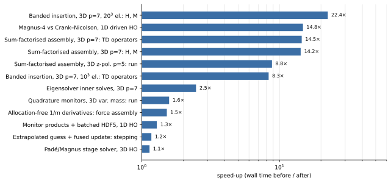
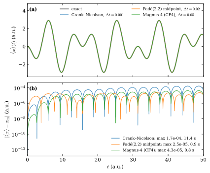

Performance
===========

This page summarises how TDSE-Z spends its time, the optimisations of the
assembly, eigensolver, propagation and output paths, and the measured effect of
each. None of them changes a computed result beyond floating-point rounding or
the linear-solver tolerance; :ref:`perf-accuracy` lists the checks. The complete
measurements, including the alternatives that were tried and not adopted, are in
``PERFORMANCE.md`` in the repository root.

Timings are wall times from the TIMING SUMMARY printed at the end of every run
(maximum over ranks), measured on one workstation (Apple M4 Pro, 8 performance
cores) with 2-8 MPI ranks. Cluster scaling is not covered here.

Overview
--------

   Measured speed-ups of individual optimisations (wall time before divided by
   wall time after, logarithmic scale). The test cases are those of
   :numref:`table-performance-summary`.

.. list-table:: Measured gains
   :name: table-performance-summary
   :widths: 34 38 10 10 8
   :header-rows: 1

   * - Optimisation
     - Test case
     - Before
     - After
     - Gain
   * - Banded insertion of element matrices
     - 3D, :math:`p=7`, :math:`20^3` elements, 4 ranks: :math:`\mathbf H,\mathbf M`
     - 258 s
     - 11.5 s
     - 22x
   * - Fourth-order propagator (``magnus4`` instead of ``cn``)
     - 1D driven oscillator, equal accuracy class
     - 11.4 s
     - 0.77 s
     - 15x
   * - Sum-factorised assembly
     - 3D, :math:`p=7`, :math:`10^3` elements: time-dependent operators
     - 464 s
     - 32 s
     - 14x
   * - Sum-factorised assembly
     - 3D, :math:`z` polarisation, :math:`p=5`: whole run
     - 62.6 s
     - 7.1 s
     - 8.9x
   * - Eigensolver inner solves and fallback
     - 3D, :math:`p=7`, 15.6k DOFs, 4 states
     - 49.0 s
     - 19.8 s
     - 2.5x
   * - Monitor expectation values at the quadrature points
     - 3D varying mass, discrete acceleration, 50 steps: whole run
     - 142 s
     - 90 s
     - 1.6x
   * - Allocation-free :math:`1/m` derivatives
     - 3D, :math:`p=4`, varying mass: force assembly
     - 28.1 s
     - 18.5 s
     - 1.5x
   * - Monitor products and batched HDF5 writes
     - 1D oscillator, :math:`5\times10^4` steps
     - 15.8 s
     - 12.3 s
     - 1.3x
   * - Extrapolated initial guess, fused stage update
     - 3D, :math:`p=3`, 32k DOFs, ``pade22``, 40 steps: time stepping
     - 3.40 s
     - 2.90 s
     - 1.2x

Linear solves of the propagation
--------------------------------

The semi-discrete equation is

.. math::
   :label: eq-perf-semidiscrete

   i\,\mathbf M\,\dot{\mathbf c}(t) = \mathbf H(t)\,\mathbf c(t),
   \qquad
   \mathbf H(t) = \mathbf H_0 + s\,\mathbf E(t)\cdot\mathbf D ,

with overlap matrix :math:`\mathbf M`, field-free Hamiltonian
:math:`\mathbf H_0` (kinetic, potential and, when enabled, the CAP) and dipole
matrices :math:`\mathbf D`. Every propagator solves systems of the form
:math:`(\mathbf M + g\,\mathbf H)\,\mathbf y = \mathbf b` with GMRES
[Saad1986]_, right-preconditioned so that the stopping test (relative
residual :math:`10^{-12}`) applies to the true residual, and restricted additive
Schwarz [CaiSarkis1999]_ with ILU(0) on each subdomain, built once and reused
[PETSc]_. A solve that needs more than twice the iterations of the first solve
after the last build (plus five) triggers a rebuild, which keeps strongly
driven runs convergent.

The preconditioner does not affect the result: against an exact LU solve the
2D test propagation differs by at most :math:`1.3\times10^{-11}` (dipoles). Of
the preconditioners available in PETSc and PetIGA, ASM/ILU(0) is the fastest on
one node; geometric and algebraic multigrid need fewer iterations but more time
per step, and the PetIGA element and basis-function block preconditioners
(``igaebe``, ``igabbb``) do not converge on their own (:doc:`Time-Propagation`).

Fourth-order propagators
------------------------

``pade22`` and ``magnus4`` apply the (2,2) Padé approximant of the step
exponential, which factorises into two Cayley-type stages,

.. math::
   :label: eq-perf-stages

   \mathbf A_k = \mathbf M + g_k\,\mathbf H_{\mathrm E}
   = \underbrace{\mathbf M + g_k\,\mathbf H_0}_{\mathbf B_k} + g_k\,s\,\mathbf E\cdot\mathbf D,
   \qquad k = 1, 2,

with :math:`g_{1,2} = h(\mp\sqrt3 + 3i)/12`. ``magnus4`` is the
commutator-free fourth-order Magnus scheme [BlanesMoan2006]_ [Alvermann2011]_, two such
exponentials per step. :numref:`fig-performance-propagators` compares them with
Crank-Nicolson [Crank1947]_ on a strongly driven oscillator with an exact
solution.

   1D harmonic oscillator driven by :math:`E(t)=\cos(0.6\,t)` (degree 7,
   1200 elements, 2 ranks). (a) Dipole :math:`\langle x\rangle(t)` from the
   ``dipoles`` dataset on top of the exact solution. (b) Absolute error; the
   legend gives the maximum error and the propagation time. Crank-Nicolson,
   :math:`\Delta t = 10^{-3}`: :math:`1.7\times10^{-4}`, 11.4 s; ``pade22``,
   :math:`\Delta t = 0.02`: :math:`2.5\times10^{-5}`, 0.91 s; ``magnus4``,
   :math:`\Delta t = 0.05`: :math:`4.3\times10^{-5}`, 0.77 s. Reproduced by
   ``docs/perf/run.sh``.

The stage solver exploits the structure of :eq:`eq-perf-stages`:

- **Cached field-free parts.** :math:`\mathbf B_k` depends only on the step
  length and is computed once per step length.
- **Fused stage update.** :math:`\mathbf A_k = \mathbf B_k + g_k s\,\mathbf
  E\cdot\mathbf D` is formed in one pass over the stored values (all matrices
  share the sparsity structure, checked once), instead of a copy and one
  matrix addition per field axis.
- **Paired right-hand sides.** Since :math:`\overline{g_1} = -g_2`, the
  right-hand side of stage :math:`k` is
  :math:`2\mathbf M\mathbf x - \mathbf A_{3-k}\mathbf x`: two sparse products
  instead of three.
- **Extrapolated initial guess.** Each solve starts from the stage input plus
  the stage increment :math:`\boldsymbol\delta = \mathbf y - \mathbf x`
  extrapolated from the last :math:`q` steps,

  .. math::
     :label: eq-perf-guess

     \mathbf y_0^{(n)} = \mathbf x^{(n)}
     + \sum_{j=1}^{q} (-1)^{j-1}\binom{q}{j}\,\boldsymbol\delta^{(n-j)} ,

  so the initial residual is :math:`O(h^q)`; :math:`q = 3` by default
  (``-pade_guess_order``).

.. list-table:: Stage solver, ``pade22``, 8 ranks, :math:`\Delta t = 0.05`
   :name: table-performance-stage
   :widths: 46 18 18 18
   :header-rows: 1

   * - Case
     - time stepping
     - GMRES iterations per solve
     - operator updates
   * - 3D, :math:`p=3`, 32k DOFs, 40 steps, :math:`xy` field: :math:`q=1`, copy/add update
     - 3.40 s
     - 5.51
     - 0.61 s
   * - same, :math:`q=3`, fused update
     - 2.90 s
     - 4.11
     - 0.35 s
   * - 2D, :math:`p=4`, 14k DOFs, 100 steps: :math:`q=1`, copy/add update
     - 0.52 s
     - 5.01
     - 0.072 s
   * - same, :math:`q=3`, fused update
     - 0.41 s
     - 3.38
     - 0.050 s

GMRES orthogonalisation is 1-2 % of a solve; the remainder is ILU triangular
solves and sparse products, so iterations saved translate directly into time.

Assembly
--------

Element matrices are sums over the tensor-product Gauss rule,

.. math::
   :label: eq-perf-element

   E_{ab} = \sum_{q} c(\mathbf r_q)\, D^{\alpha} N_a(\mathbf r_q)\, D^{\beta} N_b(\mathbf r_q),

with :math:`c` the quadrature weight times a coefficient (:math:`1/2m`,
:math:`V`, :math:`1/m`, :math:`x_d`, :math:`\partial_d V/m`, CAP, ...). The
B-spline basis [deBoor2001]_ and the rule are tensor products, so the sum is
contracted one axis at a time (sum factorisation): with :math:`n = p+1`
functions and :math:`Q` points per axis the work per element drops from
:math:`Q^3 n^6` to :math:`n^6 Q + n^4 Q^2 + n^2 Q^3` in 3D. The contractions
are dense matrix products evaluated with the BLAS PETSc was configured with.
Element matrices agree with the point-wise kernels to
:math:`5\times10^{-15}` (``-tdsez_sumfact_check``); this covers every operator,
including the mass-gradient corrections of the force matrices.

The assembled matrices are then inserted row by row from a dense band over each
rank's ghosted node box instead of element by element (a B-spline function
couples only to functions within :math:`p` positions per axis), which removes
up to :math:`(p+1)^{2d}/(2p+1)^d` redundant insertions per entry (78 at
:math:`p = 7` in 3D) and their inter-rank communication.

.. list-table:: Assembly, 3D, 4 ranks
   :name: table-performance-assembly
   :widths: 50 25 25
   :header-rows: 1

   * - Case
     - before
     - after
   * - :math:`p=7`, :math:`10^3` elements, :math:`\mathbf H,\mathbf M`: sum factorisation
     - 114 s
     - 8.0 s
   * - same, time-dependent operators
     - 464 s
     - 32 s
   * - :math:`p=7`, :math:`10^3` elements, :math:`\mathbf H,\mathbf M`: banded insertion
     - 12.1 s
     - 2.1 s
   * - :math:`p=7`, :math:`20^3` elements, :math:`\mathbf H,\mathbf M`: banded insertion
     - 258 s
     - 11.5 s

Monitors and output
-------------------

Observables are computed and recorded at every step. Operators that are
Kronecker products of 1D banded matrices (:math:`\mathbf M`, dipoles, and for a
constant mass the velocities and :math:`\mathbf K`) are applied in factorised
form. Expectation values of non-separable operators,

.. math::
   :label: eq-perf-quadrature

   \langle\psi|\mathbf A|\psi\rangle
   = \sum_q c(\mathbf r_q)\,\overline{D^\alpha\psi(\mathbf r_q)}\,D^\beta\psi(\mathbf r_q),

are evaluated from :math:`\psi` at the quadrature points, which gives the same
number as the matrix of :eq:`eq-perf-element` without storing it
(:math:`\langle V\rangle`, the forces, and for a varying mass
:math:`\langle 1/m\rangle`, :math:`\langle K\rangle` and the velocities). Every
replacement is checked against the assembled matrix on the first step and used
only if it agrees to :math:`10^{-10}` (observed :math:`10^{-15}`); the matrix
is then freed. ``-tdsez_tensor_ops 0`` and ``-tdsez_quad_obs 0`` restore the
matrix products. The time series are written to HDF5 in batches (at most once
every 2 s of wall time and at the end of the run), with unchanged contents.

Eigensolver
-----------

Bound states are computed with Krylov-Schur [Stewart2002]_ on the shift-invert
operator [Hernandez2005]_. The inner solve is direct (MUMPS) in 1D and 2D and
for small high-degree 3D problems, and FGMRES with ASM(1)/ILU(0) otherwise;
every attempt is validated by the backward error of the eigenpairs and falls
back to another inner solver on failure (:doc:`Eigensolver`). A degree-7 3D
problem with 15.6k DOFs takes 19.8 s instead of 49.0 s, and a 2D problem with
254k DOFs 34 s instead of 64 s.

.. _perf-accuracy:

Effect on accuracy
------------------

- Cached and paired stages, the fused update, sum factorisation and banded
  insertion are algebraic rewritings: results agree to rounding
  (:math:`\le 5\times10^{-14}` in energies, dipoles and spectra on the test
  inputs).
- The extrapolated initial guess changes only the GMRES starting point; the
  stopping test is unchanged, and results agree to the solver tolerance
  (dipoles :math:`\le 9\times10^{-11}` relative).
- Monitor shortcuts read :math:`\psi` only and are used after verification;
  written observables agree to :math:`\le 8\times10^{-15}`.
- Batched writes do not change any written value.

Reproducing the measurements
----------------------------

Each run prints a TIMING SUMMARY (phase wall times with their parts: eigensolver
setup and iterations, each operator, linear solves, preconditioner setup,
operator updates, observables, HDF5 writes) and a PERFORMANCE block (DOFs,
ranks, time per step, solver counts, peak memory; see :doc:`Output-Control`). Compare configurations with the same number of ranks on
an otherwise idle machine; run-to-run variation on a workstation is about
10-20 %. The propagator comparison is reproduced with

.. code-block:: bash

   cd docs/perf
   NP=2 TDSEZ=/path/to/tdsez.x ./run.sh
