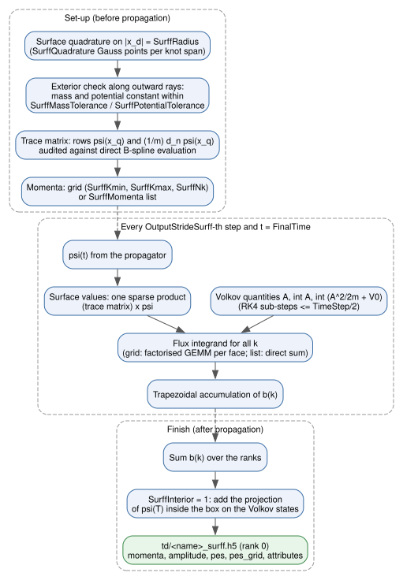
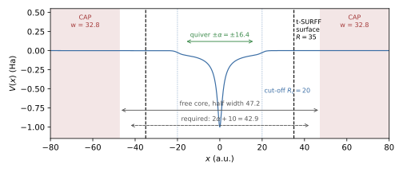

Photoelectron Spectra (t-SURFF)
===============================

The time-dependent surface flux method (t-SURFF) [TaoScrinzi2012]_
[Mosert2016]_ computes momentum-resolved photoelectron spectra from the flux of
the wave function through a surface that encloses the bound region. The box
only has to hold the bound dynamics and the quiver motion; the complex
absorbing potential (CAP) [Manolopoulos2002]_ behind the surface removes the
outgoing electrons.

t-SURFF is a passive observer: it reads :math:`\psi` at the sampled time steps
and does not modify the propagation. It is computed only when the input sets
``TSurff = 1`` and writes a separate file, ``td/<name>_surff.h5``, where
``<name>`` is the input file name without extension (``ati_1d.inp`` writes
``td/ati_1d_surff.h5``). With ``TSurff = 0`` (default) no t-SURFF data are
computed or written.

Method
------

The surface is the boundary of the box :math:`|x_d| \le R` (``SurffRadius``):
two points in 1D, the edges of a square in 2D, the faces of a cube in 3D.
Outside the surface the carrier must be free, with constant mass :math:`m`,
constant potential :math:`V_0` and the field coupling of the run:

.. math::
   :label: eq-tsurff-hamiltonian

   H = -\frac{1}{2m}\nabla^2 + V_0 + s\,\mathbf E(t)\cdot\mathbf r ,
   \qquad s = -q ,\quad q = \text{Charge}.

The length-gauge Volkov states of :eq:`eq-tsurff-hamiltonian` are

.. math::
   :label: eq-tsurff-volkov

   \chi_{\mathbf k}(\mathbf r,t) = (2\pi)^{-d/2}\,
   e^{\,i(\mathbf k+\mathbf A(t))\cdot\mathbf r - i\Phi_{\mathbf k}(t)},
   \qquad \dot{\mathbf A} = -s\,\mathbf E ,\quad
   \dot\Phi_{\mathbf k} = \frac{|\mathbf k+\mathbf A|^2}{2m} + V_0 ,

and the amplitude of the part of the wave function that has left the box is
the time integral of the flux through the surface,

.. math::
   :label: eq-tsurff-amplitude

   b(\mathbf k) = \frac{i}{2}\int_0^T\!dt \oint dS\;
   \chi^*_{\mathbf k}\Big[-\frac{1}{m}\partial_n\psi
   - \frac{i}{m}\,\hat n\cdot(\mathbf k+\mathbf A)\,\psi\Big].

:math:`|b(\mathbf k)|^2 = dP/d^d k` is the distribution of the **canonical**
momentum :math:`\mathbf k`; the final kinetic momentum is
:math:`\mathbf k + \mathbf A(T)` (attribute ``A_final``, zero for a pulse of
zero area). The coupling sign :math:`s` follows ``Charge`` (``-1`` electron,
default; ``+1`` hole). :math:`m` and :math:`V_0` are evaluated from the
``Mass`` and ``Potential`` expressions at :math:`\mathbf r = (R, 0, 0)`;
:math:`V_0` includes the carrier sign, :math:`V_0 = s\,V(R,0,0)`.

:numref:`fig-tsurff-flow` shows how the observer is set up, sampled during
the propagation and written at the end.

   Data flow of the t-SURFF observer (``src/tsurff.cpp``): set-up before the
   propagation, flux sampling during it, reduction and output after it.

Numerics
~~~~~~~~

- **Surface quadrature.** The surface points are the Gauss points of every knot
  span inside :math:`[-R, R]` on the tangential axes, ``SurffQuadrature``
  points per span (0 selects ``NQuadratures``).
- **Surface values.** :math:`\psi` and :math:`m^{-1}\partial_n\psi` at all
  surface points are obtained from one sparse product with a precomputed trace
  matrix. At set-up the trace matrix is compared with a direct B-spline
  evaluation; a relative difference above :math:`10^{-10}` stops the run.
- **Time integral.** The integral in :eq:`eq-tsurff-amplitude` uses the
  trapezoidal rule over the samples (every ``OutputStrideSurff``-th step and
  the final time); it is second order in the sampling interval.
- **Volkov phase.** :math:`\mathbf A`, :math:`\int\mathbf A\,dt` and
  :math:`\int(A^2/2m+V_0)\,dt` are integrated with classical RK4 sub-steps of
  at most ``TimeStep/2``, so the Volkov phase in :eq:`eq-tsurff-volkov` does not
  depend on the sampling stride.
- **Momentum grid.** On a tensor grid the Volkov factors separate by axis:
  per sample and face the surface sum is one small GEMM plus axpy updates,
  instead of (number of momenta × number of surface points) complex
  exponentials. A ``SurffMomenta`` list is summed directly.
- **Parallelism.** Each rank processes the surface points it owns; the
  amplitudes are summed over the ranks once, at the end of the run.

Exterior check
~~~~~~~~~~~~~~

Before the propagation starts, the mass and the potential are evaluated at five
equally spaced points on the outward ray from every surface point to the end of
the axis. The maximum deviations are printed (``t-SURFF exterior = ...``). A
relative mass deviation above ``SurffMassTolerance`` or a potential deviation
above ``SurffPotentialTolerance`` (Ha) stops the run with an error that names
both values. A Coulomb tail must therefore be switched off smoothly before
:math:`R` (see :ref:`tsurff-example-ati`), or the tolerance raised
deliberately.

.. _tsurff-end-term:

End term: the infinite-time spectrum
~~~~~~~~~~~~~~~~~~~~~~~~~~~~~~~~~~~~

The time integral in :eq:`eq-tsurff-amplitude` stops at ``FinalTime``
:math:`T`. Electrons that have not crossed the surface by then are missing,
and cutting the flux of the slowest ones (which keep crossing almost
indefinitely) spreads a spurious floor over all energies, like a truncated
Fourier transform. Running longer only shifts the problem. With
``SurffEndTerm = 1`` the flux after :math:`T` is added exactly, in the spirit
of the infinite-time surface flux methods [Morales2016]_ (implemented
independently here).

After the pulse the field is zero, so the Volkov state only gains the phase
:math:`e^{iE_{\mathbf k}(t-T)}`,
:math:`E_{\mathbf k} = |\mathbf k+\mathbf A(T)|^2/2m + V_0`, and
:math:`\psi(T+s) = e^{-i\mathbf M^{-1}\mathbf H s}\psi(T)` with the field-free
:math:`\mathbf H` including the CAP. The remaining flux is therefore the flux
functional at :math:`T` applied to

.. math::
   :label: eq-tsurff-end-term

   \phi_E = \int_0^\infty e^{iEs}\,\psi(T+s)\,ds ,
   \qquad (E\,\mathbf M - \mathbf H)\,\phi_E = i\,\mathbf M\,\psi(T) ,

evaluated at :math:`E = E_{\mathbf k}`. The CAP makes
:math:`E\mathbf M - \mathbf H` invertible and plays the role of the outgoing
condition :math:`E + i0`; ``SurffEndTerm`` therefore requires ``EnableCAP = 1``
and a field that is over at ``FinalTime`` (both checked).

Numerics:

- **Energy nodes.** :eq:`eq-tsurff-end-term` is solved on nodes uniform in
  :math:`p = |\mathbf k+\mathbf A(T)|`, with spacing
  :math:`\min(\Delta k, 0.25/(R\sqrt d))` (the surface trace of
  :math:`\phi_E` oscillates with period :math:`pprox 2\pi/(R\sqrt d)` in
  :math:`p`), refined to :math:`0.25/(L\sqrt d)` below :math:`2k_{\min}` of the
  CAP (:math:`L` the largest box half-width), where the absorber reflects and
  box quasi-modes give finer structure. Each node is projected on all momenta
  with the separable flux evaluation of a sample, and combined with 4-point
  Lagrange weights in :math:`p`. ``SurffEndTermDk`` sets a uniform spacing.
- **Multi-shift Krylov.** With a pole :math:`E_b`, every node of a window is a
  shift of one preconditioned operator,
  :math:`\mathbf A_b^{-1}(E\mathbf M - \mathbf H) = \mathbf I + \sigma\mathbf K`,
  :math:`\mathbf K = \mathbf A_b^{-1}\mathbf M`, :math:`\sigma = E - E_b`, so one
  Arnoldi basis of :math:`\mathbf K` started from
  :math:`\mathbf A_b^{-1}\mathbf b` serves all nodes: a step costs one
  application of :math:`\mathbf A_b^{-1}` and one product with
  :math:`\mathbf M` for the whole window, and each node only updates a small
  Hessenberg least-squares problem (Givens rotations) until its residual is
  below :math:`10^{-10}`. Only the surface traces of the basis vectors are
  kept. The next window takes its pole at the first unconverged node.
- **Poles.** 1D/2D: real poles with the exact sparse LU of
  :math:`\mathbf A_b` (MUMPS). 3D: complex poles :math:`E_b(1+0.5i)`, which damp
  the Helmholtz-type pole operator in proportion to its energy (the
  shifted-Laplacian rule [Erlangga2006]_), applied by GMRES to
  :math:`10^{-12}` with ASM/ILU: no factorisation, so the memory stays that of
  the propagation, and the shifts remain exact for the real energies.

Options (prefix ``surff_end_``): ``-surff_end_eta`` (relative imaginary part
of the poles), ``-surff_end_krylov`` (basis size per window, 60),
``-surff_end_window`` (nodes per window, 128), and the usual
``-surff_end_ksp_*`` / ``-surff_end_pc_*`` for the pole solves.

.. list-table:: End term against the analytic free-packet spectrum, run stopped
   while the packet is still (partly) inside the box
   :header-rows: 1
   :widths: 40 20 20 20

   * - case
     - flux only
     - with end term
     - cost of the end term
   * - 1D, :math:`k_0 = 0.8`, :math:`T = 16`, CAP :math:`k_{\min} = 0.15`
     - 69 % (yield 0.637)
     - :math:`4.3	imes10^{-4}` (yield 0.99999)
     - 182 nodes, 0.05 s
   * - 2D, :math:`T = 2` (packet inside), 1 and 3 ranks
     - 98 %
     - :math:`7.1	imes10^{-3}` (equal to plain t-SURFF run to :math:`T = 20`)
     - 378 nodes, 5 s
   * - 3D, 59 319 DOFs, :math:`T = 7`, 4 ranks
     - 55 %
     - :math:`2.0	imes10^{-2}` (grid and CAP limited)
     - 203 nodes, 24 s, no extra memory

The remaining differences are those of the discretisation and the absorber
(electrons slower than the CAP's :math:`k_{\min}` are partly reflected), the
same as for a plain t-SURFF run continued until every electron has crossed.

Against SCID-TDSE's infinite-time (iSURFV) spectrum for 3D hydrogen
(:math:`\omega = 0.4`, :math:`E_0 = 0.05`, 6-cycle :math:`\sin^2` vector
potential along :math:`z`, Coulomb tail switched off between :math:`r = 5`
and 10, surface at :math:`R = 11.04`; TDSE-Z with 132 651 DOFs, 4 ranks), the
photoelectron yields relative to SCID-TDSE are:

.. list-table::
   :header-rows: 1
   :widths: 30 17 17 18 18

   * - TDSE-Z
     - two-photon order
     - three-photon region
     - :math:`E > 0.9`
     - total
   * - flux only, :math:`T = 374`
     - 1.026
     - 1.61
     - 85
     - 1.054
   * - with end term, :math:`T = 174`
     - 1.018
     - 1.007
     - 0.98
     - 1.032

The flux-only spectra of both codes fill the minima between the ATI orders with
a truncation floor (SCID-TDSE's flux-only spectrum deviates from its own
infinite-time result in the same way); with the end term the minima, the
three-photon peak and the tail of the two codes agree. End term: 282 energies,
3 poles, 228 s, no memory beyond the propagation.

Input Keys
----------

.. list-table::
   :widths: 28 10 14 48
   :header-rows: 1

   * - Key
     - Type
     - Default
     - Description
   * - TSurff
     - bool
     - 0
     - 1 = compute the t-SURFF spectrum. Requires ``EnablePropagation = 1``.
   * - SurffRadius
     - real
     - --
     - Half-width :math:`R` of the box surface; required, :math:`R > 0`. The
       surface must lie inside every axis and in front of the CAP layer
       (:math:`R < L - 6.555/k_{\min}` on each wall); otherwise input
       validation stops the run.
   * - SurffKmax / SurffKmin
     - real[3]
     - -- / :math:`-k_{\max}`
     - Momentum grid limits per axis (comma-separated; one value applies to
       all axes). ``SurffKmax > SurffKmin`` is required when ``SurffNk > 1``.
   * - SurffNk
     - int[3]
     - --
     - Grid points per axis, at least 1 (1 = the single value ``SurffKmin``).
   * - SurffMomenta
     - file
     - (none)
     - Text file of momenta, one ``kx [ky [kz]]`` row per momentum (at least
       :math:`d` values per row; ``#`` starts a comment). Replaces the grid.
       The flux is summed directly over the list, so use it for short lists.
   * - OutputStrideSurff
     - int
     - 1
     - Sample every n-th step (and always the final time); :math:`n \ge 1`.
       The error grows as :math:`(n\,\Delta t)^2`; keep 1 unless the flux sum
       dominates the run time.
   * - SurffQuadrature
     - int
     - 0
     - Gauss points per knot span on the surface, in [0, 64]
       (0 = ``NQuadratures``).
   * - SurffInterior
     - bool
     - 0
     - 1 = add :math:`\langle\chi_{\mathbf k}(T)|\theta_{\rm box}\psi(T)\rangle`,
       the part still inside the box at ``FinalTime``. Exact for a free carrier
       at any ``FinalTime``; for bound systems it adds the plane-wave content
       of the bound states, so keep 0 there and propagate long enough instead.
   * - SurffEndTerm
     - bool
     - 0
     - 1 = add the flux after ``FinalTime`` (:ref:`tsurff-end-term`), giving
       the infinite-time spectrum for any ``FinalTime`` after the pulse.
       Requires ``EnableCAP = 1``; not with ``SurffInterior``.
   * - SurffEndTermDk
     - real
     - 0
     - Uniform momentum spacing of the end-term energy nodes (0 = automatic).
   * - SurffMassTolerance
     - real
     - 1e-6
     - Allowed relative mass variation outside the surface.
   * - SurffPotentialTolerance
     - real
     - 1e-6
     - Allowed potential variation (Ha) outside the surface.

Output: ``td/<name>_surff.h5``
-------------------------------

Written by rank 0 at the end of the run.

.. list-table::
   :widths: 25 25 50
   :header-rows: 1

   * - Dataset
     - Shape
     - Content
   * - ``momenta``
     - (Nk, d)
     - canonical momenta :math:`\mathbf k`
   * - ``amplitude``
     - (Nk, 2)
     - Re, Im of :math:`b(\mathbf k)` (including the interior term with
       ``SurffInterior = 1`` or the end term with ``SurffEndTerm = 1``)
   * - ``pes``
     - (Nk,)
     - :math:`|b(\mathbf k)|^2 = dP/d^dk`
   * - ``amplitude_flux``
     - (Nk, 2)
     - flux part up to ``FinalTime`` only (written with ``SurffInterior = 1``
       or ``SurffEndTerm = 1``)
   * - ``k_x``, ``k_y``, ``k_z``
     - (n_d,)
     - grid axes (grid mode only)
   * - ``pes_grid``
     - (n_x[, n_y[, n_z]])
     - ``pes`` on the grid, C order (``k_x`` slowest; grid mode only)

Attributes: ``final_time``, ``radius``, ``exterior_mass``,
``exterior_potential`` (:math:`V_0`, including the carrier sign), ``charge``,
``A_final`` (:math:`d` components), ``stride``, ``n_surface_points``,
``n_samples``, ``interior``, ``end_term``, ``end_term_nodes``,
``end_term_dp`` (largest node spacing).

Post-processing script
~~~~~~~~~~~~~~~~~~~~~~

``examples/tsurff/plot_tsurff.py`` reads the file, prints the run parameters and
(on a grid) the total yield :math:`\int|b|^2\,d^dk`, and writes
``<stem>_pes.dat`` (:math:`\mathbf k`, :math:`dP/d^dk`), where ``<stem>`` is
the HDF5 file name without ``.h5``. Options:

.. list-table::
   :widths: 22 78
   :header-rows: 1

   * - Option
     - Effect
   * - ``--energy``
     - Also write ``<stem>_dPdE.dat``. 1D:
       :math:`dP/dE = (m/|k|)(|b(k)|^2+|b(-k)|^2)` (needs a momentum grid
       symmetric about 0); 2D/3D: angle-integrated :math:`dP/dE`, binned in
       energy (needs a grid).
   * - ``--omega W``
     - Add a column :math:`E/\omega` to the energy file.
   * - ``--bins N``
     - Number of energy bins in 2D/3D (default 400).
   * - ``--plot FILE``
     - Write a plot (requires matplotlib).

Example 1: free wave packet (analytic benchmark)
------------------------------------------------

``InitialState = wavepacket`` starts from the Gaussian

.. math::
   :label: eq-tsurff-packet

   \psi_0 = \prod_d (2\pi w_d^2)^{-1/4}
   \exp\!\Big(-\frac{(x_d-c_d)^2}{4w_d^2} + i k_{0,d}x_d\Big)

(``WavepacketCenter``, ``WavepacketMomentum``, ``WavepacketWidth``). For a free
carrier the canonical momentum is conserved in any uniform field, so the exact
spectrum is

.. math::
   :label: eq-tsurff-exact

   |b(\mathbf k)|^2 = \prod_d \Big(\frac{2w_d^2}{\pi}\Big)^{1/2}
   e^{-2w_d^2(k_d-k_{0,d})^2}

for any pulse, mass, constant potential and charge sign. ``NBoundStates = 0``
skips the eigensolver, which is allowed with an analytic initial state. File
``examples/tsurff/free_packet_1d.inp`` (comments removed):

::

    Dimension          = 1
    Domain             = -40.0, 40.0
    SplineDegree       = 7
    NQuadratures       = 10
    KnotSequence       = uniform
    NSplines           = 400
    Charge             = -1.0
    Mass               = 1.0
    Potential          = 0
    PotentialDerivativeX = 0
    NBoundStates       = 0
    InitialState       = wavepacket
    WavepacketCenter   = 0.0
    WavepacketMomentum = 2.0
    WavepacketWidth    = 1.0
    Polarization       = x
    LaserX             = t<20 ? 0.1*sin(pi*t/20)^2*sin(1.3*t) : 0
    EnablePropagation  = 1
    Propagator         = pade22
    TimeStep           = 0.025
    FinalTime          = 40.0
    EnableCAP          = 1
    CAPKmin            = 0.5
    OutputStrideWFS    = 100000
    TSurff             = 1
    SurffInterior      = 1
    SurffRadius        = 10
    SurffKmin          = -1
    SurffKmax          = 5
    SurffNk            = 121

Measured accuracy, maximum of :math:`\big||b|^2-|b|^2_{\rm exact}\big|`
relative to the peak of :eq:`eq-tsurff-exact`:

.. list-table::
   :widths: 55 20 25
   :header-rows: 1

   * - Case
     - Error
     - Note
   * - 1D, field-free, ``pade22``, dt = 0.025
     - 1.2e-6
     - with interior term
   * - 1D, sin² pulse, mass 0.5 / offset 0.3 / ``Charge = +1``
     - 0.9–3e-5
     - all agree
   * - 1D, ``cn``, dt = 0.05 → 0.00625
     - 4.9e-3 → 7.7e-5
     - second order (propagator)
   * - 1D, flux only (no interior), ``cn`` dt = 0.0125, T = 40 / 80
     - 3.4e-3 / 2.0e-3
     - slow electrons still inside
   * - 1D, ``OutputStrideSurff`` = 1, 2, 4, 8
     - 1.2, 4.2, 16, 65 ×1e-6
     - second order (trapezoid)
   * - 2D, (2,1), degree 5, ``pade22``
     - 8.9e-5
     - interior term
   * - 3D, (1.5,1,0.5), degree 4, ``cn``, 8 ranks
     - 1.6e-3
     - coarse grid, dt = 0.02
   * - 2D, 1 rank vs 4 ranks
     - 8e-13
     - MPI independence
   * - 2D, grid vs ``SurffMomenta`` list
     - 1e-15
     - same amplitudes

Measured cost: 0.11 ms per sample for 784 surface points × 3721 momenta in 2D,
against 24 ms per propagation step (the direct sum over the same momentum list
takes 29.6 ms per sample, 260× more); 149 ms per sample for 86 400 points ×
68 921 momenta in 3D, against 6.2 s per step.

.. _tsurff-example-ati:

Example 2: above-threshold ionisation of a 1D atom
--------------------------------------------------

File: ``examples/tsurff/ati_1d.inp``. Soft-core atom
:math:`V=-1/\sqrt{x^2+1}` (:math:`I_p = 0.670` Ha), switched off smoothly by
:math:`(1-\tanh((|x|-R_c)/d))/2` with :math:`R_c = 20`, :math:`d = 2`;
800 nm, :math:`10^{14}` W/cm², 8-cycle sin² vector-potential pulse, followed by
400 a.u. of field-free propagation so that the slow electrons cross
:math:`|x| = 35`. :numref:`fig-tsurff-box` shows the layout of the box.

   Box of ``examples/tsurff/ati_1d.inp``: potential with the smooth cut-off at
   :math:`R_c = 20`, t-SURFF surface at :math:`R = 35`, CAP layers of width
   :math:`6.555/k_{\min} = 32.8` a.u. at both walls, quiver amplitude
   :math:`\alpha = E_0/\omega^2` and the free-core requirement
   :math:`2\alpha + 10` checked at start-up.

Key lines of the deck:

::

    Domain               = -80.0, 80.0
    Variables            = Rc=20, d=2
    Potential            = -0.5*(1 - tanh((abs(x)-Rc)/d)) / sqrt(x*x + 1)
    PotentialDerivativeX = 0.5*(1 - tanh((abs(x)-Rc)/d)) * x/(x*x + 1)^1.5 + 0.5*(1 - tanh((abs(x)-Rc)/d)^2)/d * sign(x) / sqrt(x*x + 1)
    CAPKmin              = 0.2
    TSurff               = 1
    SurffRadius          = 35
    SurffKmax            = 2.5
    SurffNk              = 501

Run from ``examples/tsurff`` (``tdsez.x`` is built in ``build/``; see
:doc:`MPI-Notes` for ``--bind-to none``):

::

    mpiexec -n 1 --bind-to none ../../build/tdsez.x -inp ati_1d.inp
    python plot_tsurff.py td/ati_1d_surff.h5 --energy --omega 0.057 --plot ati.png

Measured result (7 s on one core): ATI peaks spaced by :math:`\omega`
(0.88–1.09 :math:`\omega` between 0.19 and 0.82 Ha) at
:math:`n\omega - I_p - U_p` modulo :math:`\omega`; total yield
:math:`\int|b|^2dk = 9.46\times10^{-4}` against :math:`9.31\times10^{-4}`
absorbed by the CAP (the difference is the part still between the surface and
the CAP at ``FinalTime``).

Choosing the Parameters
-----------------------

- **Surface radius**: outside the bound states and the range of the potential
  (cut the potential off smoothly), and preferably outside the quiver amplitude
  :math:`\alpha = E_0/\omega^2`. The CAP layer starts behind the surface.
- **Final time**: long enough after the pulse for the slowest electron of
  interest to reach the surface,
  :math:`T - T_{\rm pulse} \gtrsim (R-r_{\rm core})/k_{\min}`; check by
  comparing two final times, or use ``SurffEndTerm = 1``, which removes the
  dependence on the final time. For free-particle tests ``SurffInterior = 1``
  is exact as well.
- **Momentum grid**: :math:`k_{\max}\gtrsim\sqrt{2m\cdot 10U_p}` covers the
  classical rescattering plateau; resolve the ATI spacing
  :math:`\Delta k \approx m\omega/k`.
- **Time step**: t-SURFF inherits the propagator error; the fourth-order
  propagators (``pade22``, ``magnus4``) are much more accurate per step than
  ``cn`` (:doc:`Time-Propagation`).
- **Charge**: as for the run (``-1`` electron). Holes (``+1``) are free
  carriers with the opposite coupling sign; the t-SURFF coupling follows
  ``Charge`` (there is no separate t-SURFF sign key).
