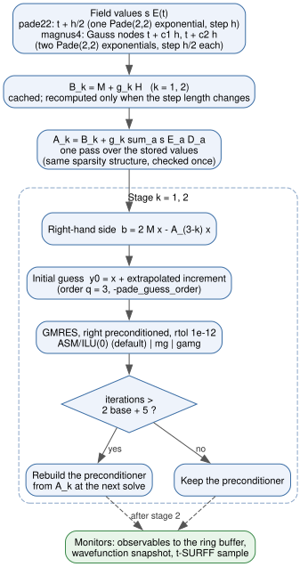
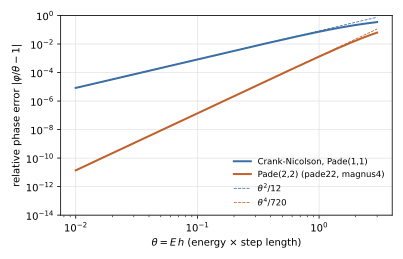

Time Propagation
================

After the eigensolver has produced the initial state, TDSE-Z integrates the
semi-discrete time-dependent Schrödinger equation from :math:`t = 0` to
``FinalTime``. This page describes the time parameters, the three propagators,
the linear solvers they use and how to choose a time step.

Time Parameters
---------------

.. list-table::
   :widths: 30 10 10 50
   :header-rows: 1

   * - Key
     - Type
     - Default
     - Description
   * - EnablePropagation
     - bool
     - 1
     - Run the time propagation. With 0 the run stops after the eigensolver
       and the static output.
   * - TimeStep / TimeStepSize
     - real
     - 0.01
     - Time step :math:`h` (atomic units). Must be positive.
   * - FinalTime / TotalTime
     - real
     - 100.0
     - End of the propagation (atomic units). Must be positive.
   * - Propagator
     - string
     - ``cn``
     - ``cn``, ``pade22`` or ``magnus4`` (see below).
   * - Preconditioner
     - string
     - ``asm``
     - ``asm``, ``mg`` or ``gamg`` (see `Preconditioners`_).
   * - MGLevels
     - int
     - 0
     - Number of multigrid levels for ``Preconditioner = mg``; 0 coarsens
       until fewer than 2000 DOFs remain. Otherwise :math:`\ge 2`.
   * - MGSmooth
     - int
     - 1
     - Smoothing sweeps before and after each coarse correction
       (``Preconditioner = mg``), :math:`\ge 1`.

The propagation ends exactly at ``FinalTime``: the last step is shortened when
``FinalTime`` is not a multiple of ``TimeStep``.

Equation of Motion
------------------

The Galerkin discretisation in the B-spline basis gives

.. math::
   :label: eq-time-propagation-eom

   i\,\mathbf M\,\dot{\mathbf c}(t) = \mathbf H_E(t)\,\mathbf c(t),
   \qquad
   \mathbf H_E(t) = \mathbf H + s\,\mathbf E(t)\cdot\mathbf D,
   \qquad s = -q ,

with the mass (overlap) matrix :math:`\mathbf M`, the field-free Hamiltonian
:math:`\mathbf H` (kinetic energy, potential and, with ``EnableCAP = 1``, the
complex absorbing potential, added to :math:`\mathbf H` before the first step),
the position matrices :math:`\mathbf D = (\mathbf D_x, \mathbf D_y, \mathbf
D_z)` of the axes in ``Polarization`` and the carrier charge
:math:`q` = ``Charge`` (:doc:`Physics-Conventions`). Every propagator advances
:eq:`eq-time-propagation-eom` by solving sparse systems of the form

.. math::
   :label: eq-time-propagation-shifted

   (\mathbf M + g\,\mathbf H_E)\,\mathbf y = \mathbf b

with a complex shift :math:`g` proportional to the step length. All three
schemes are unitary for a Hermitian :math:`\mathbf H_E` (no CAP).

Propagators
-----------

``Propagator`` selects the scheme.

``cn`` (default)
   Crank-Nicolson [Crank1947]_, the (1,1) Padé approximant of the step
   exponential, run through the PETSc ``TS`` object (``TSTHETA`` with
   :math:`\theta = 1/2`, linear problem) [PETSc]_. Second order, one solve
   per step with :math:`g = i h/2`. Standard PETSc ``-ts_*`` options apply.

``pade22``
   Exponential midpoint rule with the (2,2) Padé approximant

   .. math::
      :label: eq-time-propagation-r22

      R_{22}(z) = \frac{1 + z/2 + z^2/12}{1 - z/2 + z^2/12},
      \qquad z = -i h\,\mathbf M^{-1}\mathbf H_E(t + h/2) .

   The numerator has the roots :math:`-3 \pm i\sqrt3`, so :math:`R_{22}`
   factorises into two Cayley-type stages, each unitary,

   .. math::
      :label: eq-time-propagation-stages

      (\mathbf M + g_k\,\mathbf H_E)\,\mathbf y_k
      = (\mathbf M + \bar g_k\,\mathbf H_E)\,\mathbf y_{k-1},
      \qquad g_{1,2} = \frac{h\,(\mp\sqrt3 + 3i)}{12},
      \qquad k = 1, 2 ,

   with :math:`\mathbf y_0` the state at :math:`t` and :math:`\mathbf y_2` the
   state at :math:`t + h`. Two solves per step. The scheme is fourth order in
   the field-free phase and second order in the time dependence of the field.

``magnus4``
   Commutator-free fourth-order Magnus integrator [BlanesMoan2006]_ [Alvermann2011]_,

   .. math::
      :label: eq-time-propagation-magnus

      \mathbf U = \exp\!\big(h(a_1\mathbf A_1 + a_2\mathbf A_2)\big)\,
                  \exp\!\big(h(a_2\mathbf A_1 + a_1\mathbf A_2)\big),
      \qquad
      \mathbf A_j = -i\,\mathbf M^{-1}\mathbf H_E(t + c_j h),

   with the Gauss nodes :math:`c_{1,2} = 1/2 \mp \sqrt3/6` and
   :math:`a_{1,2} = (3 \mp 2\sqrt3)/12`. Since :math:`a_1 + a_2 = 1/2`, each
   factor is a half step with an effective field
   :math:`2(a_2\mathbf E_1 + a_1\mathbf E_2)` (applied first) and
   :math:`2(a_1\mathbf E_1 + a_2\mathbf E_2)`, evaluated with
   :eq:`eq-time-propagation-stages`. Fourth order overall, four solves per
   step.

At start-up the rational propagators print their configuration, and at the
end the number of stage solves and the mean number of GMRES iterations per
solve.

Linear Solver
-------------

Every system :eq:`eq-time-propagation-shifted` is solved with GMRES
[Saad1986]_ (restart 30, or 50 above :math:`10^5` unknowns; at most 1000
iterations) to a relative residual of :math:`10^{-12}`. The preconditioner is
applied from the right, so the stopping test acts on the true residual of the
original system whatever the preconditioner. The default preconditioner is
restricted additive Schwarz [CaiSarkis1999]_ with one subdomain per rank and
ILU(0) on each subdomain. ``-tdsez_ilu_levels n`` sets another ILU fill level;
in measurements ILU(1) saved at most one iteration in 2D and none in 3D, while
its factorisation was about 10 times slower in 3D (degree 4).

The preconditioner is built from the operator of the first step and reused
(refresh below). The solves use a non-zero initial guess; for ``pade22`` and
``magnus4`` it is extrapolated from previous steps (below).

**Rational propagators.** The stage matrices of
:eq:`eq-time-propagation-stages` are assembled with the following structure
(:numref:`fig-time-propagation-step`):

- :math:`\mathbf B_k = \mathbf M + g_k\mathbf H` is cached and recomputed only
  when the step length changes (first step, shortened last step).
- :math:`\mathbf A_k = \mathbf B_k + g_k\,s\,\mathbf E\cdot\mathbf D` is formed
  in one pass over the stored values when all matrices share the same sparsity
  structure (checked once), otherwise by matrix additions.
- Since :math:`\bar g_1 = -g_2`, the right-hand side of stage :math:`k` is
  :math:`2\mathbf M\mathbf x - \mathbf A_{3-k}\mathbf x`.
- Each stage solve starts from its input :math:`\mathbf x` plus the stage
  increment :math:`\boldsymbol\delta = \mathbf y - \mathbf x` extrapolated from
  the last :math:`q` steps,

  .. math::
     :label: eq-time-propagation-guess

     \mathbf y^{(n)}_{\text{init}} = \mathbf x^{(n)}
     + \sum_{j=1}^{q} (-1)^{j-1}\binom{q}{j}\,\boldsymbol\delta^{(n-j)} ,

  with :math:`q` = ``-pade_guess_order`` (1 to 5, default 3);
  ``-pade_extrapolate_guess 0`` starts from :math:`\mathbf x` instead.
- The two stage solvers carry the options prefixes ``pade_stage1_`` and
  ``pade_stage2_`` (for example ``-pade_stage1_ksp_rtol``,
  ``-pade_stage2_pc_type``).

   One step of ``pade22`` (``magnus4`` performs it twice with half the step
   length). The field-free parts of the stage matrices are cached, the field
   term is added in one pass, and each stage solve starts from an
   extrapolated guess and reuses the preconditioner until the refresh test
   triggers a rebuild.

**Preconditioner refresh.** For a strong field the operator drifts away from
the one the preconditioner was built from. The first solve after each build
sets a reference iteration count :math:`n_0`; a solve that needs more than
:math:`2n_0 + 5` iterations causes the preconditioner to be rebuilt from the
current operator at the next solve. This applies to every propagator and
preconditioner. In a 2D test with a field of 2 a.u. and :math:`h = 0.2`,
a fixed preconditioner needed 4, 13, 24, 65, 249 and 641 iterations in
successive steps and then failed; with the refresh the run converges with
4 to 8 rebuilds. ``cn`` prints the number of rebuilds at the end of the run.

Preconditioners
---------------

``Preconditioner`` selects the preconditioner of every propagator solve. The
outer solve always uses the full operator and the same tolerance, so the
choice changes the cost, not the result.

``asm`` (default)
   Restricted additive Schwarz, one subdomain per rank, ILU(0) subdomain
   solves.

``mg``
   Geometric multigrid on the B-spline space inside flexible GMRES (requires
   ``Basis = bspline``). Each coarse level drops every other simple interior
   knot of each axis (repeated knots, such as C\ :sup:`0` interfaces, are
   kept), as long as each axis keeps at least :math:`p+1` spans and two spans
   per rank. The coarse spaces are therefore nested in the fine one and the
   prolongation is exact knot insertion, applied axis by axis as a tensor
   product and checked at set-up on a linear function. Coarse operators are
   Galerkin products :math:`\mathbf P^T\mathbf A\mathbf P`. Each level is
   smoothed by ``MGSmooth`` Richardson sweeps with ASM/ILU(0) before and after
   the coarse correction; the coarsest level (below 2000 DOFs, or after
   ``MGLevels`` levels) is solved by LU with MUMPS when PETSc provides it.

``gamg``
   PETSc algebraic multigrid (smoothed aggregation) inside flexible GMRES.
   Its default Chebyshev/Jacobi smoothing needed 218 to 279 iterations on this
   complex operator in 2D. Use it with the ASM/ILU(0) smoother, as
   ``benchmarks/preconditioners/run.sh`` does:
   ``-mg_levels_ksp_type richardson -mg_levels_ksp_max_it 1
   -mg_levels_pc_type asm -mg_levels_sub_pc_type ilu`` (with the
   ``pade_stage1_`` / ``pade_stage2_`` prefixes for the rational
   propagators).

PETSc options with the solver prefix (``-mg_levels_*``, ``-mg_coarse_*``;
``-pade_stage1_*``, ``-pade_stage2_*``) override these defaults.
Gauss-Seidel/SOR smoothing is not used for ``mg``: on degree-5 splines it
needed 14 to 26 iterations on one rank (60 to 80 on four) against 1 to 4 with
ILU smoothing, in line with the known degree dependence of standard smoothers
for B-spline discretisations.

.. list-table:: Iterations per solve and time per step of ``mg`` relative to
   ``asm``
   :name: table-time-propagation-mg
   :widths: 46 18 18 18
   :header-rows: 1

   * - Case
     - ``asm`` its
     - ``mg`` its
     - ``mg`` time / ``asm`` time
   * - 2D, p = 5, 40k DOFs, ``cn``, :math:`h` = 0.02, 1-12 ranks
     - 3-7
     - 2-4
     - 1.4-1.8
   * - same, :math:`h` = 0.2
     - 4-11
     - 2-6
     - 1.3-1.7
   * - 2D variable mass / Coulomb / no CAP, 8 ranks
     - 6-13
     - 3-5
     - 1.1-1.5
   * - 3D, p = 3, 110k DOFs, ``cn``, 4 and 8 ranks
     - 6-8
     - 4
     - 1.2

.. list-table:: Algebraic and geometric multigrid against ASM: 3D, p = 3,
   110k DOFs, ``cn``, 8 ranks, 40 steps
   :name: table-time-propagation-gamg
   :widths: 25 25 25 25
   :header-rows: 1

   * - Preconditioner
     - its / solve
     - set-up
     - solve time / step
   * - ``asm``
     - 7
     - 1.1 s
     - 0.089 s
   * - ``mg``
     - 4
     - 1.7 s
     - 0.158 s
   * - ``gamg`` (ASM/ILU(0) smoother)
     - 4
     - 5.7 s
     - 0.134 s

Multigrid needs fewer and more uniform iterations, but on up to 12 ranks of
one machine each V-cycle costs more than the iterations it saves. It is
intended for large rank counts, where one-level ASM degrades because it has no
coarse space; measure both on the target machine.

**Other PETSc and PetIGA preconditioners.** Any ``PCType`` can be selected per
stage solver (``-pade_stage1_pc_type X -pade_stage2_pc_type X``). The
following timings were taken with ``pade22``, 8 ranks and :math:`h = 0.05`,
without the extrapolated initial guess; the ranking does not depend on it.

.. list-table:: Propagation time and iterations per solve by ``pc_type``
   :name: table-time-propagation-pctype
   :widths: 30 35 35
   :header-rows: 1

   * - ``pc_type``
     - 3D, p = 3, 32k DOFs, 40 steps
     - 2D, p = 4, 14k DOFs, 100 steps
   * - ``asm`` + ILU(0) (default)
     - 4.5 s, 5.5 its
     - 0.65 s, 5.0 its
   * - ``asm``, overlap 2
     - --
     - 0.63 s, 3.3 its
   * - ``bjacobi`` / ``gasm`` / ``bjacobi`` + ICC
     - 9.0-9.3 s, 25 its
     - 1.5-1.6 s, 19 its
   * - ``sor``
     - 40 s, 91 its
     - 6.8 s, 95 its
   * - ``jacobi``
     - 50 s, 320 its
     - 9.5 s, 238 its
   * - ``igaebe`` (PetIGA, element by element)
     - 69 s, 222 its
     - 7.2 s, 102 its
   * - ``igabbb`` (PetIGA, basis by basis)
     - not converged in 1000 its
     - not converged, also with ``-pc_bbb_overlap 4,4``

``igaebe`` and ``igabbb`` [Dalcin2016]_ invert one small dense block per
element or per basis function (overlap :math:`p/2` by default). They damp
local error like a multigrid smoother but have no global coupling, so on their
own they need hundreds of iterations or stall. Block Jacobi, GASM and ICC lack
the overlap of ASM and need about four times as many iterations.

**Accuracy is independent of the preconditioner.** The largest relative
difference of the same 2D run (100 ``pade22`` steps) from a run with an exact
LU solve (MUMPS) is:

.. list-table:: Largest relative difference from an exact solve
   :name: table-time-propagation-accuracy
   :widths: 25 15 15 15 15 15
   :header-rows: 1

   * - Preconditioner
     - dipoles
     - energies
     - currents
     - populations
     - autocorrelation
   * - ``asm`` (default)
     - 1.3e-11
     - 8.1e-13
     - 1.3e-12
     - 1.3e-12
     - 6.0e-13
   * - ``bjacobi``
     - 2.0e-11
     - 1.8e-12
     - 3.9e-12
     - 2.3e-12
     - 9.7e-13

The norm drifts by :math:`8\times10^{-14}` over the run. These differences are
far below the time-step and grid errors (about :math:`10^{-5}` on validation
grids).

**Cost of the GMRES solves.** Orthogonalisation takes 1-2 % of a solve; the
rest is preconditioner applications (ILU triangular solves, about 60 %) and
matrix-vector products. The cost is reduced by fewer iterations:

- the extrapolated initial guess :eq:`eq-time-propagation-guess` (default
  :math:`q = 3`) lowers the mean from 5.5 to 4.1 iterations per solve in 3D
  and from 5.0 to 3.4 in 2D;
- a looser tolerance, ``-pade_stage1_ksp_rtol 1e-11 -pade_stage2_ksp_rtol
  1e-11``, saves another 10-13 % and changes the outputs by about
  :math:`5\times10^{-11}`.

Pipelined GMRES (``-pade_stage1_ksp_type pgmres``, likewise for stage 2)
overlaps the global reduction of each iteration with the next product. On one
machine a reduction costs microseconds through shared memory and the extra
vector work dominates: time stepping was 20-35 % slower (3D, 8 ranks, same
4.1 iterations per solve). It may pay off across many nodes, where reductions
cross the network. It does not remove load imbalance (:doc:`MPI-Notes`).

**Strong fields.** With :math:`\tau = |g|` the operator is
:math:`\mathbf M + i\tau(\mathbf H + s\,\mathbf E\cdot\mathbf r)`, where
:math:`\tau = h/2` for ``cn``, :math:`h/\sqrt{12}` for ``pade22`` and
:math:`h/(2\sqrt{12})` for ``magnus4``. When :math:`\tau\max|\mathbf
E\cdot\mathbf r|` exceeds about 1.5 the field term dominates and the operator
behaves like an indefinite Helmholtz operator that the coarse levels of
multigrid cannot represent: in 2D tests ``mg`` needed 3-18 iterations up to
1.5 and diverged at 3, where ``asm`` still converged (5-33 iterations). With
``Preconditioner = mg`` TDSE-Z estimates :math:`\tau\max|\mathbf
E\cdot\mathbf r|` over the pulse and the box at set-up and prints a warning
above 1.5. Typical strong-field runs (:math:`E \le 0.2` a.u.,
:math:`h \le 0.05`, box :math:`\le 100` a.u.) stay well below this value.

Choosing a Time Step
--------------------

For an eigencomponent of energy :math:`E` the exact step multiplies the
coefficient by :math:`e^{-i\theta}`, :math:`\theta = Eh`. The rational
approximants reproduce the modulus exactly and the phase approximately:

.. math::
   :label: eq-time-propagation-phase

   \varphi_{\text{cn}} = 2\arctan\frac{\theta}{2}
   = \theta\Big(1 - \frac{\theta^2}{12} + O(\theta^4)\Big),
   \qquad
   \varphi_{22} = 2\arctan\frac{\theta/2}{1 - \theta^2/12}
   = \theta\Big(1 - \frac{\theta^4}{720} + O(\theta^6)\Big).

Crank-Nicolson also scales the group velocity of a component by
:math:`1/(1 + \theta^2/4)`, which slows fast electrons; the Padé(2,2)
propagators remove this error to fourth order
(:numref:`fig-time-propagation-dispersion`).

   Relative phase error of the field-free step,
   :eq:`eq-time-propagation-phase`, as a function of
   :math:`\theta = Eh`. Dashed lines: leading terms
   :math:`\theta^2/12` and :math:`\theta^4/720`.

In practice:

- choose :math:`h` so that :math:`E_{\max} h` is small for the highest energy
  that matters (the cut-off of the photoelectron or harmonic spectrum), and
  so that the field period and envelope are well resolved;
- with ``pade22`` or ``magnus4`` a much larger step reaches the same
  accuracy: on the free-packet t-SURFF benchmark (:doc:`TSurff`,
  :math:`T = 40`) ``pade22`` with :math:`h = 0.025` reaches a spectrum error
  of :math:`1.2\times10^{-6}`, against :math:`3.3\times10^{-4}` for ``cn``
  with :math:`h = 0.0125`;
- ``magnus4`` is fourth order also in the time dependence of the field, at
  twice the cost per step of ``pade22``;
- confirm convergence by repeating the run with :math:`h/2` and comparing the
  observables of interest.

Propagation Control and Progress
--------------------------------

With ``EnablePropagation = 0`` the run ends after the eigensolver, which is
useful to check eigenvalues and eigenstates (:doc:`Eigensolver`) before a long
propagation. With ``EnablePropagation = 1`` the propagation starts from the
state selected by ``InitialState`` (:doc:`Initial-State`).

The monitor prints a progress line with the step, the elapsed fraction, the
time, the squared norm :math:`\langle\psi|\mathbf M|\psi\rangle` and the total
energy (:doc:`Observables`)::

             step       %    t (a.u.)    <psi|psi>      <H> (a.u.)
          55/1103     5.0      27.500   0.99999989   -4.989291e-01

With ``Verbose = 1`` (default) a line is printed every step; with
``Verbose = 0`` about twenty lines are printed over the run.

Without a CAP the norm is conserved to the solver tolerance by all three
propagators. With ``EnableCAP = 1`` it decreases as the CAP absorbs outgoing
flux; the decrease is the absorbed probability.

Troubleshooting
---------------

**A stage solve does not converge**
  - The error ``Pade(2,2) stage k solve did not converge`` stops the run.
  - Check whether the field is strong for the chosen step
    (:math:`\tau\max|\mathbf E\cdot\mathbf r| > 1.5`, see above); reduce
    ``TimeStep`` or use ``Preconditioner = asm``.

**Norm not conserved without a CAP**
  - Check that ``EnableCAP = 0``.
  - Check the GMRES convergence with ``-pade_stage1_ksp_converged_reason``
    (``-ksp_converged_reason`` for ``cn``).

**Missing or zero time series**
  - Check ``PhysicsOutput`` (:doc:`Output-Control`): quantities not listed
    are written as zeros.
